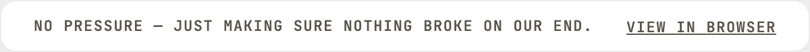

<!-- Generated by .claude/skills/shopify-email-html/scripts/build_library.py — edit section.json / template.json instead. -->

# CR-1 · Preheader bar

| | |
|---|---|
| Type | Preheader bar |
| Context | abandoned-checkout |
| Surfaces | Messaging · Code your own, Messaging section |
| Liquid variables | `abandoned_checkout.url` |
| Shopify status | draft |
| Placeholders | no |
| Characters | 1316 |
| Used by | [CR-1](../../emails/cr-1-your-carts-still-here/) |

## Preview



## HTML

Source: [`section.html`](section.html). Copy from here or from the raw file.

```html
<table role="presentation" width="100%" cellpadding="0" cellspacing="0" border="0" style="background-color:transparent;"><tr><td align="center" style="padding:0;">
<table role="presentation" class="shell" width="100%" cellpadding="0" cellspacing="0" border="0" style="width:100%;max-width:600px;">
<tr><td style="padding:0;">
<table role="presentation" width="100%" cellpadding="0" cellspacing="0" border="0" style="border-collapse:separate;background-color:#ffffff;border:1px solid #ececec;border-radius:12px;">
<tr><td class="pad-sm" style="padding:9px 24px;"><table role="presentation" width="100%" cellpadding="0" cellspacing="0" border="0"><tr>
<td style="font-family:'JetBrains Mono','Courier New',monospace;font-size:11px;line-height:17px;letter-spacing:0.8px;text-transform:uppercase;color:#5a5448;vertical-align:middle;">No pressure &mdash; just making sure nothing broke on our end.</td>
<td align="right" style="padding-left:16px;vertical-align:middle;white-space:nowrap;"><a href="{{ abandoned_checkout.url }}" target="_blank" style="font-family:'JetBrains Mono','Courier New',monospace;font-size:11px;line-height:17px;letter-spacing:0.8px;text-transform:uppercase;color:#5a5448;text-decoration:underline;">View in browser</a></td>
</tr></table></td></tr>
</table>
</td></tr>
</table>
</td></tr></table>
```
