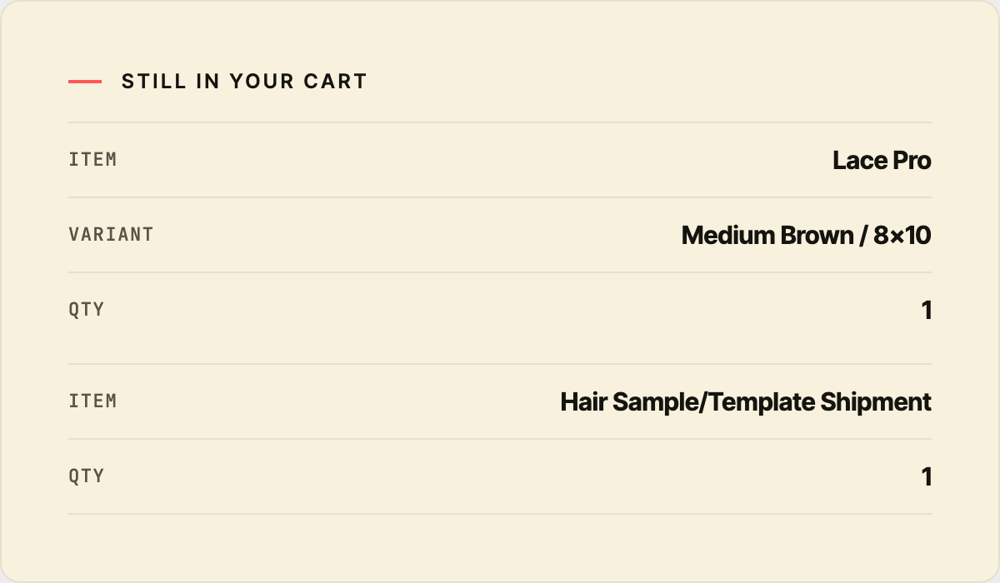

<!-- Generated by .claude/skills/shopify-email-html/scripts/build_library.py — edit section.json / template.json instead. -->

# Cart contents

| | |
|---|---|
| Type | Cart contents |
| Context | abandoned-checkout |
| Surfaces | Messaging · Code your own, Messaging section |
| Liquid variables | `abandoned_checkout.line_items`, `abandoned_checkout.remaining_products_count`, `forloop.first`, `line_item.product_title`, `line_item.quantity`, `line_item.variant_title` |
| Shopify status | draft |
| Placeholders | no |
| Characters | 3619 |
| Used by | [CR-1](../../emails/cr-1-your-carts-still-here/), [CR-2](../../emails/cr-2-three-questions-answered/), [CR-4](../../emails/cr-4-last-note-free-shipping/) |

## Preview



## HTML

Source: [`section.html`](section.html). Copy from here or from the raw file.

```html
<table role="presentation" width="100%" cellpadding="0" cellspacing="0" border="0" style="background-color:transparent;"><tr><td align="center" style="padding:0;">
<table role="presentation" class="shell" width="100%" cellpadding="0" cellspacing="0" border="0" style="width:100%;max-width:600px;">
<tr><td style="padding:0;">
<table role="presentation" width="100%" cellpadding="0" cellspacing="0" border="0" style="border-collapse:separate;background-color:#f7f1de;border:1px solid #e5dfcd;border-radius:12px;">
<tr><td class="pad" style="padding:40px;"><table role="presentation" cellpadding="0" cellspacing="0" border="0" style="margin:0 0 16px 0;">
<tr><td width="20" style="width:20px;vertical-align:middle;"><div style="height:2px;line-height:2px;font-size:0;background-color:#ff5757;">&nbsp;</div></td>
<td style="padding-left:12px;font-family:'Inter Tight',Arial,Helvetica,sans-serif;font-size:12px;line-height:16px;font-weight:600;letter-spacing:2px;text-transform:uppercase;color:#15140f;white-space:nowrap;">Still in your cart</td></tr>
</table><table role="presentation" width="100%" cellpadding="0" cellspacing="0" border="0" style="border-collapse:collapse;">
<tr><td colspan="2" style="height:10px;line-height:10px;font-size:0;">&nbsp;</td></tr>
<tr>
<td style="border-top:1px solid #e5dfcd;padding:12px 0;font-family:'JetBrains Mono','Courier New',monospace;font-size:11px;line-height:16px;letter-spacing:0.8px;text-transform:uppercase;color:#5a5448;vertical-align:middle;">Item</td>
<td align="right" style="border-top:1px solid #e5dfcd;padding:12px 0 12px 16px;font-family:'Inter Tight',Arial,Helvetica,sans-serif;font-size:15px;line-height:20px;font-weight:700;color:#15140f;text-align:right;vertical-align:middle;">{{ line_item.product_title }}</td>
</tr><tr>
<td style="border-top:1px solid #e5dfcd;padding:12px 0;font-family:'JetBrains Mono','Courier New',monospace;font-size:11px;line-height:16px;letter-spacing:0.8px;text-transform:uppercase;color:#5a5448;vertical-align:middle;">Variant</td>
<td align="right" style="border-top:1px solid #e5dfcd;padding:12px 0 12px 16px;font-family:'Inter Tight',Arial,Helvetica,sans-serif;font-size:15px;line-height:20px;font-weight:700;color:#15140f;text-align:right;vertical-align:middle;">{{ line_item.variant_title }}</td>
</tr><tr>
<td style="border-top:1px solid #e5dfcd;padding:12px 0;font-family:'JetBrains Mono','Courier New',monospace;font-size:11px;line-height:16px;letter-spacing:0.8px;text-transform:uppercase;color:#5a5448;vertical-align:middle;">Qty</td>
<td align="right" style="border-top:1px solid #e5dfcd;padding:12px 0 12px 16px;font-family:'Inter Tight',Arial,Helvetica,sans-serif;font-size:15px;line-height:20px;font-weight:700;color:#15140f;text-align:right;vertical-align:middle;">{{ line_item.quantity }}</td>
</tr>
<tr><td colspan="2" style="border-top:1px solid #e5dfcd;padding:16px 0 0 0;font-family:'JetBrains Mono','Courier New',monospace;font-size:11px;line-height:16px;letter-spacing:0.8px;text-transform:uppercase;color:#5a5448;">+ {{ abandoned_checkout.remaining_products_count }} more items</td></tr><tr><td colspan="2" style="border-top:1px solid #e5dfcd;font-size:0;line-height:0;">&nbsp;</td></tr></table></td></tr>
</table>
</td></tr>
</table>
</td></tr></table>
```
