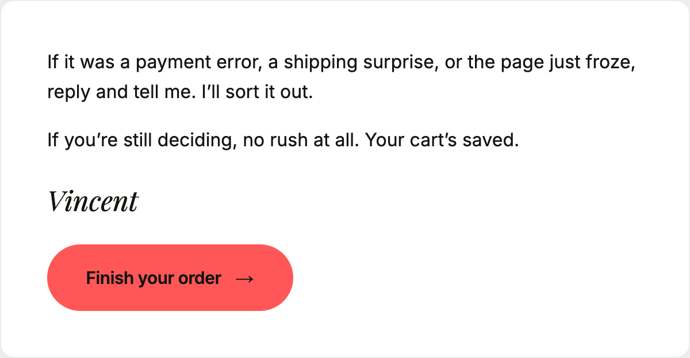

<!-- Generated by .claude/skills/shopify-email-html/scripts/build_library.py — edit section.json / template.json instead. -->

# CR-1 · Sign-off + CTA

| | |
|---|---|
| Type | Sign-off + CTA |
| Context | abandoned-checkout |
| Surfaces | Messaging · Code your own, Messaging section |
| Liquid variables | `abandoned_checkout.url` |
| Shopify status | draft |
| Placeholders | no |
| Characters | 1951 |
| Used by | [CR-1](../../emails/cr-1-your-carts-still-here/) |

## Preview



## HTML

Source: [`section.html`](section.html). Copy from here or from the raw file.

```html
<table role="presentation" width="100%" cellpadding="0" cellspacing="0" border="0" style="background-color:transparent;"><tr><td align="center" style="padding:0;">
<table role="presentation" class="shell" width="100%" cellpadding="0" cellspacing="0" border="0" style="width:100%;max-width:600px;">
<tr><td style="padding:0;">
<table role="presentation" width="100%" cellpadding="0" cellspacing="0" border="0" style="border-collapse:separate;background-color:#ffffff;border:1px solid #ececec;border-radius:12px;">
<tr><td class="pad" style="padding:40px;"><p style="margin:0 0 16px 0;font-family:'Inter',Arial,Helvetica,sans-serif;font-size:16px;line-height:26px;font-weight:400;color:#15140f;text-align:left;">If it was a payment error, a shipping surprise, or the page just froze, reply and tell me. I&rsquo;ll sort it out.</p><p style="margin:0 0 24px 0;font-family:'Inter',Arial,Helvetica,sans-serif;font-size:16px;line-height:26px;font-weight:400;color:#15140f;text-align:left;">If you&rsquo;re still deciding, no rush at all. Your cart&rsquo;s saved.</p><p style="margin:0 0 24px 0;font-family:'Playfair Display',Georgia,'Times New Roman',serif;font-size:24px;line-height:30px;font-weight:400;color:#15140f;text-align:left;font-style:italic;">Vincent</p><table role="presentation" class="btn" cellpadding="0" cellspacing="0" border="0" style="border-collapse:separate;margin:0;">
<tr><td style="border-radius:999px;background-color:#ff5757;">
<a href="{{ abandoned_checkout.url }}" target="_blank" style="display:inline-block;padding:0 34px;line-height:58px;font-family:'Inter Tight',Arial,Helvetica,sans-serif;font-size:15px;font-weight:600;letter-spacing:0.3px;color:#15140f;text-decoration:none;border-radius:999px;white-space:nowrap;">Finish your order<span style="padding-left:12px;font-family:'Inter',Arial,Helvetica,sans-serif;font-size:16px;">&rarr;</span></a>
</td></tr></table></td></tr>
</table>
</td></tr>
</table>
</td></tr></table>
```
