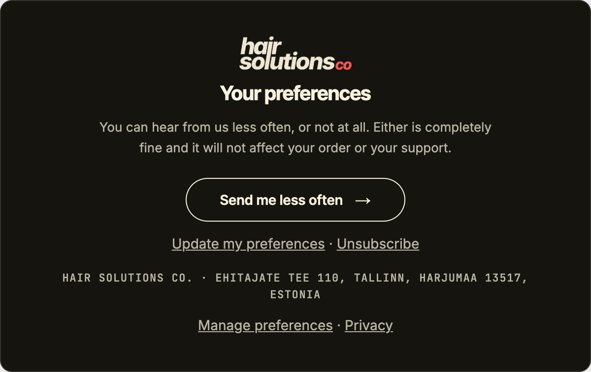

<!-- Generated by .claude/skills/shopify-email-html/scripts/build_library.py — edit section.json / template.json instead. -->

# Preferences footer

| | |
|---|---|
| Type | Preferences footer |
| Context | any |
| Surfaces | Messaging · Code your own, Messaging section |
| Liquid variables | `unsubscribe_link` |
| Shopify status | draft |
| Placeholders | no |
| Characters | 3225 |
| Used by | [CR-1](../../emails/cr-1-your-carts-still-here/), [CR-2](../../emails/cr-2-three-questions-answered/), [CR-3](../../emails/cr-3-not-sure-you-picked-right/), [CR-4](../../emails/cr-4-last-note-free-shipping/), [RO-3](../../emails/ro-3-replacement-window/), [WB-1](../../emails/wb-1-checking-in/) |

## Preview



## HTML

Source: [`section.html`](section.html). Copy from here or from the raw file.

```html
<table role="presentation" width="100%" cellpadding="0" cellspacing="0" border="0" style="background-color:transparent;"><tr><td align="center" style="padding:0;">
<table role="presentation" class="shell" width="100%" cellpadding="0" cellspacing="0" border="0" style="width:100%;max-width:600px;">
<tr><td style="padding:0;">
<table role="presentation" width="100%" cellpadding="0" cellspacing="0" border="0" style="border-collapse:separate;background-color:#15140f;border:1px solid #35332c;border-radius:12px;">
<tr><td class="pad-sm" style="padding:36px 24px 36px 24px;">
<p style="margin:0 0 10px 0;font-family:'Inter Tight',Arial,Helvetica,sans-serif;font-size:20px;line-height:28px;font-weight:700;color:#f7f1de;text-align:center;letter-spacing:-0.3px;">Your preferences</p>
<p class="pad-copy" style="margin:0 0 20px 0;font-family:'Inter',Arial,Helvetica,sans-serif;font-size:13px;line-height:21px;font-weight:400;color:#b8b3a4;text-align:center;padding:0 70px;">You can hear from us less often, or not at all. Either is completely fine and it will not affect your order or your support.</p>
<table role="presentation" align="center" class="btn" cellpadding="0" cellspacing="0" border="0" style="border-collapse:separate;margin:0 auto;">
<tr><td style="border-radius:999px;background-color:#15140f;">
<a href="https://hairsolutions.co/pages/edit-notifications" target="_blank" style="display:inline-block;border:1px solid #f7f1de;padding:0 34px;line-height:42px;font-family:'Inter Tight',Arial,Helvetica,sans-serif;font-size:14px;font-weight:600;letter-spacing:0.3px;color:#f7f1de;text-decoration:none;border-radius:999px;white-space:nowrap;">Send me less often<span style="padding-left:12px;font-family:'Inter',Arial,Helvetica,sans-serif;font-size:16px;">&rarr;</span></a>
</td></tr></table>
<p style="margin:0 0 16px 0;font-family:'Inter',Arial,Helvetica,sans-serif;font-size:14px;line-height:21px;font-weight:400;color:#b8b3a4;text-align:center;padding-top:12px;"><a href="https://hairsolutions.co/pages/edit-notifications" target="_blank" style="color:#b8b3a4;text-decoration:underline;">Update my preferences</a> &middot; <span class="unsub">{{ unsubscribe_link }}</span></p>
<p style="margin:0 0 12px 0;font-family:'JetBrains Mono','Courier New',monospace;font-size:11px;line-height:17px;font-weight:500;letter-spacing:0.8px;text-transform:uppercase;color:#b8b3a4;text-align:center;padding:0 24px;">Hair Solutions Co. &middot; Ehitajate tee 110, Tallinn, Harjumaa 13517, Estonia</p>
<p style="margin:0 0 0px 0;font-family:'Inter',Arial,Helvetica,sans-serif;font-size:14px;line-height:21px;font-weight:400;color:#b8b3a4;text-align:center;"><a href="https://hairsolutions.co/pages/edit-notifications" target="_blank" style="color:#b8b3a4;text-decoration:underline;">Manage preferences</a> &middot; <a href="https://hairsolutions.co/policies/privacy-policy" target="_blank" style="color:#b8b3a4;text-decoration:underline;">Privacy</a></p></td></tr>
</table>
</td></tr>
</table>
</td></tr></table>
```
