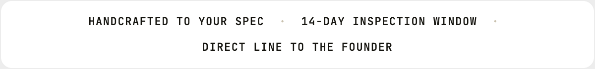

<!-- Generated by .claude/skills/shopify-email-html/scripts/build_library.py — edit section.json / template.json instead. -->

# Trust strip

| | |
|---|---|
| Type | Trust strip |
| Context | any |
| Surfaces | Messaging · Code your own, Messaging section |
| Liquid variables | — |
| Shopify status | draft |
| Placeholders | no |
| Characters | 1041 |
| Used by | [CR-2](../../emails/cr-2-three-questions-answered/), [CR-3](../../emails/cr-3-not-sure-you-picked-right/) |

## Preview



## HTML

Source: [`section.html`](section.html). Copy from here or from the raw file.

```html
<table role="presentation" width="100%" cellpadding="0" cellspacing="0" border="0" style="background-color:transparent;"><tr><td align="center" style="padding:0;">
<table role="presentation" class="shell" width="100%" cellpadding="0" cellspacing="0" border="0" style="width:100%;max-width:600px;">
<tr><td style="padding:0;">
<table role="presentation" width="100%" cellpadding="0" cellspacing="0" border="0" style="border-collapse:separate;background-color:#ffffff;border:1px solid #ececec;border-radius:12px;">
<tr><td class="pad-sm" style="padding:8px 24px;"><p style="margin:0 0 0px 0;font-family:'JetBrains Mono','Courier New',monospace;font-size:11px;line-height:26px;font-weight:500;letter-spacing:0.8px;text-transform:uppercase;color:#15140f;text-align:center;">Handcrafted to your spec&nbsp;<span style="color:#c9c1ae;">&nbsp;&middot;&nbsp;</span>&nbsp;14-day inspection window&nbsp;<span style="color:#c9c1ae;">&nbsp;&middot;&nbsp;</span><br>Direct line to the founder</p></td></tr>
</table>
</td></tr>
</table>
</td></tr></table>
```
