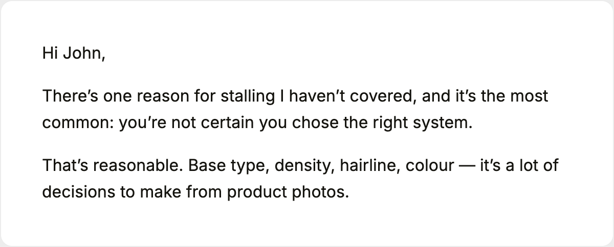

<!-- Generated by .claude/skills/shopify-email-html/scripts/build_library.py — edit section.json / template.json instead. -->

# CR-3 · Intro

| | |
|---|---|
| Type | Text |
| Context | any |
| Surfaces | Messaging · Code your own, Messaging section |
| Liquid variables | `customer.first_name` |
| Shopify status | draft |
| Placeholders | no |
| Characters | 1428 |
| Used by | [CR-3](../../emails/cr-3-not-sure-you-picked-right/) |

## Preview



## HTML

Source: [`section.html`](section.html). Copy from here or from the raw file.

```html
<table role="presentation" width="100%" cellpadding="0" cellspacing="0" border="0" style="background-color:transparent;"><tr><td align="center" style="padding:0;">
<table role="presentation" class="shell" width="100%" cellpadding="0" cellspacing="0" border="0" style="width:100%;max-width:600px;">
<tr><td style="padding:0;">
<table role="presentation" width="100%" cellpadding="0" cellspacing="0" border="0" style="border-collapse:separate;background-color:#ffffff;border:1px solid #ececec;border-radius:12px;">
<tr><td class="pad" style="padding:38px 40px 40px 40px;"><p style="margin:0 0 16px 0;font-family:'Inter',Arial,Helvetica,sans-serif;font-size:16px;line-height:26px;font-weight:400;color:#15140f;text-align:left;">Hi {{ customer.first_name | default: "there" }},</p><p style="margin:0 0 16px 0;font-family:'Inter',Arial,Helvetica,sans-serif;font-size:16px;line-height:26px;font-weight:400;color:#15140f;text-align:left;">There&rsquo;s one reason for stalling I haven&rsquo;t covered, and it&rsquo;s the most common: you&rsquo;re not certain you chose the right system.</p><p style="margin:0 0 0px 0;font-family:'Inter',Arial,Helvetica,sans-serif;font-size:16px;line-height:26px;font-weight:400;color:#15140f;text-align:left;">That&rsquo;s reasonable. Base type, density, hairline, colour &mdash; it&rsquo;s a lot of decisions to make from product photos.</p></td></tr>
</table>
</td></tr>
</table>
</td></tr></table>
```
