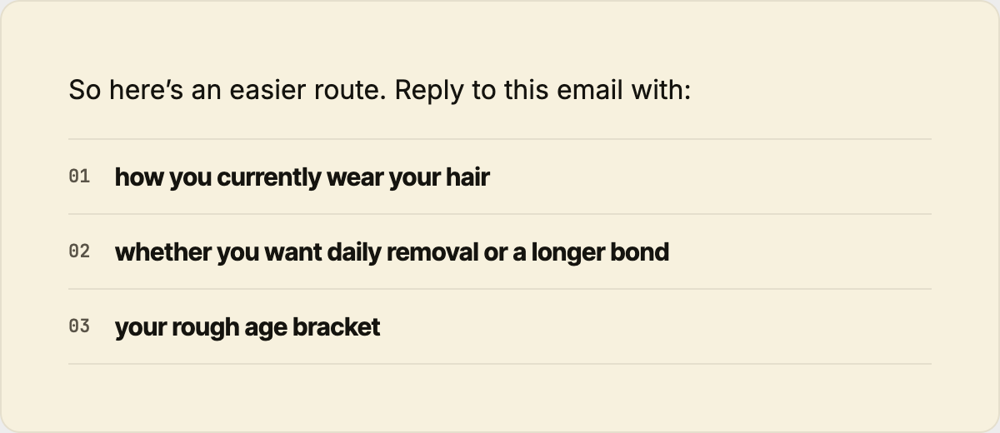

<!-- Generated by .claude/skills/shopify-email-html/scripts/build_library.py — edit section.json / template.json instead. -->

# CR-3 · Reply checklist

| | |
|---|---|
| Type | Checklist |
| Context | any |
| Surfaces | Messaging · Code your own, Messaging section |
| Liquid variables | — |
| Shopify status | draft |
| Placeholders | no |
| Characters | 2241 |
| Used by | [CR-3](../../emails/cr-3-not-sure-you-picked-right/) |

## Preview



## HTML

Source: [`section.html`](section.html). Copy from here or from the raw file.

```html
<table role="presentation" width="100%" cellpadding="0" cellspacing="0" border="0" style="background-color:transparent;"><tr><td align="center" style="padding:0;">
<table role="presentation" class="shell" width="100%" cellpadding="0" cellspacing="0" border="0" style="width:100%;max-width:600px;">
<tr><td style="padding:0;">
<table role="presentation" width="100%" cellpadding="0" cellspacing="0" border="0" style="border-collapse:separate;background-color:#f7f1de;border:1px solid #e5dfcd;border-radius:12px;">
<tr><td class="pad" style="padding:40px;"><p style="margin:0 0 16px 0;font-family:'Inter',Arial,Helvetica,sans-serif;font-size:16px;line-height:26px;font-weight:400;color:#15140f;text-align:left;">So here&rsquo;s an easier route. Reply to this email with:</p><table role="presentation" width="100%" cellpadding="0" cellspacing="0" border="0" style="border-collapse:collapse;border-bottom:1px solid #e5dfcd;"><tr><td width="28" valign="top" style="width:28px;padding:10px 0;border-top:1px solid #e5dfcd;font-family:'JetBrains Mono','Courier New',monospace;font-size:11px;line-height:24px;color:#5a5448;">01</td><td style="padding:10px 0;border-top:1px solid #e5dfcd;font-family:'Inter Tight',Arial,Helvetica,sans-serif;font-size:15px;line-height:24px;font-weight:700;color:#15140f;">how you currently wear your hair</td></tr><tr><td width="28" valign="top" style="width:28px;padding:10px 0;border-top:1px solid #e5dfcd;font-family:'JetBrains Mono','Courier New',monospace;font-size:11px;line-height:24px;color:#5a5448;">02</td><td style="padding:10px 0;border-top:1px solid #e5dfcd;font-family:'Inter Tight',Arial,Helvetica,sans-serif;font-size:15px;line-height:24px;font-weight:700;color:#15140f;">whether you want daily removal or a longer bond</td></tr><tr><td width="28" valign="top" style="width:28px;padding:10px 0;border-top:1px solid #e5dfcd;font-family:'JetBrains Mono','Courier New',monospace;font-size:11px;line-height:24px;color:#5a5448;">03</td><td style="padding:10px 0;border-top:1px solid #e5dfcd;font-family:'Inter Tight',Arial,Helvetica,sans-serif;font-size:15px;line-height:24px;font-weight:700;color:#15140f;">your rough age bracket</td></tr></table></td></tr>
</table>
</td></tr>
</table>
</td></tr></table>
```
