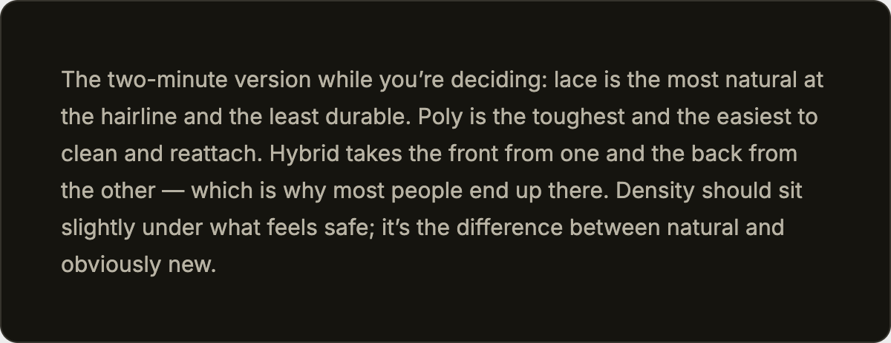

<!-- Generated by .claude/skills/shopify-email-html/scripts/build_library.py — edit section.json / template.json instead. -->

# CR-3 · Ink note

| | |
|---|---|
| Type | Ink note |
| Context | any |
| Surfaces | Messaging · Code your own, Messaging section |
| Liquid variables | — |
| Shopify status | draft |
| Placeholders | no |
| Characters | 1166 |
| Used by | [CR-3](../../emails/cr-3-not-sure-you-picked-right/) |

## Preview



## HTML

Source: [`section.html`](section.html). Copy from here or from the raw file.

```html
<table role="presentation" width="100%" cellpadding="0" cellspacing="0" border="0" style="background-color:transparent;"><tr><td align="center" style="padding:0;">
<table role="presentation" class="shell" width="100%" cellpadding="0" cellspacing="0" border="0" style="width:100%;max-width:600px;">
<tr><td style="padding:0;">
<table role="presentation" width="100%" cellpadding="0" cellspacing="0" border="0" style="border-collapse:separate;background-color:#15140f;border:1px solid #35332c;border-radius:12px;">
<tr><td class="pad" style="padding:40px;"><p style="margin:0 0 0px 0;font-family:'Inter',Arial,Helvetica,sans-serif;font-size:15px;line-height:25px;font-weight:400;color:#b8b3a4;text-align:left;">The two-minute version while you&rsquo;re deciding: lace is the most natural at the hairline and the least durable. Poly is the toughest and the easiest to clean and reattach. Hybrid takes the front from one and the back from the other &mdash; which is why most people end up there. Density should sit slightly under what feels safe; it&rsquo;s the difference between natural and obviously new.</p></td></tr>
</table>
</td></tr>
</table>
</td></tr></table>
```
