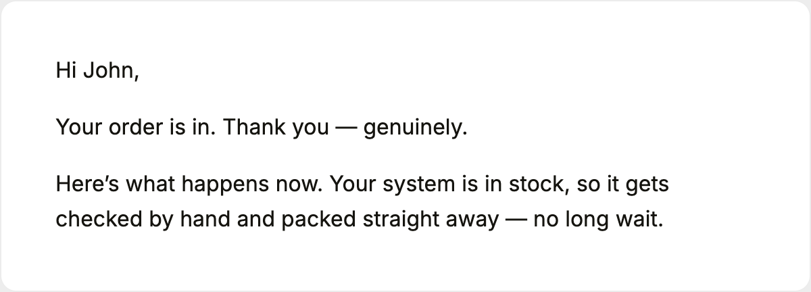

<!-- Generated by .claude/skills/shopify-email-html/scripts/build_library.py — edit section.json / template.json instead. -->

# PP-1 · Intro

| | |
|---|---|
| Type | Text |
| Context | order |
| Surfaces | Notification template |
| Liquid variables | `fname`, `is_custom` |
| Shopify status | live |
| Placeholders | no |
| Characters | 1597 |
| Used by | [PP-1](../../emails/pp-1-order-confirmation/) |

## Preview



## HTML

Source: [`section.html`](section.html). Copy from here or from the raw file.

```html
<table role="presentation" width="100%" cellpadding="0" cellspacing="0" border="0" style="background-color:transparent;"><tr><td align="center" style="padding:0;">
<table role="presentation" class="shell" width="100%" cellpadding="0" cellspacing="0" border="0" style="width:100%;max-width:600px;">
<tr><td style="padding:0;">
<table role="presentation" width="100%" cellpadding="0" cellspacing="0" border="0" style="border-collapse:separate;background-color:#ffffff;border:1px solid #ececec;border-radius:12px;">
<tr><td class="pad" style="padding:38px 40px 40px 40px;"><p style="margin:0 0 16px 0;font-family:'Inter',Arial,Helvetica,sans-serif;font-size:16px;line-height:26px;font-weight:400;color:#15140f;text-align:left;">Hi {{ fname }}there,</p><p style="margin:0 0 16px 0;font-family:'Inter',Arial,Helvetica,sans-serif;font-size:16px;line-height:26px;font-weight:400;color:#15140f;text-align:left;">Your order is in. Thank you &mdash; genuinely.</p><p style="margin:0 0 0px 0;font-family:'Inter',Arial,Helvetica,sans-serif;font-size:16px;line-height:26px;font-weight:400;color:#15140f;text-align:left;">Here&rsquo;s what happens now. Your system isn&rsquo;t sitting on a shelf waiting to be boxed; it gets made for you. That takes time, and I&rsquo;d rather tell you that up front than have you wondering where it is.Here&rsquo;s what happens now. Your system is in stock, so it gets checked by hand and packed straight away &mdash; no long wait.</p></td></tr>
</table>
</td></tr>
</table>
</td></tr></table>
```
