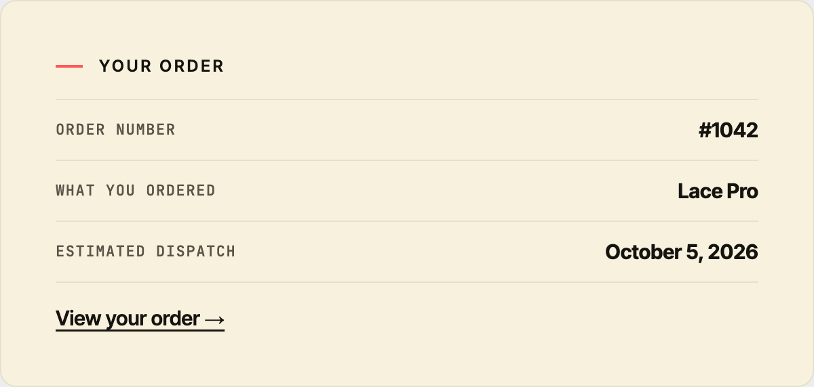

<!-- Generated by .claude/skills/shopify-email-html/scripts/build_library.py — edit section.json / template.json instead. -->

# PP-1 · Order summary

| | |
|---|---|
| Type | Order summary |
| Context | order |
| Surfaces | Notification template |
| Liquid variables | `dispatch_s`, `order_name`, `order_status_url`, `product_summary` |
| Shopify status | live |
| Placeholders | no |
| Characters | 3158 |
| Used by | [PP-1](../../emails/pp-1-order-confirmation/) |

## Preview



## HTML

Source: [`section.html`](section.html). Copy from here or from the raw file.

```html
<table role="presentation" width="100%" cellpadding="0" cellspacing="0" border="0" style="background-color:transparent;"><tr><td align="center" style="padding:0;">
<table role="presentation" class="shell" width="100%" cellpadding="0" cellspacing="0" border="0" style="width:100%;max-width:600px;">
<tr><td style="padding:0;">
<table role="presentation" width="100%" cellpadding="0" cellspacing="0" border="0" style="border-collapse:separate;background-color:#f7f1de;border:1px solid #e5dfcd;border-radius:12px;">
<tr><td class="pad" style="padding:40px;"><table role="presentation" cellpadding="0" cellspacing="0" border="0" style="margin:0 0 16px 0;">
<tr><td width="20" style="width:20px;vertical-align:middle;"><div style="height:2px;line-height:2px;font-size:0;background-color:#ff5757;">&nbsp;</div></td>
<td style="padding-left:12px;font-family:'Inter Tight',Arial,Helvetica,sans-serif;font-size:12px;line-height:16px;font-weight:600;letter-spacing:2px;text-transform:uppercase;color:#15140f;white-space:nowrap;">Your order</td></tr>
</table><table role="presentation" width="100%" cellpadding="0" cellspacing="0" border="0" style="border-collapse:collapse;border-bottom:1px solid #e5dfcd;"><tr>
<td style="border-top:1px solid #e5dfcd;padding:12px 0;font-family:'JetBrains Mono','Courier New',monospace;font-size:11px;line-height:16px;letter-spacing:0.8px;text-transform:uppercase;color:#5a5448;vertical-align:middle;">Order number</td>
<td align="right" style="border-top:1px solid #e5dfcd;padding:12px 0 12px 16px;font-family:'Inter Tight',Arial,Helvetica,sans-serif;font-size:15px;line-height:20px;font-weight:700;color:#15140f;text-align:right;vertical-align:middle;">{{ order_name }}</td>
</tr><tr>
<td style="border-top:1px solid #e5dfcd;padding:12px 0;font-family:'JetBrains Mono','Courier New',monospace;font-size:11px;line-height:16px;letter-spacing:0.8px;text-transform:uppercase;color:#5a5448;vertical-align:middle;">What you ordered</td>
<td align="right" style="border-top:1px solid #e5dfcd;padding:12px 0 12px 16px;font-family:'Inter Tight',Arial,Helvetica,sans-serif;font-size:15px;line-height:20px;font-weight:700;color:#15140f;text-align:right;vertical-align:middle;">{{ product_summary }}</td>
</tr><tr>
<td style="border-top:1px solid #e5dfcd;padding:12px 0;font-family:'JetBrains Mono','Courier New',monospace;font-size:11px;line-height:16px;letter-spacing:0.8px;text-transform:uppercase;color:#5a5448;vertical-align:middle;">Estimated dispatch</td>
<td align="right" style="border-top:1px solid #e5dfcd;padding:12px 0 12px 16px;font-family:'Inter Tight',Arial,Helvetica,sans-serif;font-size:15px;line-height:20px;font-weight:700;color:#15140f;text-align:right;vertical-align:middle;">{{ dispatch_s | date: '%B %-d, %Y' }}</td>
</tr></table><p style="margin:0 0 0px 0;font-family:'Inter Tight',Arial,Helvetica,sans-serif;font-size:15px;line-height:20px;font-weight:600;color:#15140f;text-align:left;padding-top:16px;"><a href="{{ order_status_url }}" target="_blank" style="color:#15140f;text-decoration:underline;text-underline-offset:3px;">View your order &rarr;</a></p></td></tr>
</table>
</td></tr>
</table>
</td></tr></table>
```
