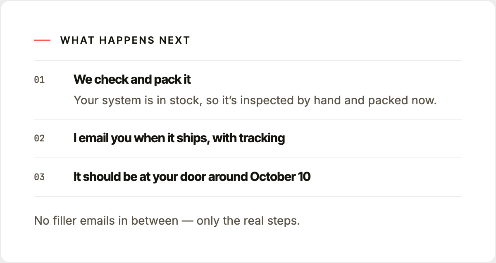

<!-- Generated by .claude/skills/shopify-email-html/scripts/build_library.py — edit section.json / template.json instead. -->

# PP-1 · Timeline

| | |
|---|---|
| Type | Timeline |
| Context | order |
| Surfaces | Notification template |
| Liquid variables | `delivery_s`, `is_custom` |
| Shopify status | live |
| Placeholders | no |
| Characters | 5910 |
| Used by | [PP-1](../../emails/pp-1-order-confirmation/) |

## Preview



## HTML

Source: [`section.html`](section.html). Copy from here or from the raw file.

```html
<table role="presentation" width="100%" cellpadding="0" cellspacing="0" border="0" style="background-color:transparent;"><tr><td align="center" style="padding:0;">
<table role="presentation" class="shell" width="100%" cellpadding="0" cellspacing="0" border="0" style="width:100%;max-width:600px;">
<tr><td style="padding:0;">
<table role="presentation" width="100%" cellpadding="0" cellspacing="0" border="0" style="border-collapse:separate;background-color:#ffffff;border:1px solid #ececec;border-radius:12px;">
<tr><td class="pad" style="padding:40px;"><table role="presentation" cellpadding="0" cellspacing="0" border="0" style="margin:0 0 16px 0;">
<tr><td width="20" style="width:20px;vertical-align:middle;"><div style="height:2px;line-height:2px;font-size:0;background-color:#ff5757;">&nbsp;</div></td>
<td style="padding-left:12px;font-family:'Inter Tight',Arial,Helvetica,sans-serif;font-size:12px;line-height:16px;font-weight:600;letter-spacing:2px;text-transform:uppercase;color:#15140f;white-space:nowrap;">What happens next</td></tr>
</table><table role="presentation" width="100%" cellpadding="0" cellspacing="0" border="0" style="border-collapse:collapse;border-bottom:1px solid #ececec;"><tr>
<td width="48" valign="top" style="width:48px;border-top:1px solid #ececec;padding:12px 0;font-family:'JetBrains Mono','Courier New',monospace;font-size:11px;line-height:22px;color:#5a5448;vertical-align:top;">01</td>
<td valign="top" style="border-top:1px solid #ececec;padding:11px 0 12px 0;vertical-align:top;"><p style="margin:0 0 0px 0;font-family:'Inter Tight',Arial,Helvetica,sans-serif;font-size:15px;line-height:22px;font-weight:700;color:#15140f;text-align:left;letter-spacing:-0.2px;">Production starts</p><p style="margin:0 0 0px 0;font-family:'Inter',Arial,Helvetica,sans-serif;font-size:14px;line-height:21px;font-weight:400;color:#5a5448;text-align:left;padding-top:4px;">The base is cut and the hair is hand-tied to your spec.</p></td></tr><tr>
<td width="48" valign="top" style="width:48px;border-top:1px solid #ececec;padding:12px 0;font-family:'JetBrains Mono','Courier New',monospace;font-size:11px;line-height:22px;color:#5a5448;vertical-align:top;">02</td>
<td valign="top" style="border-top:1px solid #ececec;padding:11px 0 12px 0;vertical-align:top;"><p style="margin:0 0 0px 0;font-family:'Inter Tight',Arial,Helvetica,sans-serif;font-size:15px;line-height:22px;font-weight:700;color:#15140f;text-align:left;letter-spacing:-0.2px;">I email you when it goes into production</p></td></tr><tr>
<td width="48" valign="top" style="width:48px;border-top:1px solid #ececec;padding:12px 0;font-family:'JetBrains Mono','Courier New',monospace;font-size:11px;line-height:22px;color:#5a5448;vertical-align:top;">03</td>
<td valign="top" style="border-top:1px solid #ececec;padding:11px 0 12px 0;vertical-align:top;"><p style="margin:0 0 0px 0;font-family:'Inter Tight',Arial,Helvetica,sans-serif;font-size:15px;line-height:22px;font-weight:700;color:#15140f;text-align:left;letter-spacing:-0.2px;">I email you when it ships, with tracking</p></td></tr><tr>
<td width="48" valign="top" style="width:48px;border-top:1px solid #ececec;padding:12px 0;font-family:'JetBrains Mono','Courier New',monospace;font-size:11px;line-height:22px;color:#5a5448;vertical-align:top;">04</td>
<td valign="top" style="border-top:1px solid #ececec;padding:11px 0 12px 0;vertical-align:top;"><p style="margin:0 0 0px 0;font-family:'Inter Tight',Arial,Helvetica,sans-serif;font-size:15px;line-height:22px;font-weight:700;color:#15140f;text-align:left;letter-spacing:-0.2px;">It should be at your door around {{ delivery_s | date: '%B %-d' }}</p></td></tr><tr>
<td width="48" valign="top" style="width:48px;border-top:1px solid #ececec;padding:12px 0;font-family:'JetBrains Mono','Courier New',monospace;font-size:11px;line-height:22px;color:#5a5448;vertical-align:top;">01</td>
<td valign="top" style="border-top:1px solid #ececec;padding:11px 0 12px 0;vertical-align:top;"><p style="margin:0 0 0px 0;font-family:'Inter Tight',Arial,Helvetica,sans-serif;font-size:15px;line-height:22px;font-weight:700;color:#15140f;text-align:left;letter-spacing:-0.2px;">We check and pack it</p><p style="margin:0 0 0px 0;font-family:'Inter',Arial,Helvetica,sans-serif;font-size:14px;line-height:21px;font-weight:400;color:#5a5448;text-align:left;padding-top:4px;">Your system is in stock, so it&rsquo;s inspected by hand and packed now.</p></td></tr><tr>
<td width="48" valign="top" style="width:48px;border-top:1px solid #ececec;padding:12px 0;font-family:'JetBrains Mono','Courier New',monospace;font-size:11px;line-height:22px;color:#5a5448;vertical-align:top;">02</td>
<td valign="top" style="border-top:1px solid #ececec;padding:11px 0 12px 0;vertical-align:top;"><p style="margin:0 0 0px 0;font-family:'Inter Tight',Arial,Helvetica,sans-serif;font-size:15px;line-height:22px;font-weight:700;color:#15140f;text-align:left;letter-spacing:-0.2px;">I email you when it ships, with tracking</p></td></tr><tr>
<td width="48" valign="top" style="width:48px;border-top:1px solid #ececec;padding:12px 0;font-family:'JetBrains Mono','Courier New',monospace;font-size:11px;line-height:22px;color:#5a5448;vertical-align:top;">03</td>
<td valign="top" style="border-top:1px solid #ececec;padding:11px 0 12px 0;vertical-align:top;"><p style="margin:0 0 0px 0;font-family:'Inter Tight',Arial,Helvetica,sans-serif;font-size:15px;line-height:22px;font-weight:700;color:#15140f;text-align:left;letter-spacing:-0.2px;">It should be at your door around {{ delivery_s | date: '%B %-d' }}</p></td></tr></table><p style="margin:0 0 0px 0;font-family:'Inter',Arial,Helvetica,sans-serif;font-size:14px;line-height:21px;font-weight:400;color:#5a5448;text-align:left;padding-top:18px;">No filler emails in between &mdash; only the real steps.</p></td></tr>
</table>
</td></tr>
</table>
</td></tr></table>
```
