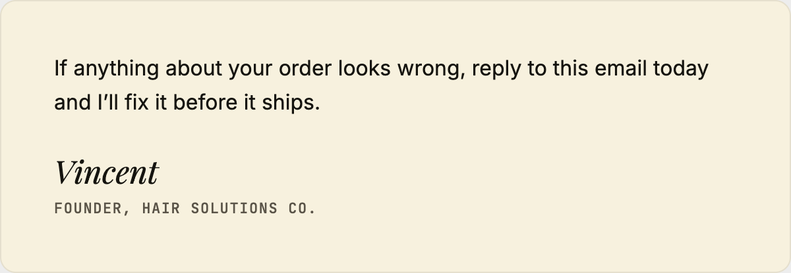

<!-- Generated by .claude/skills/shopify-email-html/scripts/build_library.py — edit section.json / template.json instead. -->

# PP-1 · Signature

| | |
|---|---|
| Type | Signature |
| Context | order |
| Surfaces | Notification template |
| Liquid variables | `is_custom` |
| Shopify status | live |
| Placeholders | no |
| Characters | 1386 |
| Used by | [PP-1](../../emails/pp-1-order-confirmation/) |

## Preview



## HTML

Source: [`section.html`](section.html). Copy from here or from the raw file.

```html
<table role="presentation" width="100%" cellpadding="0" cellspacing="0" border="0" style="background-color:transparent;"><tr><td align="center" style="padding:0;">
<table role="presentation" class="shell" width="100%" cellpadding="0" cellspacing="0" border="0" style="width:100%;max-width:600px;">
<tr><td style="padding:0;">
<table role="presentation" width="100%" cellpadding="0" cellspacing="0" border="0" style="border-collapse:separate;background-color:#f7f1de;border:1px solid #e5dfcd;border-radius:12px;">
<tr><td class="pad" style="padding:38px 40px 40px 40px;"><p style="margin:0 0 24px 0;font-family:'Inter',Arial,Helvetica,sans-serif;font-size:16px;line-height:26px;font-weight:400;color:#15140f;text-align:left;">If anything about your order looks wrong, reply to this email today and I&rsquo;ll fix it before production startsit ships.</p><p style="margin:0 0 6px 0;font-family:'Playfair Display',Georgia,'Times New Roman',serif;font-size:24px;line-height:30px;font-weight:400;color:#15140f;text-align:left;font-style:italic;">Vincent</p><p style="margin:0 0 0px 0;font-family:'JetBrains Mono','Courier New',monospace;font-size:11px;line-height:16px;font-weight:500;letter-spacing:0.8px;text-transform:uppercase;color:#5a5448;text-align:left;">Founder, Hair Solutions Co.</p></td></tr>
</table>
</td></tr>
</table>
</td></tr></table>
```
