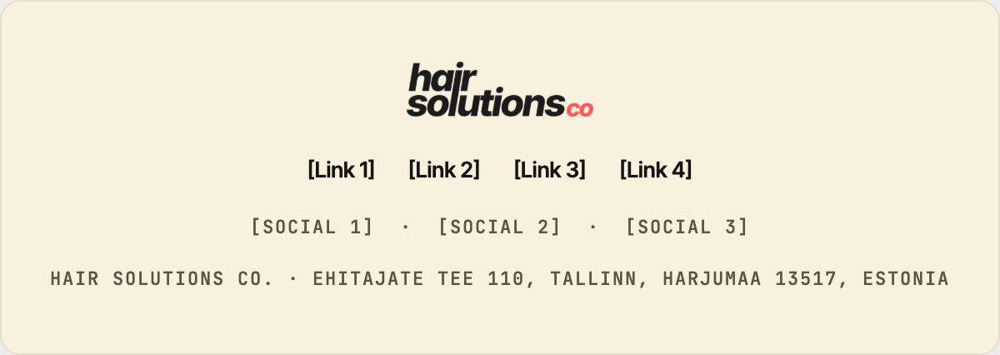

<!-- Generated by .claude/skills/shopify-email-html/scripts/build_library.py — edit section.json / template.json instead. -->

# Footer · Logo, links and legal · Bone

| | |
|---|---|
| Type | Footer |
| Context | any |
| Surfaces | Messaging · Code your own, Messaging section |
| Liquid variables | — |
| Shopify status | unused |
| Placeholders | yes — do not ship as is |
| Characters | 2877 |
| Used by | — |

> Module bank. All copy is a labelled slot: replace it before use.

## Module bank

- Category: 01 · Global chrome
- Module: Footer · Logo, links and legal · theme **bone**
- Figma source: [Footer](https://www.figma.com/design/9Il504CQE8jLaUTBVzphqc/Email-Design-System?node-id=479-17090)

**Changed from the Figma module to meet the v6 rules**

- Links are slots in the v6 body-small face; the legal line is the v6 meta role with the registered address from the v6 emails
- Shopify Messaging adds its own unsubscribe footer after sections; keep this card for brand, links and address only

**Figma sample copy (reference only, not in the section)**: Shop Systems · Our Story · Guides · Contact · In · YouTube · Instagram · X · © 2026 Hair Solutions Co. · Unsubscribe · Manage preferences

## Preview



## HTML

Source: [`section.html`](section.html). Copy from here or from the raw file.

```html
<table role="presentation" width="100%" cellpadding="0" cellspacing="0" border="0" style="background-color:transparent;"><tr><td align="center" style="padding:0;">
<table role="presentation" class="shell" width="100%" cellpadding="0" cellspacing="0" border="0" style="width:100%;max-width:600px;">
<tr><td style="padding:0;">
<table role="presentation" width="100%" cellpadding="0" cellspacing="0" border="0" style="border-collapse:separate;background-color:#f7f1de;border:1px solid #e5dfcd;border-radius:12px;">
<tr><td class="pad-sm" style="padding:36px 24px;"><div style="height:20px;line-height:20px;font-size:0;">&nbsp;</div><p style="margin:0;text-align:center;font-size:0;line-height:0;"><a href="https://hairsolutions.co" target="_blank" style="font-family:'Inter Tight',Arial,Helvetica,sans-serif;font-size:13px;line-height:24px;font-weight:600;letter-spacing:0;text-transform:none;color:#15140f;text-decoration:none;padding:0 10px;white-space:nowrap;display:inline-block;">[Link 1]</a><a href="https://hairsolutions.co" target="_blank" style="font-family:'Inter Tight',Arial,Helvetica,sans-serif;font-size:13px;line-height:24px;font-weight:600;letter-spacing:0;text-transform:none;color:#15140f;text-decoration:none;padding:0 10px;white-space:nowrap;display:inline-block;">[Link 2]</a><a href="https://hairsolutions.co" target="_blank" style="font-family:'Inter Tight',Arial,Helvetica,sans-serif;font-size:13px;line-height:24px;font-weight:600;letter-spacing:0;text-transform:none;color:#15140f;text-decoration:none;padding:0 10px;white-space:nowrap;display:inline-block;">[Link 3]</a><a href="https://hairsolutions.co" target="_blank" style="font-family:'Inter Tight',Arial,Helvetica,sans-serif;font-size:13px;line-height:24px;font-weight:600;letter-spacing:0;text-transform:none;color:#15140f;text-decoration:none;padding:0 10px;white-space:nowrap;display:inline-block;">[Link 4]</a></p><div style="height:14px;line-height:14px;font-size:0;">&nbsp;</div><p style="margin:0 0 0px 0;font-family:'JetBrains Mono','Courier New',monospace;font-size:11px;line-height:17px;font-weight:500;letter-spacing:0.9px;color:#5a5448;text-align:center;text-transform:uppercase;">[Social 1] &nbsp;&middot;&nbsp; [Social 2] &nbsp;&middot;&nbsp; [Social 3]</p><div style="height:14px;line-height:14px;font-size:0;">&nbsp;</div><p style="margin:0 0 0px 0;font-family:'JetBrains Mono','Courier New',monospace;font-size:11px;line-height:17px;font-weight:500;letter-spacing:0.9px;color:#5a5448;text-align:center;text-transform:uppercase;">Hair Solutions Co. &middot; Ehitajate tee 110, Tallinn, Harjumaa 13517, Estonia</p></td></tr>
</table>
</td></tr>
</table>
</td></tr></table>
```
