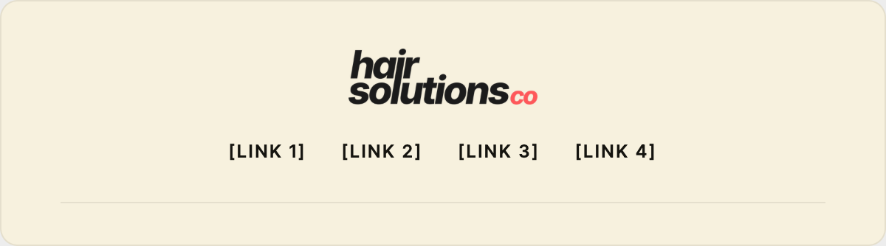

<!-- Generated by .claude/skills/shopify-email-html/scripts/build_library.py — edit section.json / template.json instead. -->

# Navigation · Centred logo, links and rule · Bone

| | |
|---|---|
| Type | Navigation |
| Context | any |
| Surfaces | Messaging · Code your own, Messaging section |
| Liquid variables | — |
| Shopify status | unused |
| Placeholders | yes — do not ship as is |
| Characters | 2385 |
| Used by | — |

> Module bank. All copy is a labelled slot: replace it before use.

## Module bank

- Category: 01 · Global chrome
- Module: Navigation · Centred logo, links and rule · theme **bone**
- Figma source: [Navigation · Centered Logo with Underline](https://www.figma.com/design/9Il504CQE8jLaUTBVzphqc/Email-Design-System?node-id=479-16711)

**Changed from the Figma module to meet the v6 rules**

- The underline is a v6 hairline (the surface's rule colour), full content width, under the links
- Approved v5 wordmark; links in the v6 eyebrow face

**Figma sample copy (reference only, not in the section)**: Shop systems · System guide · Care · Support

## Preview



## HTML

Source: [`section.html`](section.html). Copy from here or from the raw file.

```html
<table role="presentation" width="100%" cellpadding="0" cellspacing="0" border="0" style="background-color:transparent;"><tr><td align="center" style="padding:0;">
<table role="presentation" class="shell" width="100%" cellpadding="0" cellspacing="0" border="0" style="width:100%;max-width:600px;">
<tr><td style="padding:0;">
<table role="presentation" width="100%" cellpadding="0" cellspacing="0" border="0" style="border-collapse:separate;background-color:#f7f1de;border:1px solid #e5dfcd;border-radius:12px;">
<tr><td class="pad" style="padding:32px 40px 28px 40px;"><div style="height:20px;line-height:20px;font-size:0;">&nbsp;</div><p style="margin:0;text-align:center;font-size:0;line-height:0;"><a href="https://hairsolutions.co" target="_blank" style="font-family:'Inter Tight',Arial,Helvetica,sans-serif;font-size:12px;line-height:24px;font-weight:600;letter-spacing:1.5px;text-transform:uppercase;color:#15140f;text-decoration:none;padding:0 12px;white-space:nowrap;display:inline-block;">[Link 1]</a><a href="https://hairsolutions.co" target="_blank" style="font-family:'Inter Tight',Arial,Helvetica,sans-serif;font-size:12px;line-height:24px;font-weight:600;letter-spacing:1.5px;text-transform:uppercase;color:#15140f;text-decoration:none;padding:0 12px;white-space:nowrap;display:inline-block;">[Link 2]</a><a href="https://hairsolutions.co" target="_blank" style="font-family:'Inter Tight',Arial,Helvetica,sans-serif;font-size:12px;line-height:24px;font-weight:600;letter-spacing:1.5px;text-transform:uppercase;color:#15140f;text-decoration:none;padding:0 12px;white-space:nowrap;display:inline-block;">[Link 3]</a><a href="https://hairsolutions.co" target="_blank" style="font-family:'Inter Tight',Arial,Helvetica,sans-serif;font-size:12px;line-height:24px;font-weight:600;letter-spacing:1.5px;text-transform:uppercase;color:#15140f;text-decoration:none;padding:0 12px;white-space:nowrap;display:inline-block;">[Link 4]</a></p><div style="height:22px;line-height:22px;font-size:0;">&nbsp;</div><div style="margin:0px 0 0px 0;height:1px;line-height:1px;font-size:0;background-color:#e5dfcd;">&nbsp;</div></td></tr>
</table>
</td></tr>
</table>
</td></tr></table>
```
