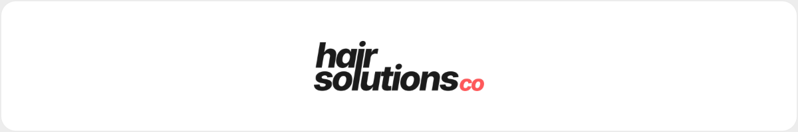

<!-- Generated by .claude/skills/shopify-email-html/scripts/build_library.py — edit section.json / template.json instead. -->

# Navigation · Centred logo · White

| | |
|---|---|
| Type | Navigation |
| Context | any |
| Surfaces | Messaging · Code your own, Messaging section |
| Liquid variables | — |
| Shopify status | unused |
| Placeholders | yes — do not ship as is |
| Characters | 827 |
| Used by | — |

> Module bank. All copy is a labelled slot: replace it before use.

## Module bank

- Category: 01 · Global chrome
- Module: Navigation · Centred logo · theme **white**
- Figma source: [Navigation · Centered Logo Only](https://www.figma.com/design/9Il504CQE8jLaUTBVzphqc/Email-Design-System?node-id=479-16702)

**Changed from the Figma module to meet the v6 rules**

- Logo at 128px (v6 header size), centred, 30px padding: the v6 Frame · Header

**Figma sample copy (reference only, not in the section)**: 

## Preview



## HTML

Source: [`section.html`](section.html). Copy from here or from the raw file.

```html
<table role="presentation" width="100%" cellpadding="0" cellspacing="0" border="0" style="background-color:transparent;"><tr><td align="center" style="padding:0;">
<table role="presentation" class="shell" width="100%" cellpadding="0" cellspacing="0" border="0" style="width:100%;max-width:600px;">
<tr><td style="padding:0;">
<table role="presentation" width="100%" cellpadding="0" cellspacing="0" border="0" style="border-collapse:separate;background-color:#ffffff;border:1px solid #ececec;border-radius:12px;">
<tr><td class="pad" style="padding:30px 40px;"></td></tr>
</table>
</td></tr>
</table>
</td></tr></table>
```
