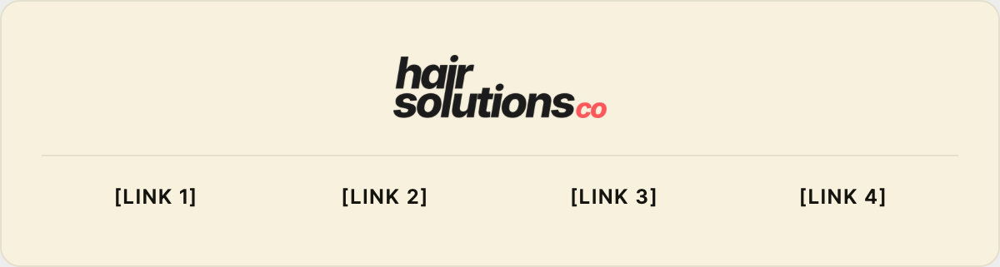

<!-- Generated by .claude/skills/shopify-email-html/scripts/build_library.py — edit section.json / template.json instead. -->

# Navigation · Logo above a justified link bar · Bone

| | |
|---|---|
| Type | Navigation |
| Context | any |
| Surfaces | Messaging · Code your own, Messaging section |
| Liquid variables | — |
| Shopify status | unused |
| Placeholders | yes — do not ship as is |
| Characters | 2363 |
| Used by | — |

> Module bank. All copy is a labelled slot: replace it before use.

## Module bank

- Category: 01 · Global chrome
- Module: Navigation · Logo above a justified link bar · theme **bone**
- Figma source: [Navigation · Logo Centered Above Horizontal](https://www.figma.com/design/9Il504CQE8jLaUTBVzphqc/Email-Design-System?node-id=479-16600)

**Changed from the Figma module to meet the v6 rules**

- Figma drew this identically to the centred nav; here the four links are equal-width cells in a full-width bar under a hairline
- Link cells stay four across on mobile (they shrink and wrap)

**Figma sample copy (reference only, not in the section)**: Shop systems · System guide · Care · Support

## Preview



## HTML

Source: [`section.html`](section.html). Copy from here or from the raw file.

```html
<table role="presentation" width="100%" cellpadding="0" cellspacing="0" border="0" style="background-color:transparent;"><tr><td align="center" style="padding:0;">
<table role="presentation" class="shell" width="100%" cellpadding="0" cellspacing="0" border="0" style="width:100%;max-width:600px;">
<tr><td style="padding:0;">
<table role="presentation" width="100%" cellpadding="0" cellspacing="0" border="0" style="border-collapse:separate;background-color:#f7f1de;border:1px solid #e5dfcd;border-radius:12px;">
<tr><td class="pad-sm" style="padding:32px 24px;"><div style="height:22px;line-height:22px;font-size:0;">&nbsp;</div><table role="presentation" width="100%" cellpadding="0" cellspacing="0" border="0" style="border-top:1px solid #e5dfcd;"><tr><td align="center" width="25%" style="width:25%;padding:14px 4px 0 4px;"><a href="https://hairsolutions.co" target="_blank" style="font-family:'Inter Tight',Arial,Helvetica,sans-serif;font-size:12px;line-height:18px;font-weight:600;letter-spacing:1.2px;text-transform:uppercase;color:#15140f;text-decoration:none;">[Link 1]</a></td><td align="center" width="25%" style="width:25%;padding:14px 4px 0 4px;"><a href="https://hairsolutions.co" target="_blank" style="font-family:'Inter Tight',Arial,Helvetica,sans-serif;font-size:12px;line-height:18px;font-weight:600;letter-spacing:1.2px;text-transform:uppercase;color:#15140f;text-decoration:none;">[Link 2]</a></td><td align="center" width="25%" style="width:25%;padding:14px 4px 0 4px;"><a href="https://hairsolutions.co" target="_blank" style="font-family:'Inter Tight',Arial,Helvetica,sans-serif;font-size:12px;line-height:18px;font-weight:600;letter-spacing:1.2px;text-transform:uppercase;color:#15140f;text-decoration:none;">[Link 3]</a></td><td align="center" width="25%" style="width:25%;padding:14px 4px 0 4px;"><a href="https://hairsolutions.co" target="_blank" style="font-family:'Inter Tight',Arial,Helvetica,sans-serif;font-size:12px;line-height:18px;font-weight:600;letter-spacing:1.2px;text-transform:uppercase;color:#15140f;text-decoration:none;">[Link 4]</a></td></tr></table></td></tr>
</table>
</td></tr>
</table>
</td></tr></table>
```
