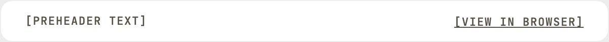

<!-- Generated by .claude/skills/shopify-email-html/scripts/build_library.py — edit section.json / template.json instead. -->

# Preheader · Message and browser link · White

| | |
|---|---|
| Type | Preheader bar |
| Context | any |
| Surfaces | Messaging · Code your own, Messaging section |
| Liquid variables | — |
| Shopify status | unused |
| Placeholders | yes — do not ship as is |
| Characters | 1349 |
| Used by | — |

> Module bank. All copy is a labelled slot: replace it before use.

## Module bank

- Category: 01 · Global chrome
- Module: Preheader · Message and browser link · theme **white**
- Figma source: [Pre-Header](https://www.figma.com/design/9Il504CQE8jLaUTBVzphqc/Email-Design-System?node-id=479-16508)

**Changed from the Figma module to meet the v6 rules**

- Meta role (JetBrains Mono 11, tracked) on the v6 preheader surface; v6 default is the White version
- 'View in browser' is a slot: Shopify Messaging has no view-in-browser variable (see PROJECT.md), leave it out or link your own page

**Figma sample copy (reference only, not in the section)**: New textures and lengths now available · View in browser

## Preview



## HTML

Source: [`section.html`](section.html). Copy from here or from the raw file.

```html
<table role="presentation" width="100%" cellpadding="0" cellspacing="0" border="0" style="background-color:transparent;"><tr><td align="center" style="padding:0;">
<table role="presentation" class="shell" width="100%" cellpadding="0" cellspacing="0" border="0" style="width:100%;max-width:600px;">
<tr><td style="padding:0;">
<table role="presentation" width="100%" cellpadding="0" cellspacing="0" border="0" style="border-collapse:separate;background-color:#ffffff;border:1px solid #ececec;border-radius:12px;">
<tr><td class="pad-sm" style="padding:10px 24px;"><table role="presentation" width="100%" cellpadding="0" cellspacing="0" border="0"><tr><td align="left" valign="middle" style="padding-right:16px;"><p style="margin:0 0 0px 0;font-family:'JetBrains Mono','Courier New',monospace;font-size:11px;line-height:17px;font-weight:500;letter-spacing:0.9px;color:#5a5448;text-align:left;text-transform:uppercase;">[Preheader text]</p></td><td align="right" valign="middle" style="white-space:nowrap;"><a href="https://hairsolutions.co" target="_blank" style="font-family:'JetBrains Mono','Courier New',monospace;font-size:11px;line-height:17px;font-weight:500;letter-spacing:0.9px;text-transform:uppercase;color:#5a5448;text-decoration:underline;">[View in browser]</a></td></tr></table></td></tr>
</table>
</td></tr>
</table>
</td></tr></table>
```
