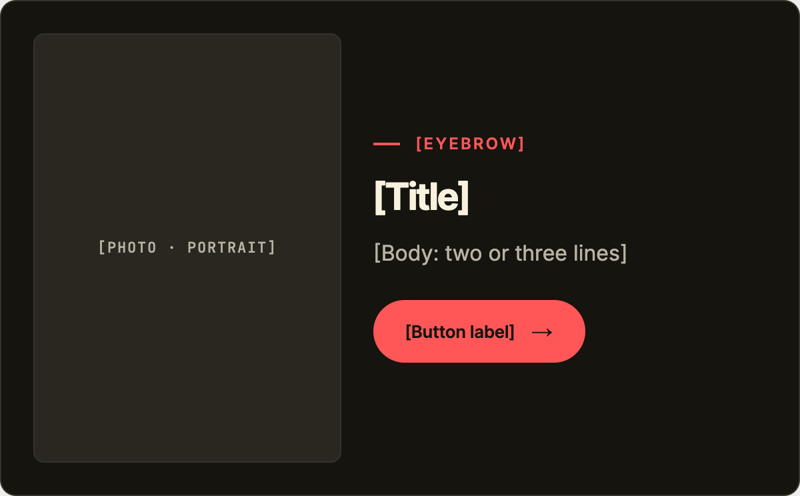

<!-- Generated by .claude/skills/shopify-email-html/scripts/build_library.py — edit section.json / template.json instead. -->

# Hero · Asymmetric image and text split · Ink

| | |
|---|---|
| Type | Hero |
| Context | any |
| Surfaces | Messaging · Code your own, Messaging section |
| Liquid variables | — |
| Shopify status | unused |
| Placeholders | yes — do not ship as is |
| Characters | 2969 |
| Used by | — |

> Module bank. All copy is a labelled slot: replace it before use.

## Module bank

- Category: 02 · Heroes
- Module: Hero · Asymmetric image and text split · theme **ink**
- Figma source: [Hero · Asymmetric image-text split](https://www.figma.com/design/9Il504CQE8jLaUTBVzphqc/Email-Design-System?node-id=480-11487)

**Changed from the Figma module to meet the v6 rules**

- Tall image left (about 40%), copy right; stacks on mobile
- Eyebrow in the v6 eyebrow role (label ink on light, coral on Ink); title in the v6 title role; small v6 pill button

**Figma sample copy (reference only, not in the section)**: The Atelier metric · Uncompromising Hair Restoration · Experience the security of custom-tailored medical-grade bases. · Discover Atelier

## Preview



## HTML

Source: [`section.html`](section.html). Copy from here or from the raw file.

```html
<table role="presentation" width="100%" cellpadding="0" cellspacing="0" border="0" style="background-color:transparent;"><tr><td align="center" style="padding:0;">
<table role="presentation" class="shell" width="100%" cellpadding="0" cellspacing="0" border="0" style="width:100%;max-width:600px;">
<tr><td style="padding:0;">
<table role="presentation" width="100%" cellpadding="0" cellspacing="0" border="0" style="border-collapse:separate;background-color:#15140f;border:1px solid #35332c;border-radius:12px;">
<tr><td class="pad-sm" style="padding:24px;"><table role="presentation" width="100%" cellpadding="0" cellspacing="0" border="0"><tr><td class="stack" width="42%" valign="middle" style="width:42%;padding:0 0 0 0px;vertical-align:middle;"><table role="presentation" width="100%" cellpadding="0" cellspacing="0" border="0" style="border-collapse:separate;background-color:#2a2620;border:1px solid #35332c;border-radius:8px;"><tr><td align="center" valign="middle" height="320" style="height:320px;padding:0 16px;"><p style="margin:0 0 0px 0;font-family:'JetBrains Mono','Courier New',monospace;font-size:11px;line-height:17px;font-weight:500;letter-spacing:0.9px;color:#b8b3a4;text-align:center;text-transform:uppercase;">[Photo · portrait]</p></td></tr></table></td><td class="stack stack-gap" width="58%" valign="middle" style="width:58%;padding:0 0 0 24px;vertical-align:middle;"><table role="presentation" cellpadding="0" cellspacing="0" border="0" style="margin:0 0 16px 0;">
<tr><td width="20" style="width:20px;vertical-align:middle;"><div style="height:2px;line-height:2px;font-size:0;background-color:#ff5757;">&nbsp;</div></td>
<td style="padding-left:12px;font-family:'Inter Tight',Arial,Helvetica,sans-serif;font-size:12px;line-height:16px;font-weight:600;letter-spacing:2px;text-transform:uppercase;color:#ff5757;white-space:nowrap;">[Eyebrow]</td></tr>
</table><h2 style="margin:0 0 14px 0;font-family:'Inter Tight',Arial,Helvetica,sans-serif;font-size:28px;line-height:31px;font-weight:700;letter-spacing:-0.6px;color:#f7f1de;text-align:left;">[Title]</h2><p style="margin:0 0 22px 0;font-family:'Inter',Arial,Helvetica,sans-serif;font-size:16px;line-height:26px;font-weight:400;color:#b8b3a4;text-align:left;">[Body: two or three lines]</p><table role="presentation" class="btn" cellpadding="0" cellspacing="0" border="0" style="border-collapse:separate;margin:0;">
<tr><td style="border-radius:999px;background-color:#ff5757;">
<a href="https://hairsolutions.co" target="_blank" style="display:inline-block;padding:0 24px;line-height:46px;font-family:'Inter Tight',Arial,Helvetica,sans-serif;font-size:13px;font-weight:600;letter-spacing:0.3px;color:#15140f;text-decoration:none;border-radius:999px;white-space:nowrap;">[Button label]<span style="padding-left:12px;font-family:'Inter',Arial,Helvetica,sans-serif;font-size:16px;">&rarr;</span></a>
</td></tr></table></td></tr></table></td></tr>
</table>
</td></tr>
</table>
</td></tr></table>
```
