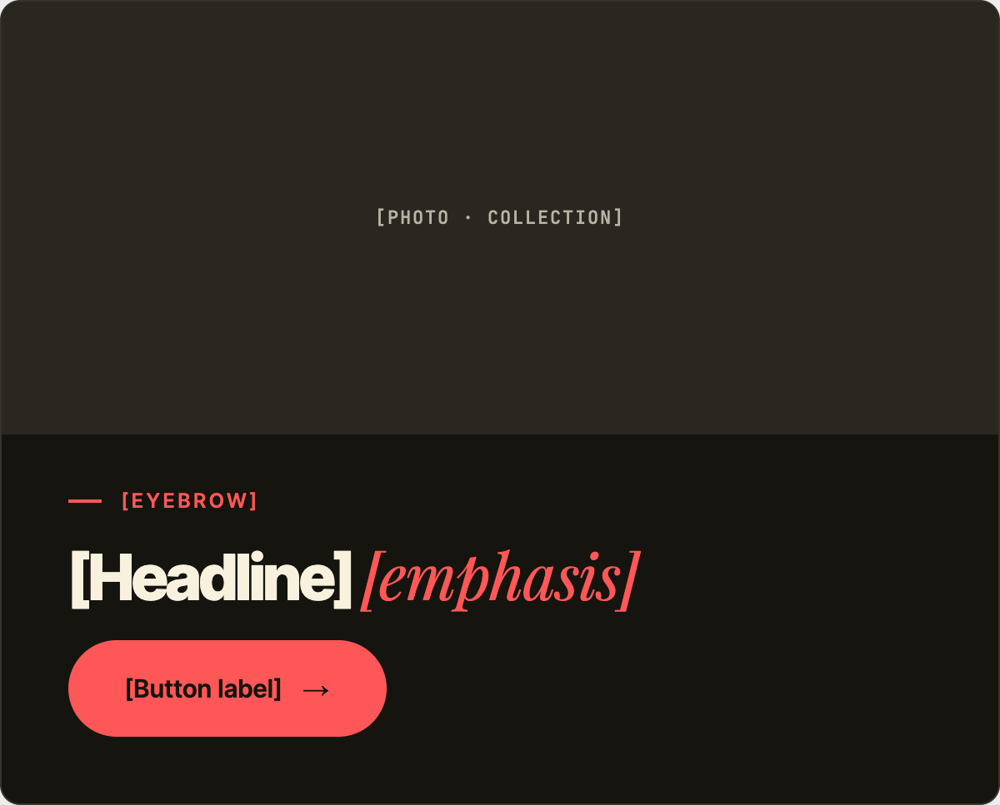

<!-- Generated by .claude/skills/shopify-email-html/scripts/build_library.py — edit section.json / template.json instead. -->

# Hero · Collection banner · Ink

| | |
|---|---|
| Type | Hero |
| Context | any |
| Surfaces | Messaging · Code your own, Messaging section |
| Liquid variables | — |
| Shopify status | unused |
| Placeholders | yes — do not ship as is |
| Characters | 2531 |
| Used by | — |

> Module bank. All copy is a labelled slot: replace it before use.

## Module bank

- Category: 02 · Heroes
- Module: Hero · Collection banner · theme **ink**
- Figma source: [Hero · Collection banner dark](https://www.figma.com/design/9Il504CQE8jLaUTBVzphqc/Email-Design-System?node-id=480-12092)

**Changed from the Figma module to meet the v6 rules**

- Full-bleed image top, left-aligned eyebrow, short headline with serif emphasis and one button below
- Named for the layout, not the colour: Bone, Ink and White all exist

**Figma sample copy (reference only, not in the section)**: The collection · Men's hair systems. · Design your system

## Preview



## HTML

Source: [`section.html`](section.html). Copy from here or from the raw file.

```html
<table role="presentation" width="100%" cellpadding="0" cellspacing="0" border="0" style="background-color:transparent;"><tr><td align="center" style="padding:0;">
<table role="presentation" class="shell" width="100%" cellpadding="0" cellspacing="0" border="0" style="width:100%;max-width:600px;">
<tr><td style="padding:0;">
<table role="presentation" width="100%" cellpadding="0" cellspacing="0" border="0" style="border-collapse:separate;background-color:#15140f;border:1px solid #35332c;border-radius:12px;overflow:hidden;">
<tr><td align="center" valign="middle" height="260" style="height:260px;padding:0 16px;background-color:#2a2620;font-size:11px;line-height:17px;"><p style="margin:0 0 0px 0;font-family:'JetBrains Mono','Courier New',monospace;font-size:11px;line-height:17px;font-weight:500;letter-spacing:0.9px;color:#b8b3a4;text-align:center;text-transform:uppercase;">[Photo · collection]</p></td></tr><tr><td class="pad" style="padding:32px 40px 40px 40px;"><table role="presentation" cellpadding="0" cellspacing="0" border="0" style="margin:0 0 16px 0;">
<tr><td width="20" style="width:20px;vertical-align:middle;"><div style="height:2px;line-height:2px;font-size:0;background-color:#ff5757;">&nbsp;</div></td>
<td style="padding-left:12px;font-family:'Inter Tight',Arial,Helvetica,sans-serif;font-size:12px;line-height:16px;font-weight:600;letter-spacing:2px;text-transform:uppercase;color:#ff5757;white-space:nowrap;">[Eyebrow]</td></tr>
</table><h1 class="hero-h" style="margin:0 0 18px 0;font-family:'Inter Tight',Arial,Helvetica,sans-serif;font-size:38px;line-height:40px;font-weight:800;letter-spacing:-1.4px;color:#f7f1de;text-align:left;">[Headline] <span style="font-family:'Playfair Display',Georgia,'Times New Roman',serif;font-style:italic;font-weight:400;color:#ff5757;letter-spacing:-0.5px;">[emphasis]</span></h1><table role="presentation" class="btn" cellpadding="0" cellspacing="0" border="0" style="border-collapse:separate;margin:0;">
<tr><td style="border-radius:999px;background-color:#ff5757;">
<a href="https://hairsolutions.co" target="_blank" style="display:inline-block;padding:0 34px;line-height:58px;font-family:'Inter Tight',Arial,Helvetica,sans-serif;font-size:15px;font-weight:600;letter-spacing:0.3px;color:#15140f;text-decoration:none;border-radius:999px;white-space:nowrap;">[Button label]<span style="padding-left:12px;font-family:'Inter',Arial,Helvetica,sans-serif;font-size:16px;">&rarr;</span></a>
</td></tr></table></td></tr>
</table>
</td></tr>
</table>
</td></tr></table>
```
