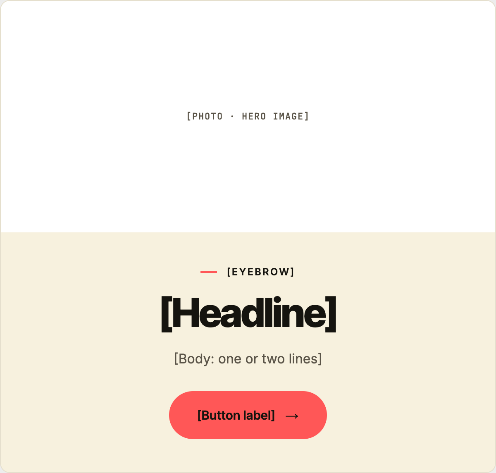

<!-- Generated by .claude/skills/shopify-email-html/scripts/build_library.py — edit section.json / template.json instead. -->

# Hero · Image with text below · Bone

| | |
|---|---|
| Type | Hero |
| Context | any |
| Surfaces | Messaging · Code your own, Messaging section |
| Liquid variables | — |
| Shopify status | unused |
| Placeholders | yes — do not ship as is |
| Characters | 2578 |
| Used by | — |

> Module bank. All copy is a labelled slot: replace it before use.

## Module bank

- Category: 02 · Heroes
- Module: Hero · Image with text below · theme **bone**
- Figma source: [Hero · Image background with overlaid](https://www.figma.com/design/9Il504CQE8jLaUTBVzphqc/Email-Design-System?node-id=480-11421)

**Changed from the Figma module to meet the v6 rules**

- Text no longer sits on the photo (v6: never put text on a photo): the image is a full-bleed top, the copy sits on the card surface below
- Headline in sentence case, 48/50 Inter Tight 800
- Button is the v6 primary pill (coral, ink label, arrow)

**Figma sample copy (reference only, not in the section)**: Atelier invitation · Bespoke Hair Systems · Hand-crafted, custom matched, and completely natural. Book your signature consultation today. · Schedule Appointment

## Preview



## HTML

Source: [`section.html`](section.html). Copy from here or from the raw file.

```html
<table role="presentation" width="100%" cellpadding="0" cellspacing="0" border="0" style="background-color:transparent;"><tr><td align="center" style="padding:0;">
<table role="presentation" class="shell" width="100%" cellpadding="0" cellspacing="0" border="0" style="width:100%;max-width:600px;">
<tr><td style="padding:0;">
<table role="presentation" width="100%" cellpadding="0" cellspacing="0" border="0" style="border-collapse:separate;background-color:#f7f1de;border:1px solid #e5dfcd;border-radius:12px;overflow:hidden;">
<tr><td align="center" valign="middle" height="280" style="height:280px;padding:0 16px;background-color:#ffffff;font-size:11px;line-height:17px;"><p style="margin:0 0 0px 0;font-family:'JetBrains Mono','Courier New',monospace;font-size:11px;line-height:17px;font-weight:500;letter-spacing:0.9px;color:#5a5448;text-align:center;text-transform:uppercase;">[Photo · hero image]</p></td></tr><tr><td class="pad" style="padding:40px;"><table role="presentation" align="center" cellpadding="0" cellspacing="0" border="0" style="margin:0 auto 16px auto;">
<tr><td width="20" style="width:20px;vertical-align:middle;"><div style="height:2px;line-height:2px;font-size:0;background-color:#ff5757;">&nbsp;</div></td>
<td style="padding-left:12px;font-family:'Inter Tight',Arial,Helvetica,sans-serif;font-size:12px;line-height:16px;font-weight:600;letter-spacing:2px;text-transform:uppercase;color:#15140f;white-space:nowrap;">[Eyebrow]</td></tr>
</table><h1 class="hero-h" style="margin:0 0 18px 0;font-family:'Inter Tight',Arial,Helvetica,sans-serif;font-size:48px;line-height:50px;font-weight:800;letter-spacing:-1.8px;color:#15140f;text-align:center;">[Headline]</h1><p style="margin:0 0 26px 0;font-family:'Inter',Arial,Helvetica,sans-serif;font-size:16px;line-height:26px;font-weight:400;color:#5a5448;text-align:center;">[Body: one or two lines]</p><table role="presentation" align="center" class="btn" cellpadding="0" cellspacing="0" border="0" style="border-collapse:separate;margin:0 auto;">
<tr><td style="border-radius:999px;background-color:#ff5757;">
<a href="https://hairsolutions.co" target="_blank" style="display:inline-block;padding:0 34px;line-height:58px;font-family:'Inter Tight',Arial,Helvetica,sans-serif;font-size:15px;font-weight:600;letter-spacing:0.3px;color:#15140f;text-decoration:none;border-radius:999px;white-space:nowrap;">[Button label]<span style="padding-left:12px;font-family:'Inter',Arial,Helvetica,sans-serif;font-size:16px;">&rarr;</span></a>
</td></tr></table></td></tr>
</table>
</td></tr>
</table>
</td></tr></table>
```
