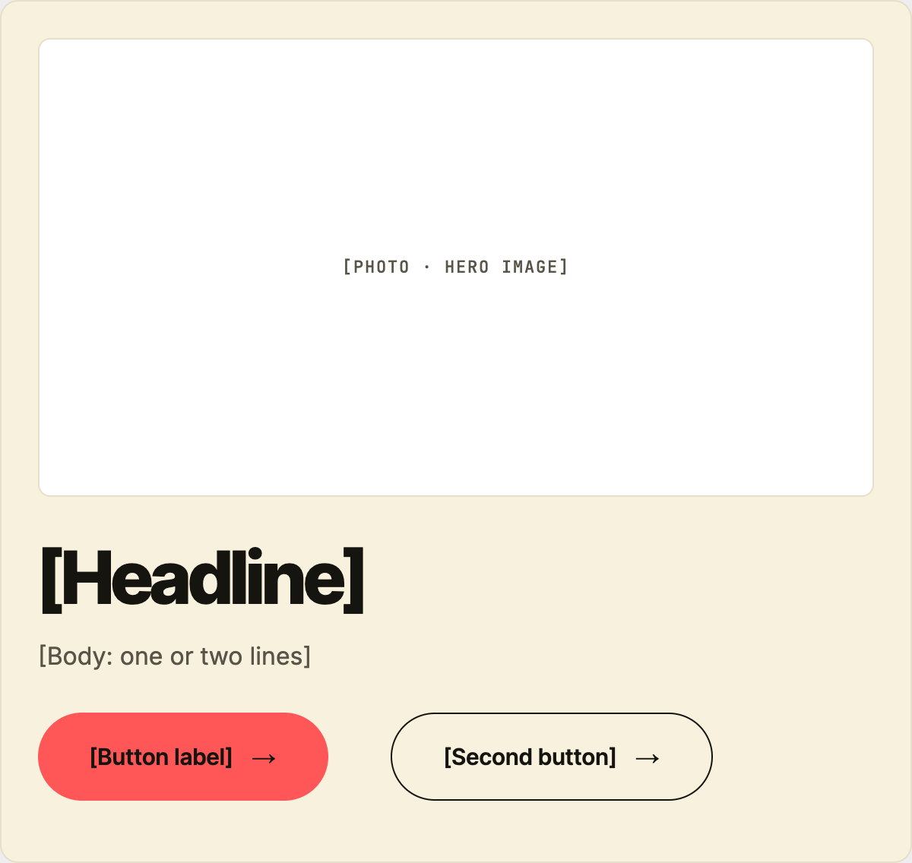

<!-- Generated by .claude/skills/shopify-email-html/scripts/build_library.py — edit section.json / template.json instead. -->

# Hero · Inset image with two buttons · Bone

| | |
|---|---|
| Type | Hero |
| Context | any |
| Surfaces | Messaging · Code your own, Messaging section |
| Liquid variables | — |
| Shopify status | unused |
| Placeholders | yes — do not ship as is |
| Characters | 3229 |
| Used by | — |

> Module bank. All copy is a labelled slot: replace it before use.

## Module bank

- Category: 02 · Heroes
- Module: Hero · Inset image with two buttons · theme **bone**
- Figma source: [Hero · Stacked asymmetric image](https://www.figma.com/design/9Il504CQE8jLaUTBVzphqc/Email-Design-System?node-id=480-11609)

**Changed from the Figma module to meet the v6 rules**

- Image is an inset inside the card (8px corners), copy and buttons below it
- Two buttons: the v6 primary pill and an outline pill (never two coral buttons)

**Figma sample copy (reference only, not in the section)**: The botanical maintenance routine · Protect and prolong the vitality of your base and natural hair. · Shop elixirs · Read care guides

## Preview



## HTML

Source: [`section.html`](section.html). Copy from here or from the raw file.

```html
<table role="presentation" width="100%" cellpadding="0" cellspacing="0" border="0" style="background-color:transparent;"><tr><td align="center" style="padding:0;">
<table role="presentation" class="shell" width="100%" cellpadding="0" cellspacing="0" border="0" style="width:100%;max-width:600px;">
<tr><td style="padding:0;">
<table role="presentation" width="100%" cellpadding="0" cellspacing="0" border="0" style="border-collapse:separate;background-color:#f7f1de;border:1px solid #e5dfcd;border-radius:12px;">
<tr><td class="pad-sm" style="padding:24px 24px 40px 24px;"><table role="presentation" width="100%" cellpadding="0" cellspacing="0" border="0" style="border-collapse:separate;background-color:#ffffff;border:1px solid #e5dfcd;border-radius:8px;"><tr><td align="center" valign="middle" height="300" style="height:300px;padding:0 16px;"><p style="margin:0 0 0px 0;font-family:'JetBrains Mono','Courier New',monospace;font-size:11px;line-height:17px;font-weight:500;letter-spacing:0.9px;color:#5a5448;text-align:center;text-transform:uppercase;">[Photo · hero image]</p></td></tr></table><div style="height:28px;line-height:28px;font-size:0;">&nbsp;</div><h1 class="hero-h" style="margin:0 0 14px 0;font-family:'Inter Tight',Arial,Helvetica,sans-serif;font-size:48px;line-height:50px;font-weight:800;letter-spacing:-1.8px;color:#15140f;text-align:left;">[Headline]</h1><p style="margin:0 0 24px 0;font-family:'Inter',Arial,Helvetica,sans-serif;font-size:16px;line-height:26px;font-weight:400;color:#5a5448;text-align:left;">[Body: one or two lines]</p><table role="presentation" width="100%" cellpadding="0" cellspacing="0" border="0"><tr><td class="stack" width="40%" valign="middle" style="width:40%;padding:0 0 0 0px;vertical-align:middle;"><table role="presentation" class="btn" cellpadding="0" cellspacing="0" border="0" style="border-collapse:separate;margin:0;">
<tr><td style="border-radius:999px;background-color:#ff5757;">
<a href="https://hairsolutions.co" target="_blank" style="display:inline-block;padding:0 34px;line-height:58px;font-family:'Inter Tight',Arial,Helvetica,sans-serif;font-size:15px;font-weight:600;letter-spacing:0.3px;color:#15140f;text-decoration:none;border-radius:999px;white-space:nowrap;">[Button label]<span style="padding-left:12px;font-family:'Inter',Arial,Helvetica,sans-serif;font-size:16px;">&rarr;</span></a>
</td></tr></table></td><td class="stack stack-gap" width="60%" valign="middle" style="width:60%;padding:0 0 0 12px;vertical-align:middle;"><table role="presentation" class="btn" cellpadding="0" cellspacing="0" border="0" style="border-collapse:separate;margin:0;">
<tr><td style="border-radius:999px;background-color:#f7f1de;">
<a href="https://hairsolutions.co" target="_blank" style="display:inline-block;border:1px solid #15140f;padding:0 34px;line-height:56px;font-family:'Inter Tight',Arial,Helvetica,sans-serif;font-size:15px;font-weight:600;letter-spacing:0.3px;color:#15140f;text-decoration:none;border-radius:999px;white-space:nowrap;">[Second button]<span style="padding-left:12px;font-family:'Inter',Arial,Helvetica,sans-serif;font-size:16px;">&rarr;</span></a>
</td></tr></table></td></tr></table></td></tr>
</table>
</td></tr>
</table>
</td></tr></table>
```
