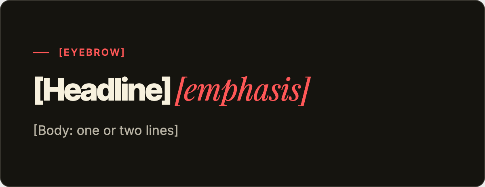

<!-- Generated by .claude/skills/shopify-email-html/scripts/build_library.py — edit section.json / template.json instead. -->

# Hero · Text only, left-aligned · Ink

| | |
|---|---|
| Type | Hero |
| Context | any |
| Surfaces | Messaging · Code your own, Messaging section |
| Liquid variables | — |
| Shopify status | unused |
| Placeholders | yes — do not ship as is |
| Characters | 1673 |
| Used by | — |

> Module bank. All copy is a labelled slot: replace it before use.

## Module bank

- Category: 02 · Heroes
- Module: Hero · Text only, left-aligned · theme **ink**
- Figma source: [Hero · Text only contact](https://www.figma.com/design/9Il504CQE8jLaUTBVzphqc/Email-Design-System?node-id=480-12164)

**Changed from the Figma module to meet the v6 rules**

- Left-aligned eyebrow, headline with serif emphasis and body; no button or image

**Figma sample copy (reference only, not in the section)**: Contact · Talk to someone who builds these. · Tell us what you are working with and what you want it to do.

## Preview



## HTML

Source: [`section.html`](section.html). Copy from here or from the raw file.

```html
<table role="presentation" width="100%" cellpadding="0" cellspacing="0" border="0" style="background-color:transparent;"><tr><td align="center" style="padding:0;">
<table role="presentation" class="shell" width="100%" cellpadding="0" cellspacing="0" border="0" style="width:100%;max-width:600px;">
<tr><td style="padding:0;">
<table role="presentation" width="100%" cellpadding="0" cellspacing="0" border="0" style="border-collapse:separate;background-color:#15140f;border:1px solid #35332c;border-radius:12px;">
<tr><td class="pad" style="padding:56px 40px;"><table role="presentation" cellpadding="0" cellspacing="0" border="0" style="margin:0 0 16px 0;">
<tr><td width="20" style="width:20px;vertical-align:middle;"><div style="height:2px;line-height:2px;font-size:0;background-color:#ff5757;">&nbsp;</div></td>
<td style="padding-left:12px;font-family:'Inter Tight',Arial,Helvetica,sans-serif;font-size:12px;line-height:16px;font-weight:600;letter-spacing:2px;text-transform:uppercase;color:#ff5757;white-space:nowrap;">[Eyebrow]</td></tr>
</table><h1 class="hero-h" style="margin:0 0 18px 0;font-family:'Inter Tight',Arial,Helvetica,sans-serif;font-size:38px;line-height:40px;font-weight:800;letter-spacing:-1.4px;color:#f7f1de;text-align:left;">[Headline] <span style="font-family:'Playfair Display',Georgia,'Times New Roman',serif;font-style:italic;font-weight:400;color:#ff5757;letter-spacing:-0.5px;">[emphasis]</span></h1><p style="margin:0 0 0px 0;font-family:'Inter',Arial,Helvetica,sans-serif;font-size:16px;line-height:26px;font-weight:400;color:#b8b3a4;text-align:left;">[Body: one or two lines]</p></td></tr>
</table>
</td></tr>
</table>
</td></tr></table>
```
