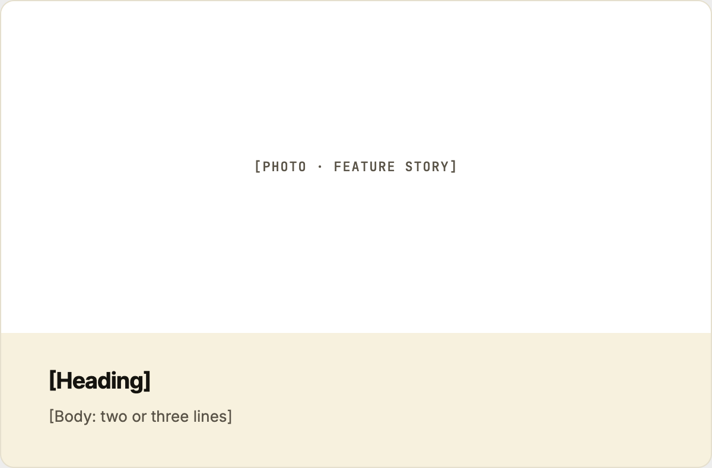

<!-- Generated by .claude/skills/shopify-email-html/scripts/build_library.py — edit section.json / template.json instead. -->

# Content · Feature story card · Bone

| | |
|---|---|
| Type | Content |
| Context | any |
| Surfaces | Messaging · Code your own, Messaging section |
| Liquid variables | — |
| Shopify status | unused |
| Placeholders | yes — do not ship as is |
| Characters | 1395 |
| Used by | — |

> Module bank. All copy is a labelled slot: replace it before use.

## Module bank

- Category: 03 · Titles & editorial
- Module: Content · Feature story card · theme **bone**
- Figma source: [FEATURE STORY CARD](https://www.figma.com/design/9Il504CQE8jLaUTBVzphqc/Email-Design-System?node-id=480-18272)

**Changed from the Figma module to meet the v6 rules**

- Full-bleed photo on top, caption block below (subtitle role and small body)

**Figma sample copy (reference only, not in the section)**: How it's made · Every system starts as a hand-drawn base pattern before ventilation begins.

## Preview



## HTML

Source: [`section.html`](section.html). Copy from here or from the raw file.

```html
<table role="presentation" width="100%" cellpadding="0" cellspacing="0" border="0" style="background-color:transparent;"><tr><td align="center" style="padding:0;">
<table role="presentation" class="shell" width="100%" cellpadding="0" cellspacing="0" border="0" style="width:100%;max-width:600px;">
<tr><td style="padding:0;">
<table role="presentation" width="100%" cellpadding="0" cellspacing="0" border="0" style="border-collapse:separate;background-color:#f7f1de;border:1px solid #e5dfcd;border-radius:12px;overflow:hidden;">
<tr><td align="center" valign="middle" height="280" style="height:280px;padding:0 16px;background-color:#ffffff;font-size:11px;line-height:17px;"><p style="margin:0 0 0px 0;font-family:'JetBrains Mono','Courier New',monospace;font-size:11px;line-height:17px;font-weight:500;letter-spacing:0.9px;color:#5a5448;text-align:center;text-transform:uppercase;">[Photo · feature story]</p></td></tr><tr><td class="pad" style="padding:28px 40px 32px 40px;"><h3 style="margin:0 0 8px 0;font-family:'Inter Tight',Arial,Helvetica,sans-serif;font-size:19px;line-height:24px;font-weight:700;color:#15140f;text-align:left;">[Heading]</h3><p style="margin:0 0 0px 0;font-family:'Inter',Arial,Helvetica,sans-serif;font-size:13px;line-height:21px;font-weight:400;color:#5a5448;text-align:left;">[Body: two or three lines]</p></td></tr>
</table>
</td></tr>
</table>
</td></tr></table>
```
