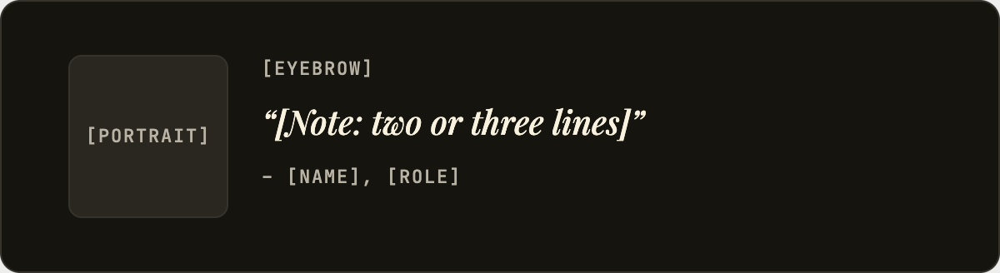

<!-- Generated by .claude/skills/shopify-email-html/scripts/build_library.py — edit section.json / template.json instead. -->

# Content · Founder note with portrait · Ink

| | |
|---|---|
| Type | Content |
| Context | any |
| Surfaces | Messaging · Code your own, Messaging section |
| Liquid variables | — |
| Shopify status | unused |
| Placeholders | yes — do not ship as is |
| Characters | 2003 |
| Used by | — |

> Module bank. All copy is a labelled slot: replace it before use.

## Module bank

- Category: 03 · Titles & editorial
- Module: Content · Founder note with portrait · theme **ink**
- Figma source: [WORKSHOP FOUNDER NOTE](https://www.figma.com/design/9Il504CQE8jLaUTBVzphqc/Email-Design-System?node-id=480-18249)

**Changed from the Figma module to meet the v6 rules**

- Portrait is a labelled 96px slot (consented portrait only; never a stock avatar); quote in the v6 note role
- Portrait and note stay side by side on mobile

**Figma sample copy (reference only, not in the section)**: A note from the workshop · We build every system the same way, whether it's your first or your fifth. · Vincent, Founder

## Preview



## HTML

Source: [`section.html`](section.html). Copy from here or from the raw file.

```html
<table role="presentation" width="100%" cellpadding="0" cellspacing="0" border="0" style="background-color:transparent;"><tr><td align="center" style="padding:0;">
<table role="presentation" class="shell" width="100%" cellpadding="0" cellspacing="0" border="0" style="width:100%;max-width:600px;">
<tr><td style="padding:0;">
<table role="presentation" width="100%" cellpadding="0" cellspacing="0" border="0" style="border-collapse:separate;background-color:#15140f;border:1px solid #35332c;border-radius:12px;">
<tr><td class="pad" style="padding:32px 40px;"><table role="presentation" width="100%" cellpadding="0" cellspacing="0" border="0"><tr><td valign="top" width="96" style="width:96px;padding-right:20px;"><table role="presentation" cellpadding="0" cellspacing="0" border="0" style="border-collapse:separate;background-color:#2a2620;border:1px solid #35332c;border-radius:8px;"><tr><td align="center" valign="middle" width="96" height="96" style="width:96px;height:96px;"><p style="margin:0 0 0px 0;font-family:'JetBrains Mono','Courier New',monospace;font-size:11px;line-height:17px;font-weight:500;letter-spacing:0.9px;color:#b8b3a4;text-align:center;text-transform:uppercase;">[Portrait]</p></td></tr></table></td><td valign="top"><p style="margin:0 0 8px 0;font-family:'JetBrains Mono','Courier New',monospace;font-size:11px;line-height:17px;font-weight:500;letter-spacing:0.9px;color:#b8b3a4;text-align:left;text-transform:uppercase;">[Eyebrow]</p><p style="margin:0 0 10px 0;font-family:'Playfair Display',Georgia,'Times New Roman',serif;font-size:20px;line-height:30px;font-weight:500;color:#f7f1de;text-align:left;font-style:italic;">&ldquo;[Note: two or three lines]&rdquo;</p><p style="margin:0 0 0px 0;font-family:'JetBrains Mono','Courier New',monospace;font-size:11px;line-height:17px;font-weight:500;letter-spacing:0.9px;color:#b8b3a4;text-align:left;text-transform:uppercase;">&ndash; [Name], [Role]</p></td></tr></table></td></tr>
</table>
</td></tr>
</table>
</td></tr></table>
```
