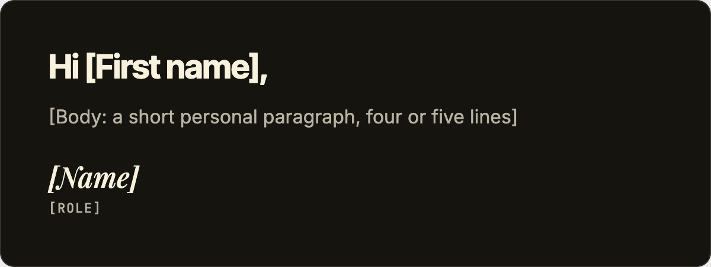

<!-- Generated by .claude/skills/shopify-email-html/scripts/build_library.py — edit section.json / template.json instead. -->

# Content · Founder note with signature · Ink

| | |
|---|---|
| Type | Content |
| Context | any |
| Surfaces | Messaging · Code your own, Messaging section |
| Liquid variables | — |
| Shopify status | unused |
| Placeholders | yes — do not ship as is |
| Characters | 1446 |
| Used by | — |

> Module bank. All copy is a labelled slot: replace it before use.

## Module bank

- Category: 03 · Titles & editorial
- Module: Content · Founder note with signature · theme **ink**
- Figma source: [Founder note](https://www.figma.com/design/9Il504CQE8jLaUTBVzphqc/Email-Design-System?node-id=480-19589)

**Changed from the Figma module to meet the v6 rules**

- Greeting in the v6 title role, body in the v6 body role, signature as a serif-italic name (v6 note role) over a meta role line; never a handwritten-signature image
- The first name is a slot: wire it to the customer first-name variable in the template

**Figma sample copy (reference only, not in the section)**: Hi {{ firstname }}, · Six weeks is the point where a system starts telling you how it likes to be treated. · Vincent · Founder, Hair Solutions Co.

## Preview



## HTML

Source: [`section.html`](section.html). Copy from here or from the raw file.

```html
<table role="presentation" width="100%" cellpadding="0" cellspacing="0" border="0" style="background-color:transparent;"><tr><td align="center" style="padding:0;">
<table role="presentation" class="shell" width="100%" cellpadding="0" cellspacing="0" border="0" style="width:100%;max-width:600px;">
<tr><td style="padding:0;">
<table role="presentation" width="100%" cellpadding="0" cellspacing="0" border="0" style="border-collapse:separate;background-color:#15140f;border:1px solid #35332c;border-radius:12px;">
<tr><td class="pad" style="padding:40px;"><h2 style="margin:0 0 14px 0;font-family:'Inter Tight',Arial,Helvetica,sans-serif;font-size:28px;line-height:31px;font-weight:700;letter-spacing:-0.6px;color:#f7f1de;text-align:left;">Hi [First name],</h2><p style="margin:0 0 22px 0;font-family:'Inter',Arial,Helvetica,sans-serif;font-size:16px;line-height:26px;font-weight:400;color:#b8b3a4;text-align:left;">[Body: a short personal paragraph, four or five lines]</p><p style="margin:0 0 4px 0;font-family:'Playfair Display',Georgia,'Times New Roman',serif;font-size:24px;line-height:30px;font-weight:500;color:#f7f1de;text-align:left;font-style:italic;">[Name]</p><p style="margin:0 0 0px 0;font-family:'JetBrains Mono','Courier New',monospace;font-size:11px;line-height:17px;font-weight:500;letter-spacing:0.9px;color:#b8b3a4;text-align:left;text-transform:uppercase;">[Role]</p></td></tr>
</table>
</td></tr>
</table>
</td></tr></table>
```
