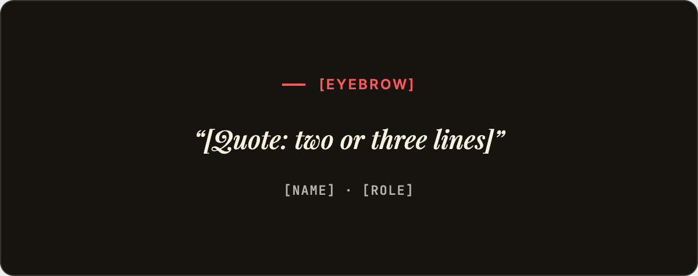

<!-- Generated by .claude/skills/shopify-email-html/scripts/build_library.py — edit section.json / template.json instead. -->

# Content · Founder quote · Ink

| | |
|---|---|
| Type | Content |
| Context | any |
| Surfaces | Messaging · Code your own, Messaging section |
| Liquid variables | — |
| Shopify status | unused |
| Placeholders | yes — do not ship as is |
| Characters | 1602 |
| Used by | — |

> Module bank. All copy is a labelled slot: replace it before use.

## Module bank

- Category: 03 · Titles & editorial
- Module: Content · Founder quote · theme **ink**
- Figma source: [Content · Founder quote block](https://www.figma.com/design/9Il504CQE8jLaUTBVzphqc/Email-Design-System?node-id=480-12619)

**Changed from the Figma module to meet the v6 rules**

- Quote in the v6 note role (serif italic 22/33), centred, with an eyebrow and a meta attribution line

**Figma sample copy (reference only, not in the section)**: From the founder · The best compliment we get is silence. · Vincent · Founder

## Preview



## HTML

Source: [`section.html`](section.html). Copy from here or from the raw file.

```html
<table role="presentation" width="100%" cellpadding="0" cellspacing="0" border="0" style="background-color:transparent;"><tr><td align="center" style="padding:0;">
<table role="presentation" class="shell" width="100%" cellpadding="0" cellspacing="0" border="0" style="width:100%;max-width:600px;">
<tr><td style="padding:0;">
<table role="presentation" width="100%" cellpadding="0" cellspacing="0" border="0" style="border-collapse:separate;background-color:#15140f;border:1px solid #35332c;border-radius:12px;">
<tr><td class="pad" style="padding:64px 40px;"><table role="presentation" align="center" cellpadding="0" cellspacing="0" border="0" style="margin:0 auto 22px auto;">
<tr><td width="20" style="width:20px;vertical-align:middle;"><div style="height:2px;line-height:2px;font-size:0;background-color:#ff5757;">&nbsp;</div></td>
<td style="padding-left:12px;font-family:'Inter Tight',Arial,Helvetica,sans-serif;font-size:12px;line-height:16px;font-weight:600;letter-spacing:2px;text-transform:uppercase;color:#ff5757;white-space:nowrap;">[Eyebrow]</td></tr>
</table><p style="margin:0 0 20px 0;font-family:'Playfair Display',Georgia,'Times New Roman',serif;font-size:22px;line-height:33px;font-weight:500;color:#f7f1de;text-align:center;font-style:italic;">&ldquo;[Quote: two or three lines]&rdquo;</p><p style="margin:0 0 0px 0;font-family:'JetBrains Mono','Courier New',monospace;font-size:11px;line-height:17px;font-weight:500;letter-spacing:0.9px;color:#b8b3a4;text-align:center;text-transform:uppercase;">[Name] &middot; [Role]</p></td></tr>
</table>
</td></tr>
</table>
</td></tr></table>
```
