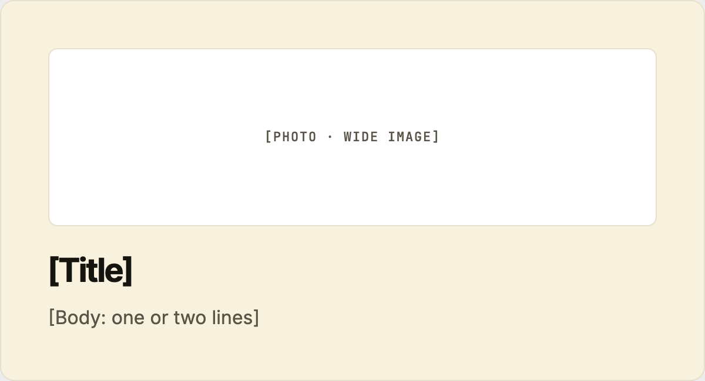

<!-- Generated by .claude/skills/shopify-email-html/scripts/build_library.py — edit section.json / template.json instead. -->

# Content · Image, heading and copy · Bone

| | |
|---|---|
| Type | Content |
| Context | any |
| Surfaces | Messaging · Code your own, Messaging section |
| Liquid variables | — |
| Shopify status | unused |
| Placeholders | yes — do not ship as is |
| Characters | 1583 |
| Used by | — |

> Module bank. All copy is a labelled slot: replace it before use.

## Module bank

- Category: 03 · Titles & editorial
- Module: Content · Image, heading and copy · theme **bone**
- Figma source: [Image and copy](https://www.figma.com/design/9Il504CQE8jLaUTBVzphqc/Email-Design-System?node-id=480-20080)

**Changed from the Figma module to meet the v6 rules**

- Inset image strip (8px corners) above a title and body in the v6 roles; slots instead of the Figma 'add a heading here' prompts

**Figma sample copy (reference only, not in the section)**: Add a heading here · Add supporting copy here.

## Preview



## HTML

Source: [`section.html`](section.html). Copy from here or from the raw file.

```html
<table role="presentation" width="100%" cellpadding="0" cellspacing="0" border="0" style="background-color:transparent;"><tr><td align="center" style="padding:0;">
<table role="presentation" class="shell" width="100%" cellpadding="0" cellspacing="0" border="0" style="width:100%;max-width:600px;">
<tr><td style="padding:0;">
<table role="presentation" width="100%" cellpadding="0" cellspacing="0" border="0" style="border-collapse:separate;background-color:#f7f1de;border:1px solid #e5dfcd;border-radius:12px;">
<tr><td class="pad" style="padding:40px;"><table role="presentation" width="100%" cellpadding="0" cellspacing="0" border="0" style="border-collapse:separate;background-color:#ffffff;border:1px solid #e5dfcd;border-radius:8px;"><tr><td align="center" valign="middle" height="150" style="height:150px;padding:0 16px;"><p style="margin:0 0 0px 0;font-family:'JetBrains Mono','Courier New',monospace;font-size:11px;line-height:17px;font-weight:500;letter-spacing:0.9px;color:#5a5448;text-align:center;text-transform:uppercase;">[Photo · wide image]</p></td></tr></table><div style="height:22px;line-height:22px;font-size:0;">&nbsp;</div><h2 style="margin:0 0 12px 0;font-family:'Inter Tight',Arial,Helvetica,sans-serif;font-size:28px;line-height:31px;font-weight:700;letter-spacing:-0.6px;color:#15140f;text-align:left;">[Title]</h2><p style="margin:0 0 0px 0;font-family:'Inter',Arial,Helvetica,sans-serif;font-size:16px;line-height:26px;font-weight:400;color:#5a5448;text-align:left;">[Body: one or two lines]</p></td></tr>
</table>
</td></tr>
</table>
</td></tr></table>
```
