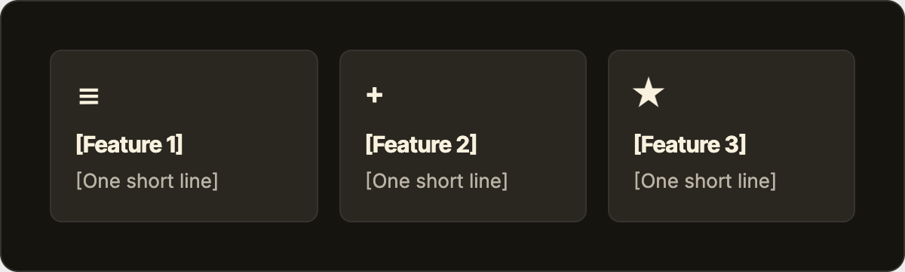

<!-- Generated by .claude/skills/shopify-email-html/scripts/build_library.py — edit section.json / template.json instead. -->

# Content · Three-column feature grid · Ink

| | |
|---|---|
| Type | Content |
| Context | any |
| Surfaces | Messaging · Code your own, Messaging section |
| Liquid variables | — |
| Shopify status | unused |
| Placeholders | yes — do not ship as is |
| Characters | 3226 |
| Used by | — |

> Module bank. All copy is a labelled slot: replace it before use.

## Module bank

- Category: 03 · Titles & editorial
- Module: Content · Three-column feature grid · theme **ink**
- Figma source: [Content · Three-column feature grid](https://www.figma.com/design/9Il504CQE8jLaUTBVzphqc/Email-Design-System?node-id=480-12550)

**Changed from the Figma module to meet the v6 rules**

- Three inset cards (8px corners) with a glyph, a name-role heading and small body; they stack on mobile (three narrow columns do not fit a phone)
- Glyphs are plain characters (no icon images)

**Figma sample copy (reference only, not in the section)**: Breathable: Allows full heat dissipation. · Hand-knotted: Artisan single ventilation. · Seamless: Disappears against the scalp.

## Preview



## HTML

Source: [`section.html`](section.html). Copy from here or from the raw file.

```html
<table role="presentation" width="100%" cellpadding="0" cellspacing="0" border="0" style="background-color:transparent;"><tr><td align="center" style="padding:0;">
<table role="presentation" class="shell" width="100%" cellpadding="0" cellspacing="0" border="0" style="width:100%;max-width:600px;">
<tr><td style="padding:0;">
<table role="presentation" width="100%" cellpadding="0" cellspacing="0" border="0" style="border-collapse:separate;background-color:#15140f;border:1px solid #35332c;border-radius:12px;">
<tr><td class="pad" style="padding:32px;"><table role="presentation" width="100%" cellpadding="0" cellspacing="0" border="0"><tr><td class="stack" width="33.33%" valign="top" style="width:33.33%;padding:0 0 0 0px;vertical-align:top;"><table role="presentation" width="100%" cellpadding="0" cellspacing="0" border="0" style="border-collapse:separate;background-color:#2a2620;border:1px solid #35332c;border-radius:8px;"><tr><td style="padding:16px;"><p style="margin:0 0 12px 0;font-family:'Inter Tight',Arial,Helvetica,sans-serif;font-size:20px;line-height:24px;color:#f7f1de;">&#9776;</p><p style="margin:0 0 4px 0;font-family:'Inter Tight',Arial,Helvetica,sans-serif;font-size:15px;line-height:20px;font-weight:700;color:#f7f1de;text-align:left;">[Feature 1]</p><p style="margin:0 0 0px 0;font-family:'Inter',Arial,Helvetica,sans-serif;font-size:13px;line-height:21px;font-weight:400;color:#b8b3a4;text-align:left;">[One short line]</p></td></tr></table></td><td class="stack stack-gap" width="33.33%" valign="top" style="width:33.33%;padding:0 0 0 14px;vertical-align:top;"><table role="presentation" width="100%" cellpadding="0" cellspacing="0" border="0" style="border-collapse:separate;background-color:#2a2620;border:1px solid #35332c;border-radius:8px;"><tr><td style="padding:16px;"><p style="margin:0 0 12px 0;font-family:'Inter Tight',Arial,Helvetica,sans-serif;font-size:20px;line-height:24px;color:#f7f1de;">+</p><p style="margin:0 0 4px 0;font-family:'Inter Tight',Arial,Helvetica,sans-serif;font-size:15px;line-height:20px;font-weight:700;color:#f7f1de;text-align:left;">[Feature 2]</p><p style="margin:0 0 0px 0;font-family:'Inter',Arial,Helvetica,sans-serif;font-size:13px;line-height:21px;font-weight:400;color:#b8b3a4;text-align:left;">[One short line]</p></td></tr></table></td><td class="stack stack-gap" width="33.33%" valign="top" style="width:33.33%;padding:0 0 0 14px;vertical-align:top;"><table role="presentation" width="100%" cellpadding="0" cellspacing="0" border="0" style="border-collapse:separate;background-color:#2a2620;border:1px solid #35332c;border-radius:8px;"><tr><td style="padding:16px;"><p style="margin:0 0 12px 0;font-family:'Inter Tight',Arial,Helvetica,sans-serif;font-size:20px;line-height:24px;color:#f7f1de;">&#9733;</p><p style="margin:0 0 4px 0;font-family:'Inter Tight',Arial,Helvetica,sans-serif;font-size:15px;line-height:20px;font-weight:700;color:#f7f1de;text-align:left;">[Feature 3]</p><p style="margin:0 0 0px 0;font-family:'Inter',Arial,Helvetica,sans-serif;font-size:13px;line-height:21px;font-weight:400;color:#b8b3a4;text-align:left;">[One short line]</p></td></tr></table></td></tr></table></td></tr>
</table>
</td></tr>
</table>
</td></tr></table>
```
