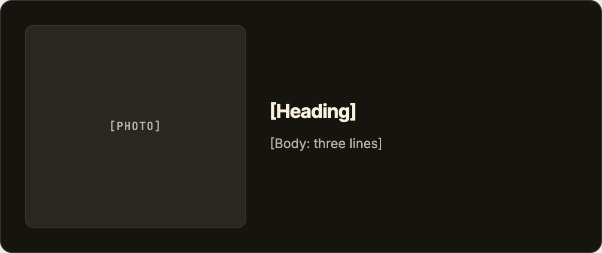

<!-- Generated by .claude/skills/shopify-email-html/scripts/build_library.py — edit section.json / template.json instead. -->

# Content · Two-column image and text · Ink

| | |
|---|---|
| Type | Content |
| Context | any |
| Surfaces | Messaging · Code your own, Messaging section |
| Liquid variables | — |
| Shopify status | unused |
| Placeholders | yes — do not ship as is |
| Characters | 1812 |
| Used by | — |

> Module bank. All copy is a labelled slot: replace it before use.

## Module bank

- Category: 03 · Titles & editorial
- Module: Content · Two-column image and text · theme **ink**
- Figma source: [Content · Two-column image + text](https://www.figma.com/design/9Il504CQE8jLaUTBVzphqc/Email-Design-System?node-id=480-12497)

**Changed from the Figma module to meet the v6 rules**

- Square image left, heading and small body right; stacks on mobile; body in the v6 small role

**Figma sample copy (reference only, not in the section)**: Bespoke fitting · We design your template based on your head shape.

## Preview



## HTML

Source: [`section.html`](section.html). Copy from here or from the raw file.

```html
<table role="presentation" width="100%" cellpadding="0" cellspacing="0" border="0" style="background-color:transparent;"><tr><td align="center" style="padding:0;">
<table role="presentation" class="shell" width="100%" cellpadding="0" cellspacing="0" border="0" style="width:100%;max-width:600px;">
<tr><td style="padding:0;">
<table role="presentation" width="100%" cellpadding="0" cellspacing="0" border="0" style="border-collapse:separate;background-color:#15140f;border:1px solid #35332c;border-radius:12px;">
<tr><td class="pad-sm" style="padding:24px;"><table role="presentation" width="100%" cellpadding="0" cellspacing="0" border="0"><tr><td class="stack" width="40%" valign="middle" style="width:40%;padding:0 0 0 0px;vertical-align:middle;"><table role="presentation" width="100%" cellpadding="0" cellspacing="0" border="0" style="border-collapse:separate;background-color:#2a2620;border:1px solid #35332c;border-radius:8px;"><tr><td align="center" valign="middle" height="200" style="height:200px;padding:0 16px;"><p style="margin:0 0 0px 0;font-family:'JetBrains Mono','Courier New',monospace;font-size:11px;line-height:17px;font-weight:500;letter-spacing:0.9px;color:#b8b3a4;text-align:center;text-transform:uppercase;">[Photo]</p></td></tr></table></td><td class="stack stack-gap" width="60%" valign="middle" style="width:60%;padding:0 0 0 24px;vertical-align:middle;"><h3 style="margin:0 0 10px 0;font-family:'Inter Tight',Arial,Helvetica,sans-serif;font-size:19px;line-height:24px;font-weight:700;color:#f7f1de;text-align:left;">[Heading]</h3><p style="margin:0 0 0px 0;font-family:'Inter',Arial,Helvetica,sans-serif;font-size:13px;line-height:21px;font-weight:400;color:#b8b3a4;text-align:left;">[Body: three lines]</p></td></tr></table></td></tr>
</table>
</td></tr>
</table>
</td></tr></table>
```
