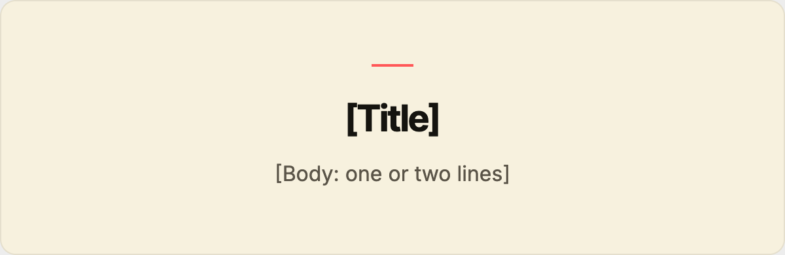

<!-- Generated by .claude/skills/shopify-email-html/scripts/build_library.py — edit section.json / template.json instead. -->

# Title · Centred with short rule · Bone

| | |
|---|---|
| Type | Title |
| Context | any |
| Surfaces | Messaging · Code your own, Messaging section |
| Liquid variables | — |
| Shopify status | unused |
| Placeholders | yes — do not ship as is |
| Characters | 1266 |
| Used by | — |

> Module bank. All copy is a labelled slot: replace it before use.

## Module bank

- Category: 03 · Titles & editorial
- Module: Title · Centred with short rule · theme **bone**
- Figma source: [Title · Coral accent line](https://www.figma.com/design/9Il504CQE8jLaUTBVzphqc/Email-Design-System?node-id=480-12419)

**Changed from the Figma module to meet the v6 rules**

- The 60x3 coral bar becomes the v6 edge rule (short, centred, 32px, 24px to the heading)
- Title in the v6 title role (Inter Tight 700, 28/31), body in the v6 body role

**Figma sample copy (reference only, not in the section)**: pH-Balanced Botanic Formulas · Sulfate-free citrus extracts engineered to cleanse custom Swiss lace bases safely.

## Preview



## HTML

Source: [`section.html`](section.html). Copy from here or from the raw file.

```html
<table role="presentation" width="100%" cellpadding="0" cellspacing="0" border="0" style="background-color:transparent;"><tr><td align="center" style="padding:0;">
<table role="presentation" class="shell" width="100%" cellpadding="0" cellspacing="0" border="0" style="width:100%;max-width:600px;">
<tr><td style="padding:0;">
<table role="presentation" width="100%" cellpadding="0" cellspacing="0" border="0" style="border-collapse:separate;background-color:#f7f1de;border:1px solid #e5dfcd;border-radius:12px;">
<tr><td class="pad" style="padding:48px 40px;"><table role="presentation" align="center" cellpadding="0" cellspacing="0" border="0" style="margin:0 auto 24px auto;"><tr><td width="32" style="width:32px;"><div style="height:2px;line-height:2px;font-size:0;background-color:#ff5757;">&nbsp;</div></td></tr></table><h2 style="margin:0 0 14px 0;font-family:'Inter Tight',Arial,Helvetica,sans-serif;font-size:28px;line-height:31px;font-weight:700;letter-spacing:-0.6px;color:#15140f;text-align:center;">[Title]</h2><p style="margin:0 0 0px 0;font-family:'Inter',Arial,Helvetica,sans-serif;font-size:16px;line-height:26px;font-weight:400;color:#5a5448;text-align:center;">[Body: one or two lines]</p></td></tr>
</table>
</td></tr>
</table>
</td></tr></table>
```
