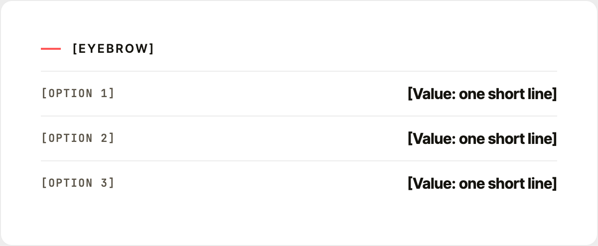

<!-- Generated by .claude/skills/shopify-email-html/scripts/build_library.py — edit section.json / template.json instead. -->

# Product · Base comparison · White

| | |
|---|---|
| Type | Product |
| Context | any |
| Surfaces | Messaging · Code your own, Messaging section |
| Liquid variables | — |
| Shopify status | unused |
| Placeholders | yes — do not ship as is |
| Characters | 2764 |
| Used by | — |

> Module bank. All copy is a labelled slot: replace it before use.

## Module bank

- Category: 04 · Products & commerce
- Module: Product · Base comparison · theme **white**
- Figma source: [Base comparison](https://www.figma.com/design/9Il504CQE8jLaUTBVzphqc/Email-Design-System?node-id=480-20039)

**Changed from the Figma module to meet the v6 rules**

- Three label/value rows between hairlines (same pattern as the recommended specification)
- Eyebrow in the v6 eyebrow role; the Figma 'paper' name dropped (the module now exists in three themes)

**Figma sample copy (reference only, not in the section)**: COMPARE · Lace: Most natural, shortest life · Poly: Most durable, easy to clean · Hybrid: Balanced — most people end up here

## Preview



## HTML

Source: [`section.html`](section.html). Copy from here or from the raw file.

```html
<table role="presentation" width="100%" cellpadding="0" cellspacing="0" border="0" style="background-color:transparent;"><tr><td align="center" style="padding:0;">
<table role="presentation" class="shell" width="100%" cellpadding="0" cellspacing="0" border="0" style="width:100%;max-width:600px;">
<tr><td style="padding:0;">
<table role="presentation" width="100%" cellpadding="0" cellspacing="0" border="0" style="border-collapse:separate;background-color:#ffffff;border:1px solid #ececec;border-radius:12px;">
<tr><td class="pad" style="padding:40px;"><table role="presentation" cellpadding="0" cellspacing="0" border="0" style="margin:0 0 14px 0;">
<tr><td width="20" style="width:20px;vertical-align:middle;"><div style="height:2px;line-height:2px;font-size:0;background-color:#ff5757;">&nbsp;</div></td>
<td style="padding-left:12px;font-family:'Inter Tight',Arial,Helvetica,sans-serif;font-size:12px;line-height:16px;font-weight:600;letter-spacing:2px;text-transform:uppercase;color:#15140f;white-space:nowrap;">[Eyebrow]</td></tr>
</table><table role="presentation" width="100%" cellpadding="0" cellspacing="0" border="0" style="border-collapse:collapse;"><tr><td style="border-top:1px solid #ececec;padding:12px 0;font-family:'JetBrains Mono','Courier New',monospace;font-size:11px;line-height:16px;letter-spacing:0.9px;text-transform:uppercase;color:#5a5448;vertical-align:middle;">[Option 1]</td><td align="right" style="border-top:1px solid #ececec;padding:12px 0 12px 16px;font-family:'Inter Tight',Arial,Helvetica,sans-serif;font-size:15px;line-height:20px;font-weight:700;color:#15140f;text-align:right;vertical-align:middle;">[Value: one short line]</td></tr><tr><td style="border-top:1px solid #ececec;padding:12px 0;font-family:'JetBrains Mono','Courier New',monospace;font-size:11px;line-height:16px;letter-spacing:0.9px;text-transform:uppercase;color:#5a5448;vertical-align:middle;">[Option 2]</td><td align="right" style="border-top:1px solid #ececec;padding:12px 0 12px 16px;font-family:'Inter Tight',Arial,Helvetica,sans-serif;font-size:15px;line-height:20px;font-weight:700;color:#15140f;text-align:right;vertical-align:middle;">[Value: one short line]</td></tr><tr><td style="border-top:1px solid #ececec;padding:12px 0;font-family:'JetBrains Mono','Courier New',monospace;font-size:11px;line-height:16px;letter-spacing:0.9px;text-transform:uppercase;color:#5a5448;vertical-align:middle;">[Option 3]</td><td align="right" style="border-top:1px solid #ececec;padding:12px 0 12px 16px;font-family:'Inter Tight',Arial,Helvetica,sans-serif;font-size:15px;line-height:20px;font-weight:700;color:#15140f;text-align:right;vertical-align:middle;">[Value: one short line]</td></tr></table></td></tr>
</table>
</td></tr>
</table>
</td></tr></table>
```
