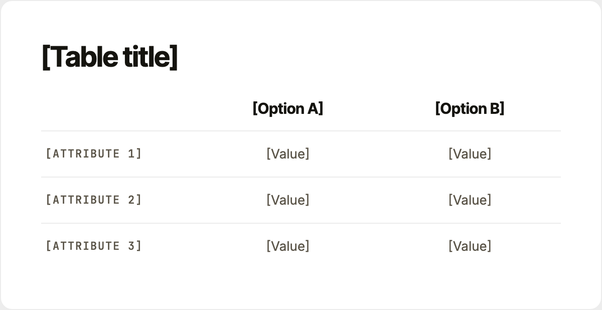

<!-- Generated by .claude/skills/shopify-email-html/scripts/build_library.py — edit section.json / template.json instead. -->

# Product · Comparison table · White

| | |
|---|---|
| Type | Product |
| Context | any |
| Surfaces | Messaging · Code your own, Messaging section |
| Liquid variables | — |
| Shopify status | unused |
| Placeholders | yes — do not ship as is |
| Characters | 4290 |
| Used by | — |

> Module bank. All copy is a labelled slot: replace it before use.

## Module bank

- Category: 04 · Products & commerce
- Module: Product · Comparison table · theme **white**
- Figma source: [LACE VS. POLY COMPARISON](https://www.figma.com/design/9Il504CQE8jLaUTBVzphqc/Email-Design-System?node-id=480-18433)

**Changed from the Figma module to meet the v6 rules**

- Three-column table (attribute plus two values) with hairline rows
- Attribute labels in the v6 mono meta role, column headers and values in the v6 name role (was 12px sans)
- Table title in the v6 title role
- Column headers are slots ([Option A], [Option B]), not a fixed lace/poly pair

**Figma sample copy (reference only, not in the section)**: Lace vs. Poly · Breathability: Excellent / Good · Durability: Moderate / Excellent · Best for: Active styling / Daily wear

## Preview



## HTML

Source: [`section.html`](section.html). Copy from here or from the raw file.

```html
<table role="presentation" width="100%" cellpadding="0" cellspacing="0" border="0" style="background-color:transparent;"><tr><td align="center" style="padding:0;">
<table role="presentation" class="shell" width="100%" cellpadding="0" cellspacing="0" border="0" style="width:100%;max-width:600px;">
<tr><td style="padding:0;">
<table role="presentation" width="100%" cellpadding="0" cellspacing="0" border="0" style="border-collapse:separate;background-color:#ffffff;border:1px solid #ececec;border-radius:12px;">
<tr><td class="pad-sm" style="padding:40px;"><h2 style="margin:0 0 14px 0;font-family:'Inter Tight',Arial,Helvetica,sans-serif;font-size:28px;line-height:31px;font-weight:700;letter-spacing:-0.6px;color:#15140f;text-align:left;">[Table title]</h2><table role="presentation" width="100%" cellpadding="0" cellspacing="0" border="0" style="border-collapse:collapse;"><tr><td align="center" valign="middle" style="width:30%;padding:12px 4px;text-align:center;"></td><td align="center" valign="middle" style="width:35%;padding:12px 4px;text-align:center;"><p style="margin:0 0 0px 0;font-family:'Inter Tight',Arial,Helvetica,sans-serif;font-size:15px;line-height:20px;font-weight:700;color:#15140f;text-align:center;">[Option A]</p></td><td align="center" valign="middle" style="width:35%;padding:12px 4px;text-align:center;"><p style="margin:0 0 0px 0;font-family:'Inter Tight',Arial,Helvetica,sans-serif;font-size:15px;line-height:20px;font-weight:700;color:#15140f;text-align:center;">[Option B]</p></td></tr><tr><td align="left" valign="middle" style="border-top:1px solid #ececec;padding:12px 4px;text-align:left;"><p style="margin:0 0 0px 0;font-family:'JetBrains Mono','Courier New',monospace;font-size:11px;line-height:17px;font-weight:500;letter-spacing:0.9px;color:#5a5448;text-align:left;text-transform:uppercase;">[Attribute 1]</p></td><td align="center" valign="middle" style="border-top:1px solid #ececec;padding:12px 4px;text-align:center;"><p style="margin:0 0 0px 0;font-family:'Inter',Arial,Helvetica,sans-serif;font-size:13px;line-height:21px;font-weight:400;color:#5a5448;text-align:center;">[Value]</p></td><td align="center" valign="middle" style="border-top:1px solid #ececec;padding:12px 4px;text-align:center;"><p style="margin:0 0 0px 0;font-family:'Inter',Arial,Helvetica,sans-serif;font-size:13px;line-height:21px;font-weight:400;color:#5a5448;text-align:center;">[Value]</p></td></tr><tr><td align="left" valign="middle" style="border-top:1px solid #ececec;padding:12px 4px;text-align:left;"><p style="margin:0 0 0px 0;font-family:'JetBrains Mono','Courier New',monospace;font-size:11px;line-height:17px;font-weight:500;letter-spacing:0.9px;color:#5a5448;text-align:left;text-transform:uppercase;">[Attribute 2]</p></td><td align="center" valign="middle" style="border-top:1px solid #ececec;padding:12px 4px;text-align:center;"><p style="margin:0 0 0px 0;font-family:'Inter',Arial,Helvetica,sans-serif;font-size:13px;line-height:21px;font-weight:400;color:#5a5448;text-align:center;">[Value]</p></td><td align="center" valign="middle" style="border-top:1px solid #ececec;padding:12px 4px;text-align:center;"><p style="margin:0 0 0px 0;font-family:'Inter',Arial,Helvetica,sans-serif;font-size:13px;line-height:21px;font-weight:400;color:#5a5448;text-align:center;">[Value]</p></td></tr><tr><td align="left" valign="middle" style="border-top:1px solid #ececec;padding:12px 4px;text-align:left;"><p style="margin:0 0 0px 0;font-family:'JetBrains Mono','Courier New',monospace;font-size:11px;line-height:17px;font-weight:500;letter-spacing:0.9px;color:#5a5448;text-align:left;text-transform:uppercase;">[Attribute 3]</p></td><td align="center" valign="middle" style="border-top:1px solid #ececec;padding:12px 4px;text-align:center;"><p style="margin:0 0 0px 0;font-family:'Inter',Arial,Helvetica,sans-serif;font-size:13px;line-height:21px;font-weight:400;color:#5a5448;text-align:center;">[Value]</p></td><td align="center" valign="middle" style="border-top:1px solid #ececec;padding:12px 4px;text-align:center;"><p style="margin:0 0 0px 0;font-family:'Inter',Arial,Helvetica,sans-serif;font-size:13px;line-height:21px;font-weight:400;color:#5a5448;text-align:center;">[Value]</p></td></tr></table></td></tr>
</table>
</td></tr>
</table>
</td></tr></table>
```
