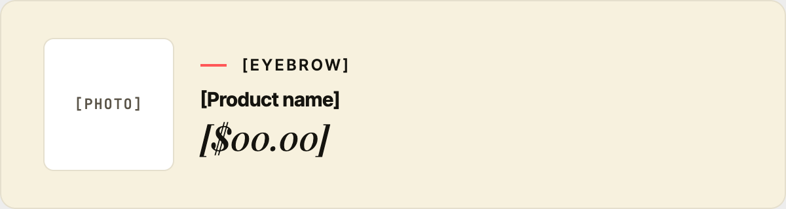

<!-- Generated by .claude/skills/shopify-email-html/scripts/build_library.py — edit section.json / template.json instead. -->

# Product · Recently viewed · Bone

| | |
|---|---|
| Type | Product |
| Context | any |
| Surfaces | Messaging · Code your own, Messaging section |
| Liquid variables | — |
| Shopify status | unused |
| Placeholders | yes — do not ship as is |
| Characters | 2242 |
| Used by | — |

> Module bank. All copy is a labelled slot: replace it before use.

## Module bank

- Category: 04 · Products & commerce
- Module: Product · Recently viewed · theme **bone**
- Figma source: [RECENTLY VIEWED PRODUCT](https://www.figma.com/design/9Il504CQE8jLaUTBVzphqc/Email-Design-System?node-id=480-18158)

**Changed from the Figma module to meet the v6 rules**

- Thumbnail left, text right; stays side by side on mobile
- Eyebrow in the v6 eyebrow role (coral dash, ink on light); title in the v6 name role; price in the serif-italic price role

**Figma sample copy (reference only, not in the section)**: YOU LOOKED AT THIS · System 01 - Lace, Base 06 · $329.00

## Preview



## HTML

Source: [`section.html`](section.html). Copy from here or from the raw file.

```html
<table role="presentation" width="100%" cellpadding="0" cellspacing="0" border="0" style="background-color:transparent;"><tr><td align="center" style="padding:0;">
<table role="presentation" class="shell" width="100%" cellpadding="0" cellspacing="0" border="0" style="width:100%;max-width:600px;">
<tr><td style="padding:0;">
<table role="presentation" width="100%" cellpadding="0" cellspacing="0" border="0" style="border-collapse:separate;background-color:#f7f1de;border:1px solid #e5dfcd;border-radius:12px;">
<tr><td class="pad-sm" style="padding:28px 32px;"><table role="presentation" width="100%" cellpadding="0" cellspacing="0" border="0"><tr><td width="100" valign="middle" style="width:100px;padding:0;"><table role="presentation" width="100%" cellpadding="0" cellspacing="0" border="0" style="border-collapse:separate;background-color:#ffffff;border:1px solid #e5dfcd;border-radius:8px;"><tr><td align="center" valign="middle" height="100" style="height:100px;padding:0 16px;"><p style="margin:0 0 0px 0;font-family:'JetBrains Mono','Courier New',monospace;font-size:11px;line-height:17px;font-weight:500;letter-spacing:0.9px;color:#5a5448;text-align:center;text-transform:uppercase;">[Photo]</p></td></tr></table></td><td valign="middle" style="padding:0 0 0 20px;"><table role="presentation" cellpadding="0" cellspacing="0" border="0" style="margin:0 0 8px 0;">
<tr><td width="20" style="width:20px;vertical-align:middle;"><div style="height:2px;line-height:2px;font-size:0;background-color:#ff5757;">&nbsp;</div></td>
<td style="padding-left:12px;font-family:'Inter Tight',Arial,Helvetica,sans-serif;font-size:12px;line-height:16px;font-weight:600;letter-spacing:2px;text-transform:uppercase;color:#15140f;white-space:nowrap;">[Eyebrow]</td></tr>
</table><p style="margin:0 0 6px 0;font-family:'Inter Tight',Arial,Helvetica,sans-serif;font-size:15px;line-height:20px;font-weight:700;color:#15140f;text-align:left;">[Product name]</p><p style="margin:0 0 0px 0;font-family:'Playfair Display',Georgia,'Times New Roman',serif;font-size:26px;line-height:26px;font-weight:500;color:#15140f;text-align:left;font-style:italic;white-space:nowrap;">[$00.00]</p></td></tr></table></td></tr>
</table>
</td></tr>
</table>
</td></tr></table>
```
