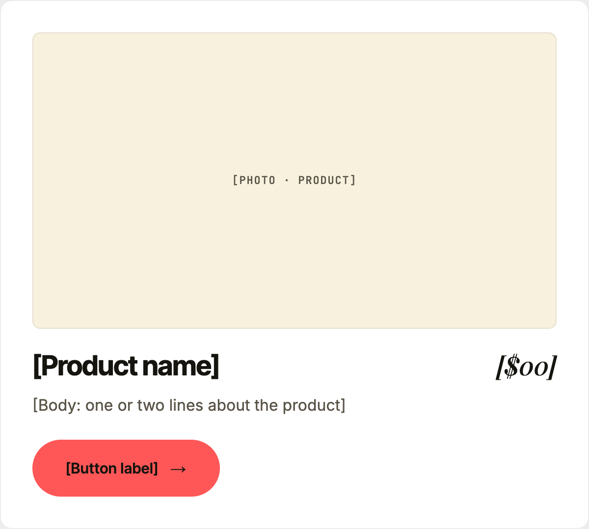

<!-- Generated by .claude/skills/shopify-email-html/scripts/build_library.py — edit section.json / template.json instead. -->

# Product · Single feature with button · White

| | |
|---|---|
| Type | Product |
| Context | any |
| Surfaces | Messaging · Code your own, Messaging section |
| Liquid variables | — |
| Shopify status | unused |
| Placeholders | yes — do not ship as is |
| Characters | 2762 |
| Used by | — |

> Module bank. All copy is a labelled slot: replace it before use.

## Module bank

- Category: 04 · Products & commerce
- Module: Product · Single feature with button · theme **white**
- Figma source: [Product · Single product feature](https://www.figma.com/design/9Il504CQE8jLaUTBVzphqc/Email-Design-System?node-id=480-12686)

**Changed from the Figma module to meet the v6 rules**

- One large product image with the name, price, one line of copy and a button below it
- Name in the v6 title role, price in the v6 serif-italic price role (was two 22px sans lines)
- Button is the v6 coral pill (58px high, ink label, arrow)
- Image is a labelled slot: use the approved product render

**Figma sample copy (reference only, not in the section)**: Swiss Lace Atelier System · $580 · Featuring single-knot hair ventilation… · Configure Your Fit →

## Preview



## HTML

Source: [`section.html`](section.html). Copy from here or from the raw file.

```html
<table role="presentation" width="100%" cellpadding="0" cellspacing="0" border="0" style="background-color:transparent;"><tr><td align="center" style="padding:0;">
<table role="presentation" class="shell" width="100%" cellpadding="0" cellspacing="0" border="0" style="width:100%;max-width:600px;">
<tr><td style="padding:0;">
<table role="presentation" width="100%" cellpadding="0" cellspacing="0" border="0" style="border-collapse:separate;background-color:#ffffff;border:1px solid #ececec;border-radius:12px;">
<tr><td class="pad-sm" style="padding:32px;"><table role="presentation" width="100%" cellpadding="0" cellspacing="0" border="0" style="border-collapse:separate;background-color:#f7f1de;border:1px solid #e5dfcd;border-radius:8px;"><tr><td align="center" valign="middle" height="300" style="height:300px;padding:0 16px;"><p style="margin:0 0 0px 0;font-family:'JetBrains Mono','Courier New',monospace;font-size:11px;line-height:17px;font-weight:500;letter-spacing:0.9px;color:#5a5448;text-align:center;text-transform:uppercase;">[Photo · product]</p></td></tr></table><div style="height:22px;line-height:22px;font-size:0;">&nbsp;</div><table role="presentation" width="100%" cellpadding="0" cellspacing="0" border="0"><tr><td valign="baseline" style="width:100%;padding:0 16px 0 0;"><h2 style="margin:0 0 0px 0;font-family:'Inter Tight',Arial,Helvetica,sans-serif;font-size:28px;line-height:31px;font-weight:700;letter-spacing:-0.6px;color:#15140f;text-align:left;">[Product name]</h2></td><td valign="baseline" align="right" style="padding:0;white-space:nowrap;"><p style="margin:0 0 0px 0;font-family:'Playfair Display',Georgia,'Times New Roman',serif;font-size:26px;line-height:26px;font-weight:500;color:#15140f;text-align:left;font-style:italic;white-space:nowrap;">[$00]</p></td></tr></table><div style="height:12px;line-height:12px;font-size:0;">&nbsp;</div><p style="margin:0 0 22px 0;font-family:'Inter',Arial,Helvetica,sans-serif;font-size:16px;line-height:26px;font-weight:400;color:#5a5448;text-align:left;">[Body: one or two lines about the product]</p><table role="presentation" class="btn" cellpadding="0" cellspacing="0" border="0" style="border-collapse:separate;margin:0;">
<tr><td style="border-radius:999px;background-color:#ff5757;">
<a href="https://hairsolutions.co" target="_blank" style="display:inline-block;padding:0 34px;line-height:58px;font-family:'Inter Tight',Arial,Helvetica,sans-serif;font-size:15px;font-weight:600;letter-spacing:0.3px;color:#15140f;text-decoration:none;border-radius:999px;white-space:nowrap;">[Button label]<span style="padding-left:12px;font-family:'Inter',Arial,Helvetica,sans-serif;font-size:16px;">&rarr;</span></a>
</td></tr></table></td></tr>
</table>
</td></tr>
</table>
</td></tr></table>
```
