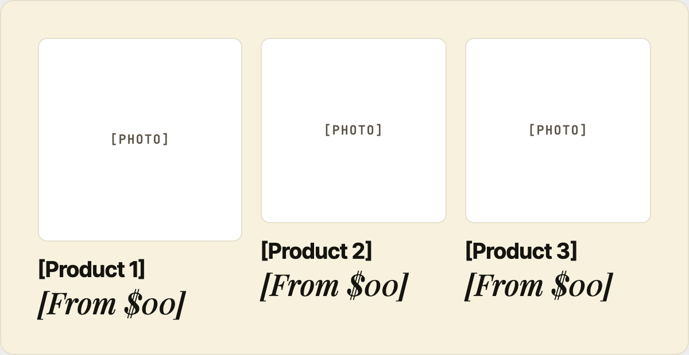

<!-- Generated by .claude/skills/shopify-email-html/scripts/build_library.py — edit section.json / template.json instead. -->

# Product · Three card row · Bone

| | |
|---|---|
| Type | Product |
| Context | any |
| Surfaces | Messaging · Code your own, Messaging section |
| Liquid variables | — |
| Shopify status | unused |
| Placeholders | yes — do not ship as is |
| Characters | 3742 |
| Used by | — |

> Module bank. All copy is a labelled slot: replace it before use.

## Module bank

- Category: 04 · Products & commerce
- Module: Product · Three card row · theme **bone**
- Figma source: [Product](https://www.figma.com/design/9Il504CQE8jLaUTBVzphqc/Email-Design-System?node-id=479-16935)

**Changed from the Figma module to meet the v6 rules**

- Three product cards in a row; on mobile they stack one per line (a 169px card does not fit three across)
- Card fill and 20px radius dropped: tiles sit directly on the card, image on the v6 inset (8px)
- Title in the v6 subtitle role (sentence case), price in the v6 serif-italic price role
- Image tiles are 1:1 labelled slots (square at any width, desktop and mobile): use square product renders

**Figma sample copy (reference only, not in the section)**: Refined Density · From $420 · Natural Movement · From $420 · Longer Lengths · From $420

## Preview



## HTML

Source: [`section.html`](section.html). Copy from here or from the raw file.

```html
<table role="presentation" width="100%" cellpadding="0" cellspacing="0" border="0" style="background-color:transparent;"><tr><td align="center" style="padding:0;">
<table role="presentation" class="shell" width="100%" cellpadding="0" cellspacing="0" border="0" style="width:100%;max-width:600px;">
<tr><td style="padding:0;">
<table role="presentation" width="100%" cellpadding="0" cellspacing="0" border="0" style="border-collapse:separate;background-color:#f7f1de;border:1px solid #e5dfcd;border-radius:12px;">
<tr><td class="pad-sm" style="padding:32px;"><table role="presentation" width="100%" cellpadding="0" cellspacing="0" border="0"><tr><td class="stack" width="33.33%" valign="top" style="width:33.33%;padding:0 0 0 0px;vertical-align:top;"><div style="width:100%;box-sizing:border-box;aspect-ratio:1/1;display:flex;align-items:center;justify-content:center;background-color:#ffffff;border:1px solid #e5dfcd;border-radius:8px;padding:0 8px;"><p style="margin:0 0 0px 0;font-family:'JetBrains Mono','Courier New',monospace;font-size:11px;line-height:17px;font-weight:500;letter-spacing:0.9px;color:#5a5448;text-align:center;text-transform:uppercase;">[Photo]</p></div><div style="height:12px;line-height:12px;font-size:0;">&nbsp;</div><h3 style="margin:0 0 4px 0;font-family:'Inter Tight',Arial,Helvetica,sans-serif;font-size:19px;line-height:24px;font-weight:700;color:#15140f;text-align:left;">[Product 1]</h3><p style="margin:0 0 0px 0;font-family:'Playfair Display',Georgia,'Times New Roman',serif;font-size:26px;line-height:26px;font-weight:500;color:#15140f;text-align:left;font-style:italic;white-space:nowrap;">[From $00]</p></td><td class="stack stack-gap" width="33.33%" valign="top" style="width:33.33%;padding:0 0 0 16px;vertical-align:top;"><div style="width:100%;box-sizing:border-box;aspect-ratio:1/1;display:flex;align-items:center;justify-content:center;background-color:#ffffff;border:1px solid #e5dfcd;border-radius:8px;padding:0 8px;"><p style="margin:0 0 0px 0;font-family:'JetBrains Mono','Courier New',monospace;font-size:11px;line-height:17px;font-weight:500;letter-spacing:0.9px;color:#5a5448;text-align:center;text-transform:uppercase;">[Photo]</p></div><div style="height:12px;line-height:12px;font-size:0;">&nbsp;</div><h3 style="margin:0 0 4px 0;font-family:'Inter Tight',Arial,Helvetica,sans-serif;font-size:19px;line-height:24px;font-weight:700;color:#15140f;text-align:left;">[Product 2]</h3><p style="margin:0 0 0px 0;font-family:'Playfair Display',Georgia,'Times New Roman',serif;font-size:26px;line-height:26px;font-weight:500;color:#15140f;text-align:left;font-style:italic;white-space:nowrap;">[From $00]</p></td><td class="stack stack-gap" width="33.33%" valign="top" style="width:33.33%;padding:0 0 0 16px;vertical-align:top;"><div style="width:100%;box-sizing:border-box;aspect-ratio:1/1;display:flex;align-items:center;justify-content:center;background-color:#ffffff;border:1px solid #e5dfcd;border-radius:8px;padding:0 8px;"><p style="margin:0 0 0px 0;font-family:'JetBrains Mono','Courier New',monospace;font-size:11px;line-height:17px;font-weight:500;letter-spacing:0.9px;color:#5a5448;text-align:center;text-transform:uppercase;">[Photo]</p></div><div style="height:12px;line-height:12px;font-size:0;">&nbsp;</div><h3 style="margin:0 0 4px 0;font-family:'Inter Tight',Arial,Helvetica,sans-serif;font-size:19px;line-height:24px;font-weight:700;color:#15140f;text-align:left;">[Product 3]</h3><p style="margin:0 0 0px 0;font-family:'Playfair Display',Georgia,'Times New Roman',serif;font-size:26px;line-height:26px;font-weight:500;color:#15140f;text-align:left;font-style:italic;white-space:nowrap;">[From $00]</p></td></tr></table></td></tr>
</table>
</td></tr>
</table>
</td></tr></table>
```
