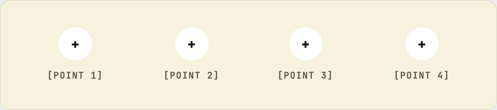

<!-- Generated by .claude/skills/shopify-email-html/scripts/build_library.py — edit section.json / template.json instead. -->

# Service · Assurance icon row · Bone

| | |
|---|---|
| Type | Service |
| Context | any |
| Surfaces | Messaging · Code your own, Messaging section |
| Liquid variables | — |
| Shopify status | unused |
| Placeholders | yes — do not ship as is |
| Characters | 4018 |
| Used by | — |

> Module bank. All copy is a labelled slot: replace it before use.

## Module bank

- Category: 05 · Services & proof
- Module: Service · Assurance icon row · theme **bone**
- Figma source: [SERVICE · PURCHASE ASSURANCE](https://www.figma.com/design/9Il504CQE8jLaUTBVzphqc/Email-Design-System?node-id=480-15300)

**Changed from the Figma module to meet the v6 rules**

- Four assurance points in one row; stays four across on mobile, shrinking
- Round icon chips (storefront feather icons replaced by the neutral chip), titles in the v6 meta role

**Figma sample copy (reference only, not in the section)**: First Purchase Assurance · 30-day Money-back · Free Shipping · Secure Payment

## Preview



## HTML

Source: [`section.html`](section.html). Copy from here or from the raw file.

```html
<table role="presentation" width="100%" cellpadding="0" cellspacing="0" border="0" style="background-color:transparent;"><tr><td align="center" style="padding:0;">
<table role="presentation" class="shell" width="100%" cellpadding="0" cellspacing="0" border="0" style="width:100%;max-width:600px;">
<tr><td style="padding:0;">
<table role="presentation" width="100%" cellpadding="0" cellspacing="0" border="0" style="border-collapse:separate;background-color:#f7f1de;border:1px solid #e5dfcd;border-radius:12px;">
<tr><td class="pad-sm" style="padding:32px 24px;"><table role="presentation" width="100%" cellpadding="0" cellspacing="0" border="0"><tr><td width="25.0%" valign="top" style="width:25.0%;padding:0 6px 0 0px;vertical-align:top;"><div style="margin:0 auto;width:40px;"><table role="presentation" cellpadding="0" cellspacing="0" border="0" style="border-collapse:separate;"><tr><td align="center" valign="middle" width="40" height="40" style="width:40px;height:40px;border-radius:999px;background-color:#ffffff;font-family:'Inter Tight',Arial,Helvetica,sans-serif;font-size:16px;line-height:38px;font-weight:700;color:#15140f;text-align:center;">+</td></tr></table></div><div style="height:10px;line-height:10px;font-size:0;">&nbsp;</div><p style="margin:0 0 0px 0;font-family:'JetBrains Mono','Courier New',monospace;font-size:11px;line-height:17px;font-weight:500;letter-spacing:0.9px;color:#5a5448;text-align:center;text-transform:uppercase;">[Point 1]</p></td><td width="25.0%" valign="top" style="width:25.0%;padding:0 6px 0 6px;vertical-align:top;"><div style="margin:0 auto;width:40px;"><table role="presentation" cellpadding="0" cellspacing="0" border="0" style="border-collapse:separate;"><tr><td align="center" valign="middle" width="40" height="40" style="width:40px;height:40px;border-radius:999px;background-color:#ffffff;font-family:'Inter Tight',Arial,Helvetica,sans-serif;font-size:16px;line-height:38px;font-weight:700;color:#15140f;text-align:center;">+</td></tr></table></div><div style="height:10px;line-height:10px;font-size:0;">&nbsp;</div><p style="margin:0 0 0px 0;font-family:'JetBrains Mono','Courier New',monospace;font-size:11px;line-height:17px;font-weight:500;letter-spacing:0.9px;color:#5a5448;text-align:center;text-transform:uppercase;">[Point 2]</p></td><td width="25.0%" valign="top" style="width:25.0%;padding:0 6px 0 6px;vertical-align:top;"><div style="margin:0 auto;width:40px;"><table role="presentation" cellpadding="0" cellspacing="0" border="0" style="border-collapse:separate;"><tr><td align="center" valign="middle" width="40" height="40" style="width:40px;height:40px;border-radius:999px;background-color:#ffffff;font-family:'Inter Tight',Arial,Helvetica,sans-serif;font-size:16px;line-height:38px;font-weight:700;color:#15140f;text-align:center;">+</td></tr></table></div><div style="height:10px;line-height:10px;font-size:0;">&nbsp;</div><p style="margin:0 0 0px 0;font-family:'JetBrains Mono','Courier New',monospace;font-size:11px;line-height:17px;font-weight:500;letter-spacing:0.9px;color:#5a5448;text-align:center;text-transform:uppercase;">[Point 3]</p></td><td width="25.0%" valign="top" style="width:25.0%;padding:0 0px 0 6px;vertical-align:top;"><div style="margin:0 auto;width:40px;"><table role="presentation" cellpadding="0" cellspacing="0" border="0" style="border-collapse:separate;"><tr><td align="center" valign="middle" width="40" height="40" style="width:40px;height:40px;border-radius:999px;background-color:#ffffff;font-family:'Inter Tight',Arial,Helvetica,sans-serif;font-size:16px;line-height:38px;font-weight:700;color:#15140f;text-align:center;">+</td></tr></table></div><div style="height:10px;line-height:10px;font-size:0;">&nbsp;</div><p style="margin:0 0 0px 0;font-family:'JetBrains Mono','Courier New',monospace;font-size:11px;line-height:17px;font-weight:500;letter-spacing:0.9px;color:#5a5448;text-align:center;text-transform:uppercase;">[Point 4]</p></td></tr></table></td></tr>
</table>
</td></tr>
</table>
</td></tr></table>
```
