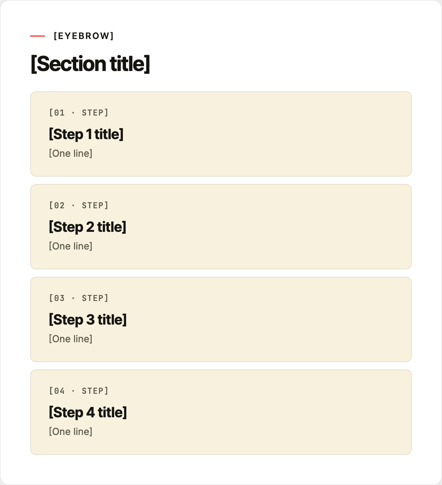

<!-- Generated by .claude/skills/shopify-email-html/scripts/build_library.py — edit section.json / template.json instead. -->

# Service · How it works, four steps · White

| | |
|---|---|
| Type | Service |
| Context | any |
| Surfaces | Messaging · Code your own, Messaging section |
| Liquid variables | — |
| Shopify status | unused |
| Placeholders | yes — do not ship as is |
| Characters | 4739 |
| Used by | — |

> Module bank. All copy is a labelled slot: replace it before use.

## Module bank

- Category: 05 · Services & proof
- Module: Service · How it works, four steps · theme **white**
- Figma source: [SERVICE · HOW IT WORKS](https://www.figma.com/design/9Il504CQE8jLaUTBVzphqc/Email-Design-System?node-id=480-15577)

**Changed from the Figma module to meet the v6 rules**

- Eyebrow plus a four-step list of inset cards (step label, title, one line)
- Section title in the v6 title role; Figma's 673px-wide frame trimmed to the 600px shell
- Step cards are the v6 inset (8px)

**Figma sample copy (reference only, not in the section)**: How it works · From first call to first look. · 01 · Consult … 04 · Care

## Preview



## HTML

Source: [`section.html`](section.html). Copy from here or from the raw file.

```html
<table role="presentation" width="100%" cellpadding="0" cellspacing="0" border="0" style="background-color:transparent;"><tr><td align="center" style="padding:0;">
<table role="presentation" class="shell" width="100%" cellpadding="0" cellspacing="0" border="0" style="width:100%;max-width:600px;">
<tr><td style="padding:0;">
<table role="presentation" width="100%" cellpadding="0" cellspacing="0" border="0" style="border-collapse:separate;background-color:#ffffff;border:1px solid #ececec;border-radius:12px;">
<tr><td class="pad" style="padding:40px;"><table role="presentation" cellpadding="0" cellspacing="0" border="0" style="margin:0 0 14px 0;">
<tr><td width="20" style="width:20px;vertical-align:middle;"><div style="height:2px;line-height:2px;font-size:0;background-color:#ff5757;">&nbsp;</div></td>
<td style="padding-left:12px;font-family:'Inter Tight',Arial,Helvetica,sans-serif;font-size:12px;line-height:16px;font-weight:600;letter-spacing:2px;text-transform:uppercase;color:#15140f;white-space:nowrap;">[Eyebrow]</td></tr>
</table><h2 style="margin:0 0 22px 0;font-family:'Inter Tight',Arial,Helvetica,sans-serif;font-size:28px;line-height:31px;font-weight:700;letter-spacing:-0.6px;color:#15140f;text-align:left;">[Section title]</h2><table role="presentation" width="100%" cellpadding="0" cellspacing="0" border="0" style="border-collapse:separate;background-color:#f7f1de;border:1px solid #e5dfcd;border-radius:8px;"><tr><td style="padding:20px 24px;"><p style="margin:0 0 8px 0;font-family:'JetBrains Mono','Courier New',monospace;font-size:11px;line-height:17px;font-weight:500;letter-spacing:0.9px;color:#5a5448;text-align:left;text-transform:uppercase;">[01 · Step]</p><h3 style="margin:0 0 4px 0;font-family:'Inter Tight',Arial,Helvetica,sans-serif;font-size:19px;line-height:24px;font-weight:700;color:#15140f;text-align:left;">[Step 1 title]</h3><p style="margin:0 0 0px 0;font-family:'Inter',Arial,Helvetica,sans-serif;font-size:13px;line-height:21px;font-weight:400;color:#5a5448;text-align:left;">[One line]</p></td></tr></table><div style="height:10px;line-height:10px;font-size:0;">&nbsp;</div><table role="presentation" width="100%" cellpadding="0" cellspacing="0" border="0" style="border-collapse:separate;background-color:#f7f1de;border:1px solid #e5dfcd;border-radius:8px;"><tr><td style="padding:20px 24px;"><p style="margin:0 0 8px 0;font-family:'JetBrains Mono','Courier New',monospace;font-size:11px;line-height:17px;font-weight:500;letter-spacing:0.9px;color:#5a5448;text-align:left;text-transform:uppercase;">[02 · Step]</p><h3 style="margin:0 0 4px 0;font-family:'Inter Tight',Arial,Helvetica,sans-serif;font-size:19px;line-height:24px;font-weight:700;color:#15140f;text-align:left;">[Step 2 title]</h3><p style="margin:0 0 0px 0;font-family:'Inter',Arial,Helvetica,sans-serif;font-size:13px;line-height:21px;font-weight:400;color:#5a5448;text-align:left;">[One line]</p></td></tr></table><div style="height:10px;line-height:10px;font-size:0;">&nbsp;</div><table role="presentation" width="100%" cellpadding="0" cellspacing="0" border="0" style="border-collapse:separate;background-color:#f7f1de;border:1px solid #e5dfcd;border-radius:8px;"><tr><td style="padding:20px 24px;"><p style="margin:0 0 8px 0;font-family:'JetBrains Mono','Courier New',monospace;font-size:11px;line-height:17px;font-weight:500;letter-spacing:0.9px;color:#5a5448;text-align:left;text-transform:uppercase;">[03 · Step]</p><h3 style="margin:0 0 4px 0;font-family:'Inter Tight',Arial,Helvetica,sans-serif;font-size:19px;line-height:24px;font-weight:700;color:#15140f;text-align:left;">[Step 3 title]</h3><p style="margin:0 0 0px 0;font-family:'Inter',Arial,Helvetica,sans-serif;font-size:13px;line-height:21px;font-weight:400;color:#5a5448;text-align:left;">[One line]</p></td></tr></table><div style="height:10px;line-height:10px;font-size:0;">&nbsp;</div><table role="presentation" width="100%" cellpadding="0" cellspacing="0" border="0" style="border-collapse:separate;background-color:#f7f1de;border:1px solid #e5dfcd;border-radius:8px;"><tr><td style="padding:20px 24px;"><p style="margin:0 0 8px 0;font-family:'JetBrains Mono','Courier New',monospace;font-size:11px;line-height:17px;font-weight:500;letter-spacing:0.9px;color:#5a5448;text-align:left;text-transform:uppercase;">[04 · Step]</p><h3 style="margin:0 0 4px 0;font-family:'Inter Tight',Arial,Helvetica,sans-serif;font-size:19px;line-height:24px;font-weight:700;color:#15140f;text-align:left;">[Step 4 title]</h3><p style="margin:0 0 0px 0;font-family:'Inter',Arial,Helvetica,sans-serif;font-size:13px;line-height:21px;font-weight:400;color:#5a5448;text-align:left;">[One line]</p></td></tr></table></td></tr>
</table>
</td></tr>
</table>
</td></tr></table>
```
