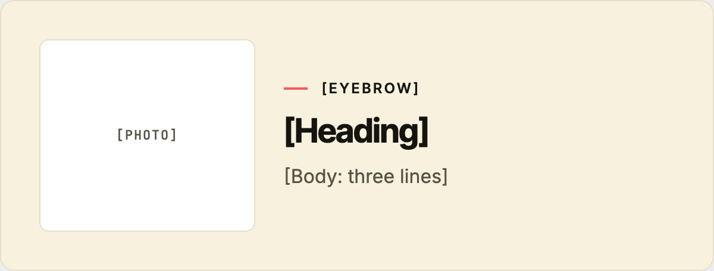

<!-- Generated by .claude/skills/shopify-email-html/scripts/build_library.py — edit section.json / template.json instead. -->

# Service · Image and base standard · Bone

| | |
|---|---|
| Type | Service |
| Context | any |
| Surfaces | Messaging · Code your own, Messaging section |
| Liquid variables | — |
| Shopify status | unused |
| Placeholders | yes — do not ship as is |
| Characters | 2326 |
| Used by | — |

> Module bank. All copy is a labelled slot: replace it before use.

## Module bank

- Category: 05 · Services & proof
- Module: Service · Image and base standard · theme **bone**
- Figma source: [SERVICE · ARTISAN BIO-BASE](https://www.figma.com/design/9Il504CQE8jLaUTBVzphqc/Email-Design-System?node-id=480-15211)

**Changed from the Figma module to meet the v6 rules**

- Square image left with eyebrow, heading and body right; stacks on mobile with the image first
- Eyebrow in the v6 eyebrow role (the Figma pill label dropped); heading in the v6 title role
- Image is a labelled slot: use an approved render

**Figma sample copy (reference only, not in the section)**: THE BASE STANDARD · Artisan Bio-Base · Designed to completely mimic natural follicle…

## Preview



## HTML

Source: [`section.html`](section.html). Copy from here or from the raw file.

```html
<table role="presentation" width="100%" cellpadding="0" cellspacing="0" border="0" style="background-color:transparent;"><tr><td align="center" style="padding:0;">
<table role="presentation" class="shell" width="100%" cellpadding="0" cellspacing="0" border="0" style="width:100%;max-width:600px;">
<tr><td style="padding:0;">
<table role="presentation" width="100%" cellpadding="0" cellspacing="0" border="0" style="border-collapse:separate;background-color:#f7f1de;border:1px solid #e5dfcd;border-radius:12px;">
<tr><td class="pad-sm" style="padding:32px;"><table role="presentation" width="100%" cellpadding="0" cellspacing="0" border="0"><tr><td class="stack" width="34%" valign="middle" style="width:34%;padding:0 0 0 0px;vertical-align:middle;"><table role="presentation" width="100%" cellpadding="0" cellspacing="0" border="0" style="border-collapse:separate;background-color:#ffffff;border:1px solid #e5dfcd;border-radius:8px;"><tr><td align="center" valign="middle" height="160" style="height:160px;padding:0 16px;"><p style="margin:0 0 0px 0;font-family:'JetBrains Mono','Courier New',monospace;font-size:11px;line-height:17px;font-weight:500;letter-spacing:0.9px;color:#5a5448;text-align:center;text-transform:uppercase;">[Photo]</p></td></tr></table></td><td class="stack stack-gap" width="66%" valign="middle" style="width:66%;padding:0 0 0 24px;vertical-align:middle;"><table role="presentation" cellpadding="0" cellspacing="0" border="0" style="margin:0 0 12px 0;">
<tr><td width="20" style="width:20px;vertical-align:middle;"><div style="height:2px;line-height:2px;font-size:0;background-color:#ff5757;">&nbsp;</div></td>
<td style="padding-left:12px;font-family:'Inter Tight',Arial,Helvetica,sans-serif;font-size:12px;line-height:16px;font-weight:600;letter-spacing:2px;text-transform:uppercase;color:#15140f;white-space:nowrap;">[Eyebrow]</td></tr>
</table><h2 style="margin:0 0 10px 0;font-family:'Inter Tight',Arial,Helvetica,sans-serif;font-size:28px;line-height:31px;font-weight:700;letter-spacing:-0.6px;color:#15140f;text-align:left;">[Heading]</h2><p style="margin:0 0 0px 0;font-family:'Inter',Arial,Helvetica,sans-serif;font-size:16px;line-height:26px;font-weight:400;color:#5a5448;text-align:left;">[Body: three lines]</p></td></tr></table></td></tr>
</table>
</td></tr>
</table>
</td></tr></table>
```
