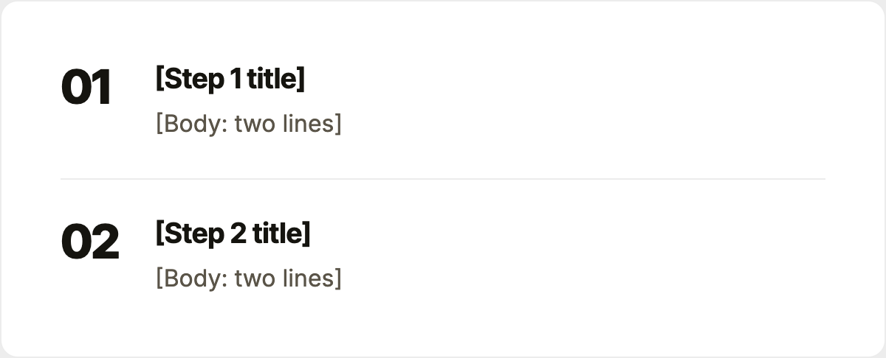

<!-- Generated by .claude/skills/shopify-email-html/scripts/build_library.py — edit section.json / template.json instead. -->

# Service · Numbered steps with rules · White

| | |
|---|---|
| Type | Service |
| Context | any |
| Surfaces | Messaging · Code your own, Messaging section |
| Liquid variables | — |
| Shopify status | unused |
| Placeholders | yes — do not ship as is |
| Characters | 2189 |
| Used by | — |

> Module bank. All copy is a labelled slot: replace it before use.

## Module bank

- Category: 05 · Services & proof
- Module: Service · Numbered steps with rules · theme **white**
- Figma source: [SERVICE · BESPOKE PROCESS](https://www.figma.com/design/9Il504CQE8jLaUTBVzphqc/Email-Design-System?node-id=480-15282)

**Changed from the Figma module to meet the v6 rules**

- Two numbered steps separated by a hairline; numbers in Inter Tight 800 on the v6 type scale
- Step title in the v6 subtitle role, description in the v6 body role

**Figma sample copy (reference only, not in the section)**: 01 Bespoke Fitting Consultation · 02 Hand-Woven Fabrication

## Preview



## HTML

Source: [`section.html`](section.html). Copy from here or from the raw file.

```html
<table role="presentation" width="100%" cellpadding="0" cellspacing="0" border="0" style="background-color:transparent;"><tr><td align="center" style="padding:0;">
<table role="presentation" class="shell" width="100%" cellpadding="0" cellspacing="0" border="0" style="width:100%;max-width:600px;">
<tr><td style="padding:0;">
<table role="presentation" width="100%" cellpadding="0" cellspacing="0" border="0" style="border-collapse:separate;background-color:#ffffff;border:1px solid #ececec;border-radius:12px;">
<tr><td class="pad" style="padding:40px;"><table role="presentation" width="100%" cellpadding="0" cellspacing="0" border="0"><tr><td width="64" valign="top" style="width:64px;padding:0;"><p style="margin:0;font-family:'Inter Tight',Arial,Helvetica,sans-serif;font-size:32px;line-height:36px;font-weight:800;letter-spacing:-1px;color:#15140f;width:48px;">01</p></td><td valign="top" style="padding:0;"><h3 style="margin:0 0 6px 0;font-family:'Inter Tight',Arial,Helvetica,sans-serif;font-size:19px;line-height:24px;font-weight:700;color:#15140f;text-align:left;">[Step 1 title]</h3><p style="margin:0 0 0px 0;font-family:'Inter',Arial,Helvetica,sans-serif;font-size:16px;line-height:26px;font-weight:400;color:#5a5448;text-align:left;">[Body: two lines]</p></td></tr></table><div style="margin:24px 0 24px 0;height:1px;line-height:1px;font-size:0;background-color:#ececec;">&nbsp;</div><table role="presentation" width="100%" cellpadding="0" cellspacing="0" border="0"><tr><td width="64" valign="top" style="width:64px;padding:0;"><p style="margin:0;font-family:'Inter Tight',Arial,Helvetica,sans-serif;font-size:32px;line-height:36px;font-weight:800;letter-spacing:-1px;color:#15140f;width:48px;">02</p></td><td valign="top" style="padding:0;"><h3 style="margin:0 0 6px 0;font-family:'Inter Tight',Arial,Helvetica,sans-serif;font-size:19px;line-height:24px;font-weight:700;color:#15140f;text-align:left;">[Step 2 title]</h3><p style="margin:0 0 0px 0;font-family:'Inter',Arial,Helvetica,sans-serif;font-size:16px;line-height:26px;font-weight:400;color:#5a5448;text-align:left;">[Body: two lines]</p></td></tr></table></td></tr>
</table>
</td></tr>
</table>
</td></tr></table>
```
