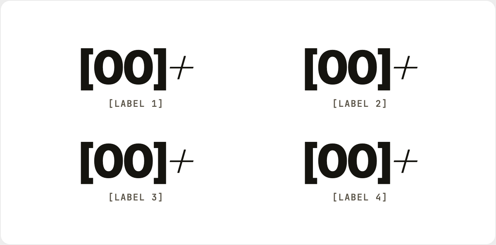

<!-- Generated by .claude/skills/shopify-email-html/scripts/build_library.py — edit section.json / template.json instead. -->

# Service · Stats band without heading · White

| | |
|---|---|
| Type | Stats |
| Context | any |
| Surfaces | Messaging · Code your own, Messaging section |
| Liquid variables | — |
| Shopify status | unused |
| Placeholders | yes — do not ship as is |
| Characters | 3542 |
| Used by | — |

> Module bank. All copy is a labelled slot: replace it before use.

## Module bank

- Category: 05 · Services & proof
- Module: Service · Stats band without heading · theme **white**
- Figma source: [SERVICE · STATS BAND LIGHT](https://www.figma.com/design/9Il504CQE8jLaUTBVzphqc/Email-Design-System?node-id=480-15671)

**Changed from the Figma module to meet the v6 rules**

- The same 2x2 stats grid as the heading version, with no eyebrow; two across on mobile
- Numerals: Inter Tight 800 with a serif-italic suffix (coral on Ink only); labels in the v6 meta role

**Figma sample copy (reference only, not in the section)**: 10K+ Customers · 97% Satisfaction · 15+ Years · 40+ Salons

## Preview



## HTML

Source: [`section.html`](section.html). Copy from here or from the raw file.

```html
<table role="presentation" width="100%" cellpadding="0" cellspacing="0" border="0" style="background-color:transparent;"><tr><td align="center" style="padding:0;">
<table role="presentation" class="shell" width="100%" cellpadding="0" cellspacing="0" border="0" style="width:100%;max-width:600px;">
<tr><td style="padding:0;">
<table role="presentation" width="100%" cellpadding="0" cellspacing="0" border="0" style="border-collapse:separate;background-color:#ffffff;border:1px solid #ececec;border-radius:12px;">
<tr><td class="pad" style="padding:48px 40px;"><table role="presentation" width="100%" cellpadding="0" cellspacing="0" border="0"><tr><td width="50.0%" valign="top" style="width:50.0%;padding:0 12px 0 0px;vertical-align:top;"><p style="margin:0 0 6px 0;font-family:'Inter Tight',Arial,Helvetica,sans-serif;font-size:56px;line-height:60px;font-weight:800;letter-spacing:-2px;text-align:center;color:#15140f;">[00]<span style="font-family:'Playfair Display',Georgia,'Times New Roman',serif;font-style:italic;font-weight:400;color:#15140f;letter-spacing:-0.5px;">+</span></p><p style="margin:0 0 0px 0;font-family:'JetBrains Mono','Courier New',monospace;font-size:11px;line-height:17px;font-weight:500;letter-spacing:0.9px;color:#5a5448;text-align:center;text-transform:uppercase;">[Label 1]</p></td><td width="50.0%" valign="top" style="width:50.0%;padding:0 0px 0 12px;vertical-align:top;"><p style="margin:0 0 6px 0;font-family:'Inter Tight',Arial,Helvetica,sans-serif;font-size:56px;line-height:60px;font-weight:800;letter-spacing:-2px;text-align:center;color:#15140f;">[00]<span style="font-family:'Playfair Display',Georgia,'Times New Roman',serif;font-style:italic;font-weight:400;color:#15140f;letter-spacing:-0.5px;">+</span></p><p style="margin:0 0 0px 0;font-family:'JetBrains Mono','Courier New',monospace;font-size:11px;line-height:17px;font-weight:500;letter-spacing:0.9px;color:#5a5448;text-align:center;text-transform:uppercase;">[Label 2]</p></td></tr></table><div style="height:28px;line-height:28px;font-size:0;">&nbsp;</div><table role="presentation" width="100%" cellpadding="0" cellspacing="0" border="0"><tr><td width="50.0%" valign="top" style="width:50.0%;padding:0 12px 0 0px;vertical-align:top;"><p style="margin:0 0 6px 0;font-family:'Inter Tight',Arial,Helvetica,sans-serif;font-size:56px;line-height:60px;font-weight:800;letter-spacing:-2px;text-align:center;color:#15140f;">[00]<span style="font-family:'Playfair Display',Georgia,'Times New Roman',serif;font-style:italic;font-weight:400;color:#15140f;letter-spacing:-0.5px;">+</span></p><p style="margin:0 0 0px 0;font-family:'JetBrains Mono','Courier New',monospace;font-size:11px;line-height:17px;font-weight:500;letter-spacing:0.9px;color:#5a5448;text-align:center;text-transform:uppercase;">[Label 3]</p></td><td width="50.0%" valign="top" style="width:50.0%;padding:0 0px 0 12px;vertical-align:top;"><p style="margin:0 0 6px 0;font-family:'Inter Tight',Arial,Helvetica,sans-serif;font-size:56px;line-height:60px;font-weight:800;letter-spacing:-2px;text-align:center;color:#15140f;">[00]<span style="font-family:'Playfair Display',Georgia,'Times New Roman',serif;font-style:italic;font-weight:400;color:#15140f;letter-spacing:-0.5px;">+</span></p><p style="margin:0 0 0px 0;font-family:'JetBrains Mono','Courier New',monospace;font-size:11px;line-height:17px;font-weight:500;letter-spacing:0.9px;color:#5a5448;text-align:center;text-transform:uppercase;">[Label 4]</p></td></tr></table></td></tr>
</table>
</td></tr>
</table>
</td></tr></table>
```
