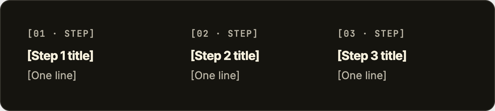

<!-- Generated by .claude/skills/shopify-email-html/scripts/build_library.py — edit section.json / template.json instead. -->

# Service · Three-step journey · Ink

| | |
|---|---|
| Type | Service |
| Context | any |
| Surfaces | Messaging · Code your own, Messaging section |
| Liquid variables | — |
| Shopify status | unused |
| Placeholders | yes — do not ship as is |
| Characters | 2767 |
| Used by | — |

> Module bank. All copy is a labelled slot: replace it before use.

## Module bank

- Category: 05 · Services & proof
- Module: Service · Three-step journey · theme **ink**
- Figma source: [SERVICE · THREE-STEP JOURNEY](https://www.figma.com/design/9Il504CQE8jLaUTBVzphqc/Email-Design-System?node-id=480-15454)

**Changed from the Figma module to meet the v6 rules**

- Three steps with a mono step label, title and one line; stack on mobile
- The connector lines between steps are dropped (they have no place when columns stack)
- Step label in the v6 meta role, title in the v6 name role, description in the v6 small role

**Figma sample copy (reference only, not in the section)**: 01 · INTAKE Consultation · 02 · ARTISAN Creation · 03 · ATELIER Delivery

## Preview



## HTML

Source: [`section.html`](section.html). Copy from here or from the raw file.

```html
<table role="presentation" width="100%" cellpadding="0" cellspacing="0" border="0" style="background-color:transparent;"><tr><td align="center" style="padding:0;">
<table role="presentation" class="shell" width="100%" cellpadding="0" cellspacing="0" border="0" style="width:100%;max-width:600px;">
<tr><td style="padding:0;">
<table role="presentation" width="100%" cellpadding="0" cellspacing="0" border="0" style="border-collapse:separate;background-color:#15140f;border:1px solid #35332c;border-radius:12px;">
<tr><td class="pad" style="padding:32px;"><table role="presentation" width="100%" cellpadding="0" cellspacing="0" border="0"><tr><td class="stack" width="33.33%" valign="top" style="width:33.33%;padding:0 0 0 0px;vertical-align:top;"><p style="margin:0 0 8px 0;font-family:'JetBrains Mono','Courier New',monospace;font-size:11px;line-height:17px;font-weight:500;letter-spacing:0.9px;color:#b8b3a4;text-align:left;text-transform:uppercase;">[01 · Step]</p><p style="margin:0 0 4px 0;font-family:'Inter Tight',Arial,Helvetica,sans-serif;font-size:15px;line-height:20px;font-weight:700;color:#f7f1de;text-align:left;">[Step 1 title]</p><p style="margin:0 0 0px 0;font-family:'Inter',Arial,Helvetica,sans-serif;font-size:13px;line-height:21px;font-weight:400;color:#b8b3a4;text-align:left;">[One line]</p></td><td class="stack stack-gap" width="33.33%" valign="top" style="width:33.33%;padding:0 0 0 20px;vertical-align:top;"><p style="margin:0 0 8px 0;font-family:'JetBrains Mono','Courier New',monospace;font-size:11px;line-height:17px;font-weight:500;letter-spacing:0.9px;color:#b8b3a4;text-align:left;text-transform:uppercase;">[02 · Step]</p><p style="margin:0 0 4px 0;font-family:'Inter Tight',Arial,Helvetica,sans-serif;font-size:15px;line-height:20px;font-weight:700;color:#f7f1de;text-align:left;">[Step 2 title]</p><p style="margin:0 0 0px 0;font-family:'Inter',Arial,Helvetica,sans-serif;font-size:13px;line-height:21px;font-weight:400;color:#b8b3a4;text-align:left;">[One line]</p></td><td class="stack stack-gap" width="33.33%" valign="top" style="width:33.33%;padding:0 0 0 20px;vertical-align:top;"><p style="margin:0 0 8px 0;font-family:'JetBrains Mono','Courier New',monospace;font-size:11px;line-height:17px;font-weight:500;letter-spacing:0.9px;color:#b8b3a4;text-align:left;text-transform:uppercase;">[03 · Step]</p><p style="margin:0 0 4px 0;font-family:'Inter Tight',Arial,Helvetica,sans-serif;font-size:15px;line-height:20px;font-weight:700;color:#f7f1de;text-align:left;">[Step 3 title]</p><p style="margin:0 0 0px 0;font-family:'Inter',Arial,Helvetica,sans-serif;font-size:13px;line-height:21px;font-weight:400;color:#b8b3a4;text-align:left;">[One line]</p></td></tr></table></td></tr>
</table>
</td></tr>
</table>
</td></tr></table>
```
