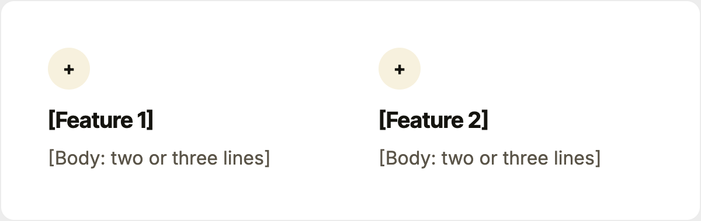

<!-- Generated by .claude/skills/shopify-email-html/scripts/build_library.py — edit section.json / template.json instead. -->

# Service · Two feature columns · White

| | |
|---|---|
| Type | Service |
| Context | any |
| Surfaces | Messaging · Code your own, Messaging section |
| Liquid variables | — |
| Shopify status | unused |
| Placeholders | yes — do not ship as is |
| Characters | 2587 |
| Used by | — |

> Module bank. All copy is a labelled slot: replace it before use.

## Module bank

- Category: 05 · Services & proof
- Module: Service · Two feature columns · theme **white**
- Figma source: [SERVICE · CONSTRUCTION & SIZING](https://www.figma.com/design/9Il504CQE8jLaUTBVzphqc/Email-Design-System?node-id=480-15130)

**Changed from the Figma module to meet the v6 rules**

- Two columns of icon, title and copy; they stack on mobile
- Icon glyphs replaced by the neutral icon chip; title in the v6 subtitle role, body in the v6 body role

**Figma sample copy (reference only, not in the section)**: Lace Construction · Custom Sizing

## Preview



## HTML

Source: [`section.html`](section.html). Copy from here or from the raw file.

```html
<table role="presentation" width="100%" cellpadding="0" cellspacing="0" border="0" style="background-color:transparent;"><tr><td align="center" style="padding:0;">
<table role="presentation" class="shell" width="100%" cellpadding="0" cellspacing="0" border="0" style="width:100%;max-width:600px;">
<tr><td style="padding:0;">
<table role="presentation" width="100%" cellpadding="0" cellspacing="0" border="0" style="border-collapse:separate;background-color:#ffffff;border:1px solid #ececec;border-radius:12px;">
<tr><td class="pad" style="padding:40px;"><table role="presentation" width="100%" cellpadding="0" cellspacing="0" border="0"><tr><td class="stack" width="50.0%" valign="top" style="width:50.0%;padding:0 0 0 0px;vertical-align:top;"><table role="presentation" cellpadding="0" cellspacing="0" border="0" style="border-collapse:separate;"><tr><td align="center" valign="middle" width="36" height="36" style="width:36px;height:36px;border-radius:999px;background-color:#f7f1de;font-family:'Inter Tight',Arial,Helvetica,sans-serif;font-size:16px;line-height:34px;font-weight:700;color:#15140f;text-align:center;">+</td></tr></table><div style="height:14px;line-height:14px;font-size:0;">&nbsp;</div><h3 style="margin:0 0 8px 0;font-family:'Inter Tight',Arial,Helvetica,sans-serif;font-size:19px;line-height:24px;font-weight:700;color:#15140f;text-align:left;">[Feature 1]</h3><p style="margin:0 0 0px 0;font-family:'Inter',Arial,Helvetica,sans-serif;font-size:16px;line-height:26px;font-weight:400;color:#5a5448;text-align:left;">[Body: two or three lines]</p></td><td class="stack stack-gap" width="50.0%" valign="top" style="width:50.0%;padding:0 0 0 24px;vertical-align:top;"><table role="presentation" cellpadding="0" cellspacing="0" border="0" style="border-collapse:separate;"><tr><td align="center" valign="middle" width="36" height="36" style="width:36px;height:36px;border-radius:999px;background-color:#f7f1de;font-family:'Inter Tight',Arial,Helvetica,sans-serif;font-size:16px;line-height:34px;font-weight:700;color:#15140f;text-align:center;">+</td></tr></table><div style="height:14px;line-height:14px;font-size:0;">&nbsp;</div><h3 style="margin:0 0 8px 0;font-family:'Inter Tight',Arial,Helvetica,sans-serif;font-size:19px;line-height:24px;font-weight:700;color:#15140f;text-align:left;">[Feature 2]</h3><p style="margin:0 0 0px 0;font-family:'Inter',Arial,Helvetica,sans-serif;font-size:16px;line-height:26px;font-weight:400;color:#5a5448;text-align:left;">[Body: two or three lines]</p></td></tr></table></td></tr>
</table>
</td></tr>
</table>
</td></tr></table>
```
