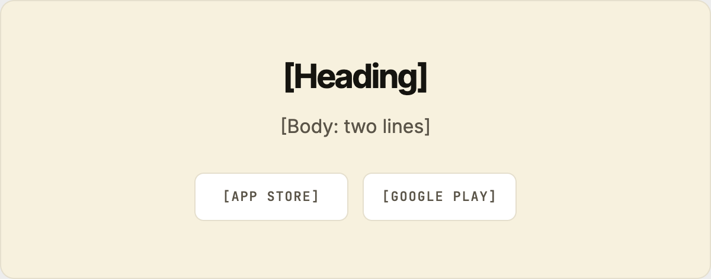

<!-- Generated by .claude/skills/shopify-email-html/scripts/build_library.py — edit section.json / template.json instead. -->

# CTA · App store badges · Bone

| | |
|---|---|
| Type | CTA |
| Context | any |
| Surfaces | Messaging · Code your own, Messaging section |
| Liquid variables | — |
| Shopify status | unused |
| Placeholders | yes — do not ship as is |
| Characters | 2268 |
| Used by | — |

> Module bank. All copy is a labelled slot: replace it before use.

## Module bank

- Category: 06 · CTAs & promotions
- Module: CTA · App store badges · theme **bone**
- Figma source: [CTA · APP REFERRALS BLOCK](https://www.figma.com/design/9Il504CQE8jLaUTBVzphqc/Email-Design-System?node-id=480-16039)

**Changed from the Figma module to meet the v6 rules**

- Two store badges side by side under the centred text; badges are labelled slots (use the official store badge images)
- Title in the v6 title role, body in the v6 body role

**Figma sample copy (reference only, not in the section)**: Manage Orders On The Go · Track your custom ventilation steps, order supplies… · App Store · Google Play

## Preview



## HTML

Source: [`section.html`](section.html). Copy from here or from the raw file.

```html
<table role="presentation" width="100%" cellpadding="0" cellspacing="0" border="0" style="background-color:transparent;"><tr><td align="center" style="padding:0;">
<table role="presentation" class="shell" width="100%" cellpadding="0" cellspacing="0" border="0" style="width:100%;max-width:600px;">
<tr><td style="padding:0;">
<table role="presentation" width="100%" cellpadding="0" cellspacing="0" border="0" style="border-collapse:separate;background-color:#f7f1de;border:1px solid #e5dfcd;border-radius:12px;">
<tr><td class="pad" style="padding:48px 40px;"><h2 style="margin:0 0 14px 0;font-family:'Inter Tight',Arial,Helvetica,sans-serif;font-size:28px;line-height:31px;font-weight:700;letter-spacing:-0.6px;color:#15140f;text-align:center;">[Heading]</h2><p style="margin:0 0 26px 0;font-family:'Inter',Arial,Helvetica,sans-serif;font-size:16px;line-height:26px;font-weight:400;color:#5a5448;text-align:center;">[Body: two lines]</p><table role="presentation" align="center" cellpadding="0" cellspacing="0" border="0" style="margin:0 auto;"><tr><td width="130" style="width:130px;padding:0 6px 0 0;"><table role="presentation" width="100%" cellpadding="0" cellspacing="0" border="0" style="border-collapse:separate;background-color:#ffffff;border:1px solid #e5dfcd;border-radius:8px;"><tr><td align="center" valign="middle" height="39" style="height:39px;padding:0 8px;"><p style="margin:0 0 0px 0;font-family:'JetBrains Mono','Courier New',monospace;font-size:11px;line-height:17px;font-weight:500;letter-spacing:0.9px;color:#5a5448;text-align:center;text-transform:uppercase;">[App Store]</p></td></tr></table></td><td width="130" style="width:130px;padding:0 0 0 6px;"><table role="presentation" width="100%" cellpadding="0" cellspacing="0" border="0" style="border-collapse:separate;background-color:#ffffff;border:1px solid #e5dfcd;border-radius:8px;"><tr><td align="center" valign="middle" height="39" style="height:39px;padding:0 8px;"><p style="margin:0 0 0px 0;font-family:'JetBrains Mono','Courier New',monospace;font-size:11px;line-height:17px;font-weight:500;letter-spacing:0.9px;color:#5a5448;text-align:center;text-transform:uppercase;">[Google Play]</p></td></tr></table></td></tr></table></td></tr>
</table>
</td></tr>
</table>
</td></tr></table>
```
