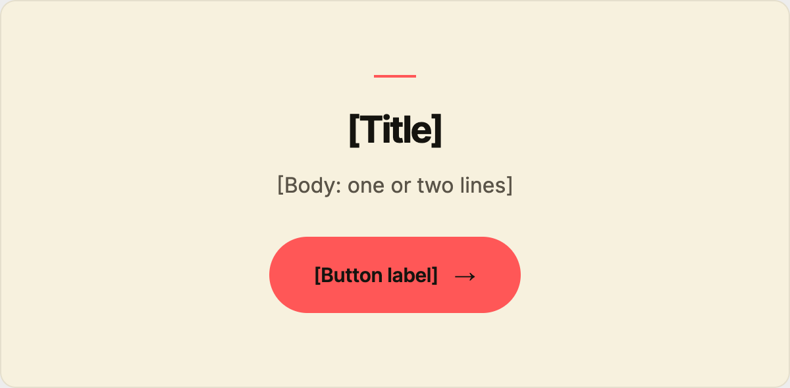

<!-- Generated by .claude/skills/shopify-email-html/scripts/build_library.py — edit section.json / template.json instead. -->

# CTA · Centred panel with rule · Bone

| | |
|---|---|
| Type | CTA |
| Context | any |
| Surfaces | Messaging · Code your own, Messaging section |
| Liquid variables | — |
| Shopify status | unused |
| Placeholders | yes — do not ship as is |
| Characters | 1913 |
| Used by | — |

> Module bank. All copy is a labelled slot: replace it before use. The real v6 coral panel is a fourth, coral-only surface; it is not part of the Bone / Ink / White bank.

## Module bank

- Category: 06 · CTAs & promotions
- Module: CTA · Centred panel with rule · theme **bone**
- Figma source: [CTA · CORAL ACCENT PANEL](https://www.figma.com/design/9Il504CQE8jLaUTBVzphqc/Email-Design-System?node-id=480-15975)

**Changed from the Figma module to meet the v6 rules**

- Figma drew a full coral surface; in v6 coral is a surface only for the ask panel (Action · Main ask on Coral), so the three themes use a short coral edge rule and the coral button
- Sentence case title in the v6 title role, v6 primary pill button

**Figma sample copy (reference only, not in the section)**: Exclusive Member Offer · Sign up today and receive a complimentary botanical adhesive release elixir with your first order. · Claim Offer

## Preview



## HTML

Source: [`section.html`](section.html). Copy from here or from the raw file.

```html
<table role="presentation" width="100%" cellpadding="0" cellspacing="0" border="0" style="background-color:transparent;"><tr><td align="center" style="padding:0;">
<table role="presentation" class="shell" width="100%" cellpadding="0" cellspacing="0" border="0" style="width:100%;max-width:600px;">
<tr><td style="padding:0;">
<table role="presentation" width="100%" cellpadding="0" cellspacing="0" border="0" style="border-collapse:separate;background-color:#f7f1de;border:1px solid #e5dfcd;border-radius:12px;">
<tr><td class="pad" style="padding:56px 40px;"><table role="presentation" align="center" cellpadding="0" cellspacing="0" border="0" style="margin:0 auto 24px auto;"><tr><td width="32" style="width:32px;"><div style="height:2px;line-height:2px;font-size:0;background-color:#ff5757;">&nbsp;</div></td></tr></table><h2 style="margin:0 0 14px 0;font-family:'Inter Tight',Arial,Helvetica,sans-serif;font-size:28px;line-height:31px;font-weight:700;letter-spacing:-0.6px;color:#15140f;text-align:center;">[Title]</h2><p style="margin:0 0 26px 0;font-family:'Inter',Arial,Helvetica,sans-serif;font-size:16px;line-height:26px;font-weight:400;color:#5a5448;text-align:center;">[Body: one or two lines]</p><table role="presentation" align="center" class="btn" cellpadding="0" cellspacing="0" border="0" style="border-collapse:separate;margin:0 auto;">
<tr><td style="border-radius:999px;background-color:#ff5757;">
<a href="https://hairsolutions.co" target="_blank" style="display:inline-block;padding:0 34px;line-height:58px;font-family:'Inter Tight',Arial,Helvetica,sans-serif;font-size:15px;font-weight:600;letter-spacing:0.3px;color:#15140f;text-decoration:none;border-radius:999px;white-space:nowrap;">[Button label]<span style="padding-left:12px;font-family:'Inter',Arial,Helvetica,sans-serif;font-size:16px;">&rarr;</span></a>
</td></tr></table></td></tr>
</table>
</td></tr>
</table>
</td></tr></table>
```
