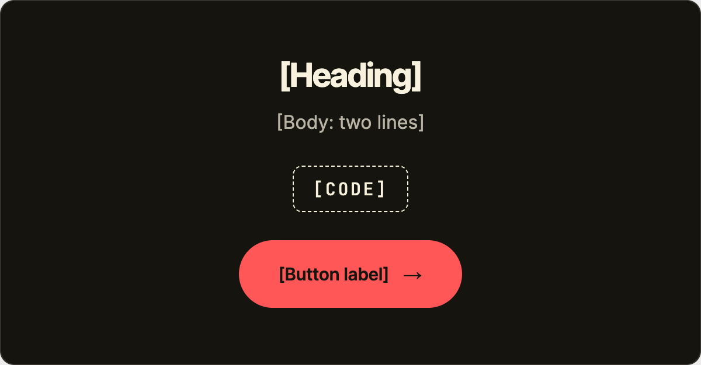

<!-- Generated by .claude/skills/shopify-email-html/scripts/build_library.py — edit section.json / template.json instead. -->

# CTA · Discount code · Ink

| | |
|---|---|
| Type | Promo |
| Context | any |
| Surfaces | Messaging · Code your own, Messaging section |
| Liquid variables | — |
| Shopify status | unused |
| Placeholders | yes — do not ship as is |
| Characters | 2205 |
| Used by | — |

> Module bank. All copy is a labelled slot: replace it before use.

## Module bank

- Category: 06 · CTAs & promotions
- Module: CTA · Discount code · theme **ink**
- Figma source: [CTA · DISCOUNT CODE PROMOTION](https://www.figma.com/design/9Il504CQE8jLaUTBVzphqc/Email-Design-System?node-id=480-16176)

**Changed from the Figma module to meet the v6 rules**

- Code in the v6 dashed code chip (mono 15, 8px radius), centred; title in the v6 title role
- Button is the v6 coral pill; the code stays a slot (never a real code)

**Figma sample copy (reference only, not in the section)**: Welcome To Hair Solutions Co. · Start your journey with a virtual mapping… · CODE: FIRSTATELIER · Get 15% Off Consultation →

## Preview



## HTML

Source: [`section.html`](section.html). Copy from here or from the raw file.

```html
<table role="presentation" width="100%" cellpadding="0" cellspacing="0" border="0" style="background-color:transparent;"><tr><td align="center" style="padding:0;">
<table role="presentation" class="shell" width="100%" cellpadding="0" cellspacing="0" border="0" style="width:100%;max-width:600px;">
<tr><td style="padding:0;">
<table role="presentation" width="100%" cellpadding="0" cellspacing="0" border="0" style="border-collapse:separate;background-color:#15140f;border:1px solid #35332c;border-radius:12px;">
<tr><td class="pad" style="padding:48px 40px;"><h2 style="margin:0 0 12px 0;font-family:'Inter Tight',Arial,Helvetica,sans-serif;font-size:28px;line-height:31px;font-weight:700;letter-spacing:-0.6px;color:#f7f1de;text-align:center;">[Heading]</h2><p style="margin:0 0 24px 0;font-family:'Inter',Arial,Helvetica,sans-serif;font-size:16px;line-height:26px;font-weight:400;color:#b8b3a4;text-align:center;">[Body: two lines]</p><table role="presentation" align="center" cellpadding="0" cellspacing="0" border="0" style="margin:0 auto;"><tr><td><table role="presentation" cellpadding="0" cellspacing="0" border="0" style="border-collapse:separate;"><tr><td style="border:1px dashed #f7f1de;border-radius:8px;padding:9px 16px;font-family:'JetBrains Mono','Courier New',monospace;font-size:15px;line-height:20px;font-weight:500;letter-spacing:1.8px;color:#f7f1de;white-space:nowrap;">[CODE]</td></tr></table></td></tr></table><div style="height:24px;line-height:24px;font-size:0;">&nbsp;</div><table role="presentation" align="center" class="btn" cellpadding="0" cellspacing="0" border="0" style="border-collapse:separate;margin:0 auto;">
<tr><td style="border-radius:999px;background-color:#ff5757;">
<a href="https://hairsolutions.co" target="_blank" style="display:inline-block;padding:0 34px;line-height:58px;font-family:'Inter Tight',Arial,Helvetica,sans-serif;font-size:15px;font-weight:600;letter-spacing:0.3px;color:#15140f;text-decoration:none;border-radius:999px;white-space:nowrap;">[Button label]<span style="padding-left:12px;font-family:'Inter',Arial,Helvetica,sans-serif;font-size:16px;">&rarr;</span></a>
</td></tr></table></td></tr>
</table>
</td></tr>
</table>
</td></tr></table>
```
