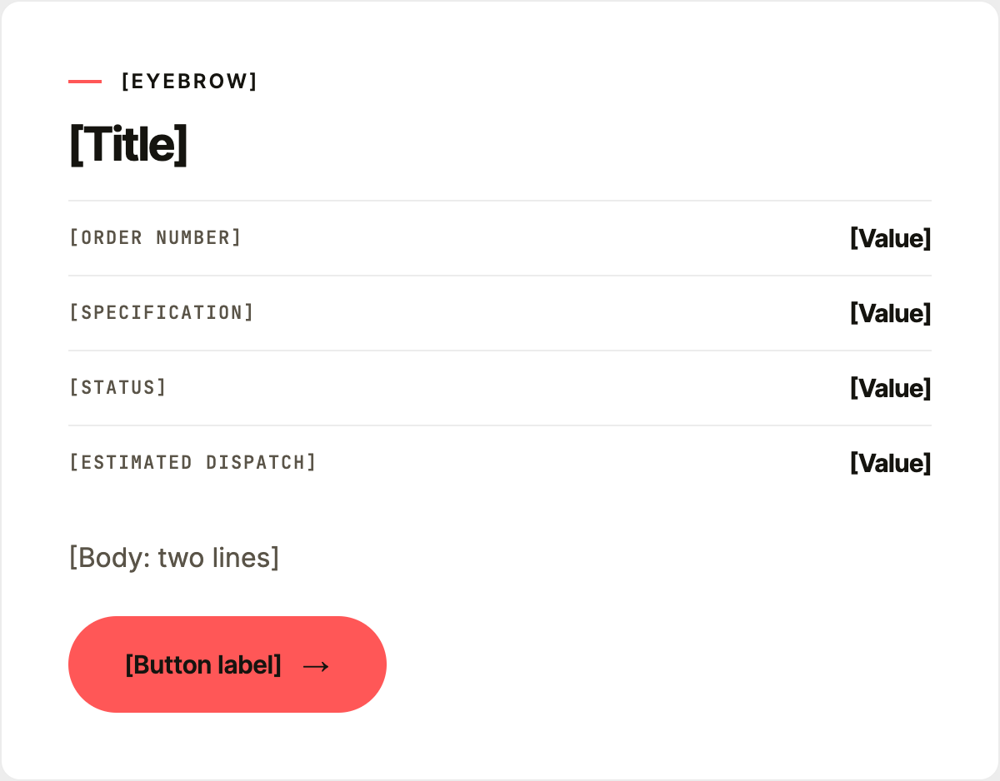

<!-- Generated by .claude/skills/shopify-email-html/scripts/build_library.py — edit section.json / template.json instead. -->

# Order · Confirmation details · White

| | |
|---|---|
| Type | Transactional |
| Context | any |
| Surfaces | Messaging · Code your own, Messaging section |
| Liquid variables | — |
| Shopify status | unused |
| Placeholders | yes — do not ship as is |
| Characters | 4293 |
| Used by | — |

> Module bank. All copy is a labelled slot: replace it before use.

## Module bank

- Category: 07 · Transactional lifecycle
- Module: Order · Confirmation details · theme **white**
- Figma source: [Order confirmation](https://www.figma.com/design/9Il504CQE8jLaUTBVzphqc/Email-Design-System?node-id=480-19713)

**Changed from the Figma module to meet the v6 rules**

- Eyebrow, title, four detail rows, a note and the button: the post-purchase pattern of the v6 emails
- Detail rows on the v6 label/value hairline rows; title in the v6 title role (sentence case); button is the v6 coral pill

**Figma sample copy (reference only, not in the section)**: ORDER CONFIRMED · Your order is in production · Order number #HS-40218 · Specification System 01 · Lace, Base 06 · Status In production · Estimated dispatch Aug 24 · I'll email you at each real step… · View order status →

## Preview



## HTML

Source: [`section.html`](section.html). Copy from here or from the raw file.

```html
<table role="presentation" width="100%" cellpadding="0" cellspacing="0" border="0" style="background-color:transparent;"><tr><td align="center" style="padding:0;">
<table role="presentation" class="shell" width="100%" cellpadding="0" cellspacing="0" border="0" style="width:100%;max-width:600px;">
<tr><td style="padding:0;">
<table role="presentation" width="100%" cellpadding="0" cellspacing="0" border="0" style="border-collapse:separate;background-color:#ffffff;border:1px solid #ececec;border-radius:12px;">
<tr><td class="pad" style="padding:40px;"><table role="presentation" cellpadding="0" cellspacing="0" border="0" style="margin:0 0 14px 0;">
<tr><td width="20" style="width:20px;vertical-align:middle;"><div style="height:2px;line-height:2px;font-size:0;background-color:#ff5757;">&nbsp;</div></td>
<td style="padding-left:12px;font-family:'Inter Tight',Arial,Helvetica,sans-serif;font-size:12px;line-height:16px;font-weight:600;letter-spacing:2px;text-transform:uppercase;color:#15140f;white-space:nowrap;">[Eyebrow]</td></tr>
</table><h2 style="margin:0 0 18px 0;font-family:'Inter Tight',Arial,Helvetica,sans-serif;font-size:28px;line-height:31px;font-weight:700;letter-spacing:-0.6px;color:#15140f;text-align:left;">[Title]</h2><table role="presentation" width="100%" cellpadding="0" cellspacing="0" border="0" style="border-collapse:collapse;"><tr><td style="border-top:1px solid #ececec;padding:12px 0;font-family:'JetBrains Mono','Courier New',monospace;font-size:11px;line-height:16px;letter-spacing:0.9px;text-transform:uppercase;color:#5a5448;vertical-align:middle;">[Order number]</td><td align="right" style="border-top:1px solid #ececec;padding:12px 0 12px 16px;font-family:'Inter Tight',Arial,Helvetica,sans-serif;font-size:15px;line-height:20px;font-weight:700;color:#15140f;text-align:right;vertical-align:middle;">[Value]</td></tr><tr><td style="border-top:1px solid #ececec;padding:12px 0;font-family:'JetBrains Mono','Courier New',monospace;font-size:11px;line-height:16px;letter-spacing:0.9px;text-transform:uppercase;color:#5a5448;vertical-align:middle;">[Specification]</td><td align="right" style="border-top:1px solid #ececec;padding:12px 0 12px 16px;font-family:'Inter Tight',Arial,Helvetica,sans-serif;font-size:15px;line-height:20px;font-weight:700;color:#15140f;text-align:right;vertical-align:middle;">[Value]</td></tr><tr><td style="border-top:1px solid #ececec;padding:12px 0;font-family:'JetBrains Mono','Courier New',monospace;font-size:11px;line-height:16px;letter-spacing:0.9px;text-transform:uppercase;color:#5a5448;vertical-align:middle;">[Status]</td><td align="right" style="border-top:1px solid #ececec;padding:12px 0 12px 16px;font-family:'Inter Tight',Arial,Helvetica,sans-serif;font-size:15px;line-height:20px;font-weight:700;color:#15140f;text-align:right;vertical-align:middle;">[Value]</td></tr><tr><td style="border-top:1px solid #ececec;padding:12px 0;font-family:'JetBrains Mono','Courier New',monospace;font-size:11px;line-height:16px;letter-spacing:0.9px;text-transform:uppercase;color:#5a5448;vertical-align:middle;">[Estimated dispatch]</td><td align="right" style="border-top:1px solid #ececec;padding:12px 0 12px 16px;font-family:'Inter Tight',Arial,Helvetica,sans-serif;font-size:15px;line-height:20px;font-weight:700;color:#15140f;text-align:right;vertical-align:middle;">[Value]</td></tr></table><div style="height:22px;line-height:22px;font-size:0;">&nbsp;</div><p style="margin:0 0 22px 0;font-family:'Inter',Arial,Helvetica,sans-serif;font-size:16px;line-height:26px;font-weight:400;color:#5a5448;text-align:left;">[Body: two lines]</p><table role="presentation" class="btn" cellpadding="0" cellspacing="0" border="0" style="border-collapse:separate;margin:0;">
<tr><td style="border-radius:999px;background-color:#ff5757;">
<a href="https://hairsolutions.co" target="_blank" style="display:inline-block;padding:0 34px;line-height:58px;font-family:'Inter Tight',Arial,Helvetica,sans-serif;font-size:15px;font-weight:600;letter-spacing:0.3px;color:#15140f;text-decoration:none;border-radius:999px;white-space:nowrap;">[Button label]<span style="padding-left:12px;font-family:'Inter',Arial,Helvetica,sans-serif;font-size:16px;">&rarr;</span></a>
</td></tr></table></td></tr>
</table>
</td></tr>
</table>
</td></tr></table>
```
