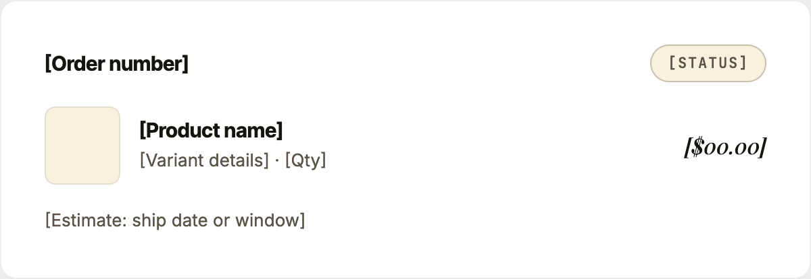

<!-- Generated by .claude/skills/shopify-email-html/scripts/build_library.py — edit section.json / template.json instead. -->

# Order · Production status · White

| | |
|---|---|
| Type | Transactional |
| Context | any |
| Surfaces | Messaging · Code your own, Messaging section |
| Liquid variables | — |
| Shopify status | unused |
| Placeholders | yes — do not ship as is |
| Characters | 3015 |
| Used by | — |

> Module bank. All copy is a labelled slot: replace it before use.

## Module bank

- Category: 07 · Transactional lifecycle
- Module: Order · Production status · theme **white**
- Figma source: [ORDER PRODUCTION STATUS](https://www.figma.com/design/9Il504CQE8jLaUTBVzphqc/Email-Design-System?node-id=480-18221)

**Changed from the Figma module to meet the v6 rules**

- Order number with a status pill, one line item, and the ship estimate
- Status pill is the v6 badge (mono 11, 999px); product thumbnail is a labelled slot
- Order number, status, item and estimate are slots wired to the order variables in the template

**Figma sample copy (reference only, not in the section)**: Order #HS-10482 · IN PRODUCTION · System 01 - Lace, Base 06 · Density: Medium · Qty 1 · $329.00 · Estimated ship date: 4-6 weeks from today

## Preview



## HTML

Source: [`section.html`](section.html). Copy from here or from the raw file.

```html
<table role="presentation" width="100%" cellpadding="0" cellspacing="0" border="0" style="background-color:transparent;"><tr><td align="center" style="padding:0;">
<table role="presentation" class="shell" width="100%" cellpadding="0" cellspacing="0" border="0" style="width:100%;max-width:600px;">
<tr><td style="padding:0;">
<table role="presentation" width="100%" cellpadding="0" cellspacing="0" border="0" style="border-collapse:separate;background-color:#ffffff;border:1px solid #ececec;border-radius:12px;">
<tr><td class="pad-sm" style="padding:32px;"><table role="presentation" width="100%" cellpadding="0" cellspacing="0" border="0"><tr><td valign="middle" style="padding:0;"><p style="margin:0 0 0px 0;font-family:'Inter Tight',Arial,Helvetica,sans-serif;font-size:15px;line-height:20px;font-weight:700;color:#15140f;text-align:left;">[Order number]</p></td><td valign="middle" align="right" style="padding:0;white-space:nowrap;"><span style="display:inline-block;font-family:'JetBrains Mono','Courier New',monospace;font-size:11px;line-height:16px;font-weight:500;letter-spacing:0.9px;text-transform:uppercase;padding:5px 12px;border-radius:999px;border:1px solid #c9c1ae;background-color:#f7f1de;color:#5a5448;">[Status]</span></td></tr></table><div style="height:18px;line-height:18px;font-size:0;">&nbsp;</div><table role="presentation" width="100%" cellpadding="0" cellspacing="0" border="0"><tr><td width="56" valign="middle" style="width:56px;padding:0;"><table role="presentation" width="100%" cellpadding="0" cellspacing="0" border="0" style="border-collapse:separate;background-color:#f7f1de;border:1px solid #e5dfcd;border-radius:8px;"><tr><td align="center" valign="middle" height="56" style="height:56px;padding:0;"><p style="margin:0 0 0px 0;font-family:'JetBrains Mono','Courier New',monospace;font-size:11px;line-height:17px;font-weight:500;letter-spacing:0.9px;color:#5a5448;text-align:center;text-transform:uppercase;"></p></td></tr></table></td><td valign="middle" style="padding:0 14px;"><p style="margin:0 0 2px 0;font-family:'Inter Tight',Arial,Helvetica,sans-serif;font-size:15px;line-height:20px;font-weight:700;color:#15140f;text-align:left;">[Product name]</p><p style="margin:0 0 0px 0;font-family:'Inter',Arial,Helvetica,sans-serif;font-size:13px;line-height:21px;font-weight:400;color:#5a5448;text-align:left;">[Variant details] &middot; [Qty]</p></td><td valign="middle" align="right" style="padding:0;white-space:nowrap;"><p style="margin:0 0 0px 0;font-family:'Playfair Display',Georgia,'Times New Roman',serif;font-size:16px;line-height:20px;font-weight:500;color:#15140f;text-align:right;font-style:italic;white-space:nowrap;">[$00.00]</p></td></tr></table><div style="height:16px;line-height:16px;font-size:0;">&nbsp;</div><p style="margin:0 0 0px 0;font-family:'Inter',Arial,Helvetica,sans-serif;font-size:13px;line-height:21px;font-weight:400;color:#5a5448;text-align:left;">[Estimate: ship date or window]</p></td></tr>
</table>
</td></tr>
</table>
</td></tr></table>
```
