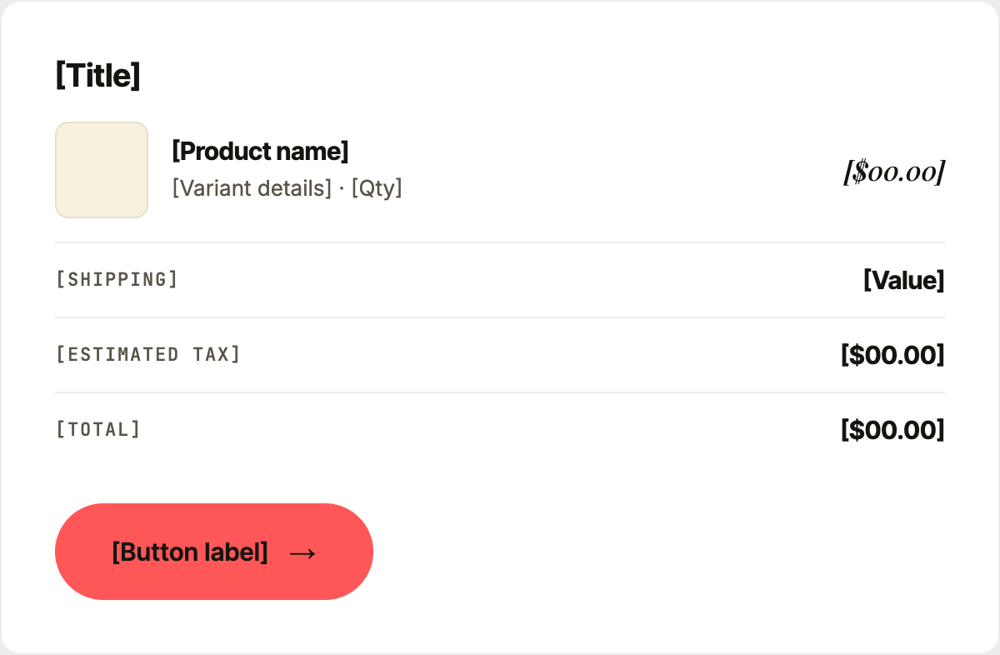

<!-- Generated by .claude/skills/shopify-email-html/scripts/build_library.py — edit section.json / template.json instead. -->

# Order · Saved checkout summary · White

| | |
|---|---|
| Type | Transactional |
| Context | any |
| Surfaces | Messaging · Code your own, Messaging section |
| Liquid variables | — |
| Shopify status | unused |
| Placeholders | yes — do not ship as is |
| Characters | 4542 |
| Used by | — |

> Module bank. All copy is a labelled slot: replace it before use.

## Module bank

- Category: 07 · Transactional lifecycle
- Module: Order · Saved checkout summary · theme **white**
- Figma source: [SAVED CHECKOUT SUMMARY](https://www.figma.com/design/9Il504CQE8jLaUTBVzphqc/Email-Design-System?node-id=480-18612)

**Changed from the Figma module to meet the v6 rules**

- One line item, shipping, tax and total rows, and the button
- Rows are the v6 label/value hairline rows; button is the v6 coral pill

**Figma sample copy (reference only, not in the section)**: Your checkout is saved · System 01 - Lace, Base 06 · $329.00 · Shipping Free · Estimated tax $0.00 · Total $329.00 · Complete checkout →

## Preview



## HTML

Source: [`section.html`](section.html). Copy from here or from the raw file.

```html
<table role="presentation" width="100%" cellpadding="0" cellspacing="0" border="0" style="background-color:transparent;"><tr><td align="center" style="padding:0;">
<table role="presentation" class="shell" width="100%" cellpadding="0" cellspacing="0" border="0" style="width:100%;max-width:600px;">
<tr><td style="padding:0;">
<table role="presentation" width="100%" cellpadding="0" cellspacing="0" border="0" style="border-collapse:separate;background-color:#ffffff;border:1px solid #ececec;border-radius:12px;">
<tr><td class="pad-sm" style="padding:32px;"><h3 style="margin:0 0 16px 0;font-family:'Inter Tight',Arial,Helvetica,sans-serif;font-size:19px;line-height:24px;font-weight:700;color:#15140f;text-align:left;">[Title]</h3><table role="presentation" width="100%" cellpadding="0" cellspacing="0" border="0"><tr><td width="56" valign="middle" style="width:56px;padding:0;"><table role="presentation" width="100%" cellpadding="0" cellspacing="0" border="0" style="border-collapse:separate;background-color:#f7f1de;border:1px solid #e5dfcd;border-radius:8px;"><tr><td align="center" valign="middle" height="56" style="height:56px;padding:0;"><p style="margin:0 0 0px 0;font-family:'JetBrains Mono','Courier New',monospace;font-size:11px;line-height:17px;font-weight:500;letter-spacing:0.9px;color:#5a5448;text-align:center;text-transform:uppercase;"></p></td></tr></table></td><td valign="middle" style="padding:0 14px;"><p style="margin:0 0 2px 0;font-family:'Inter Tight',Arial,Helvetica,sans-serif;font-size:15px;line-height:20px;font-weight:700;color:#15140f;text-align:left;">[Product name]</p><p style="margin:0 0 0px 0;font-family:'Inter',Arial,Helvetica,sans-serif;font-size:13px;line-height:21px;font-weight:400;color:#5a5448;text-align:left;">[Variant details] &middot; [Qty]</p></td><td valign="middle" align="right" style="padding:0;white-space:nowrap;"><p style="margin:0 0 0px 0;font-family:'Playfair Display',Georgia,'Times New Roman',serif;font-size:16px;line-height:20px;font-weight:500;color:#15140f;text-align:right;font-style:italic;white-space:nowrap;">[$00.00]</p></td></tr></table><div style="height:14px;line-height:14px;font-size:0;">&nbsp;</div><table role="presentation" width="100%" cellpadding="0" cellspacing="0" border="0" style="border-collapse:collapse;"><tr><td style="border-top:1px solid #ececec;padding:12px 0;font-family:'JetBrains Mono','Courier New',monospace;font-size:11px;line-height:16px;letter-spacing:0.9px;text-transform:uppercase;color:#5a5448;vertical-align:middle;">[Shipping]</td><td align="right" style="border-top:1px solid #ececec;padding:12px 0 12px 16px;font-family:'Inter Tight',Arial,Helvetica,sans-serif;font-size:15px;line-height:20px;font-weight:700;color:#15140f;text-align:right;vertical-align:middle;">[Value]</td></tr><tr><td style="border-top:1px solid #ececec;padding:12px 0;font-family:'JetBrains Mono','Courier New',monospace;font-size:11px;line-height:16px;letter-spacing:0.9px;text-transform:uppercase;color:#5a5448;vertical-align:middle;">[Estimated tax]</td><td align="right" style="border-top:1px solid #ececec;padding:12px 0 12px 16px;font-family:'Inter Tight',Arial,Helvetica,sans-serif;font-size:15px;line-height:20px;font-weight:700;color:#15140f;text-align:right;vertical-align:middle;">[$00.00]</td></tr><tr><td style="border-top:1px solid #ececec;padding:12px 0;font-family:'JetBrains Mono','Courier New',monospace;font-size:11px;line-height:16px;letter-spacing:0.9px;text-transform:uppercase;color:#5a5448;vertical-align:middle;">[Total]</td><td align="right" style="border-top:1px solid #ececec;padding:12px 0 12px 16px;font-family:'Inter Tight',Arial,Helvetica,sans-serif;font-size:15px;line-height:20px;font-weight:700;color:#15140f;text-align:right;vertical-align:middle;">[$00.00]</td></tr></table><div style="height:22px;line-height:22px;font-size:0;">&nbsp;</div><table role="presentation" class="btn" cellpadding="0" cellspacing="0" border="0" style="border-collapse:separate;margin:0;">
<tr><td style="border-radius:999px;background-color:#ff5757;">
<a href="https://hairsolutions.co" target="_blank" style="display:inline-block;padding:0 34px;line-height:58px;font-family:'Inter Tight',Arial,Helvetica,sans-serif;font-size:15px;font-weight:600;letter-spacing:0.3px;color:#15140f;text-decoration:none;border-radius:999px;white-space:nowrap;">[Button label]<span style="padding-left:12px;font-family:'Inter',Arial,Helvetica,sans-serif;font-size:16px;">&rarr;</span></a>
</td></tr></table></td></tr>
</table>
</td></tr>
</table>
</td></tr></table>
```
