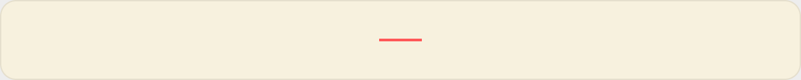

<!-- Generated by .claude/skills/shopify-email-html/scripts/build_library.py — edit section.json / template.json instead. -->

# Divider · Short rule · Bone

| | |
|---|---|
| Type | Divider |
| Context | any |
| Surfaces | Messaging · Code your own, Messaging section |
| Liquid variables | — |
| Shopify status | unused |
| Placeholders | yes — do not ship as is |
| Characters | 883 |
| Used by | — |

> Module bank. All copy is a labelled slot: replace it before use.

## Module bank

- Category: 08 · Utility
- Module: Divider · Short rule · theme **bone**
- Figma source: [Divider](https://www.figma.com/design/9Il504CQE8jLaUTBVzphqc/Email-Design-System?node-id=479-17039)

**Changed from the Figma module to meet the v6 rules**

- Figma's divider was a rule plus a usage note ('48px rhythm'): the note is dropped; the divider is a v6 card holding the short coral rule, so it keeps the flush stack
- Use it where two blocks share a surface and need a break; where the surface can change instead, change the surface (the composition guide's seam rule)

**Figma sample copy (reference only, not in the section)**: SECTION BREAK · 48PX RHYTHM

## Preview



## HTML

Source: [`section.html`](section.html). Copy from here or from the raw file.

```html
<table role="presentation" width="100%" cellpadding="0" cellspacing="0" border="0" style="background-color:transparent;"><tr><td align="center" style="padding:0;">
<table role="presentation" class="shell" width="100%" cellpadding="0" cellspacing="0" border="0" style="width:100%;max-width:600px;">
<tr><td style="padding:0;">
<table role="presentation" width="100%" cellpadding="0" cellspacing="0" border="0" style="border-collapse:separate;background-color:#f7f1de;border:1px solid #e5dfcd;border-radius:12px;">
<tr><td class="pad" style="padding:28px 40px;"><table role="presentation" align="center" cellpadding="0" cellspacing="0" border="0" style="margin:0 auto 0px auto;"><tr><td width="32" style="width:32px;"><div style="height:2px;line-height:2px;font-size:0;background-color:#ff5757;">&nbsp;</div></td></tr></table></td></tr>
</table>
</td></tr>
</table>
</td></tr></table>
```
