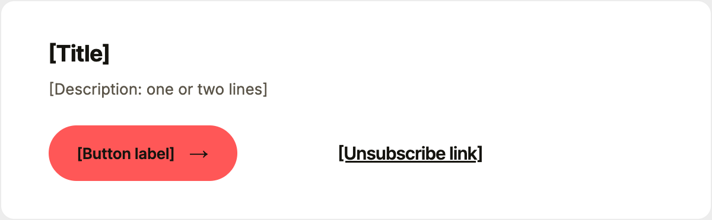

<!-- Generated by .claude/skills/shopify-email-html/scripts/build_library.py — edit section.json / template.json instead. -->

# Utility · Frequency save · White

| | |
|---|---|
| Type | Utility |
| Context | any |
| Surfaces | Messaging · Code your own, Messaging section |
| Liquid variables | — |
| Shopify status | unused |
| Placeholders | yes — do not ship as is |
| Characters | 2148 |
| Used by | — |

> Module bank. All copy is a labelled slot: replace it before use.

## Module bank

- Category: 08 · Utility
- Module: Utility · Frequency save · theme **white**
- Figma source: [EMAIL PREFERENCE SAVE](https://www.figma.com/design/9Il504CQE8jLaUTBVzphqc/Email-Design-System?node-id=480-18918)

**Changed from the Figma module to meet the v6 rules**

- Offers a lower frequency before the unsubscribe, the retention pattern of the v6 emails; the offer button is the one coral pill
- The unsubscribe stays a plain underlined link (never hidden or de-emphasised below legal requirements)

**Figma sample copy (reference only, not in the section)**: Before you go – · Would fewer emails work better for you? · Once a month → · Unsubscribe instead

## Preview



## HTML

Source: [`section.html`](section.html). Copy from here or from the raw file.

```html
<table role="presentation" width="100%" cellpadding="0" cellspacing="0" border="0" style="background-color:transparent;"><tr><td align="center" style="padding:0;">
<table role="presentation" class="shell" width="100%" cellpadding="0" cellspacing="0" border="0" style="width:100%;max-width:600px;">
<tr><td style="padding:0;">
<table role="presentation" width="100%" cellpadding="0" cellspacing="0" border="0" style="border-collapse:separate;background-color:#ffffff;border:1px solid #ececec;border-radius:12px;">
<tr><td class="pad-sm" style="padding:32px 40px;"><h3 style="margin:0 0 8px 0;font-family:'Inter Tight',Arial,Helvetica,sans-serif;font-size:19px;line-height:24px;font-weight:700;color:#15140f;text-align:left;">[Title]</h3><p style="margin:0 0 20px 0;font-family:'Inter',Arial,Helvetica,sans-serif;font-size:13px;line-height:21px;font-weight:400;color:#5a5448;text-align:left;">[Description: one or two lines]</p><table role="presentation" width="100%" cellpadding="0" cellspacing="0" border="0"><tr><td class="stack" width="44%" valign="middle" style="width:44%;padding:0 0 0 0px;vertical-align:middle;"><table role="presentation" class="btn" cellpadding="0" cellspacing="0" border="0" style="border-collapse:separate;margin:0;">
<tr><td style="border-radius:999px;background-color:#ff5757;">
<a href="https://hairsolutions.co" target="_blank" style="display:inline-block;padding:0 24px;line-height:46px;font-family:'Inter Tight',Arial,Helvetica,sans-serif;font-size:13px;font-weight:600;letter-spacing:0.3px;color:#15140f;text-decoration:none;border-radius:999px;white-space:nowrap;">[Button label]<span style="padding-left:12px;font-family:'Inter',Arial,Helvetica,sans-serif;font-size:16px;">&rarr;</span></a>
</td></tr></table></td><td class="stack stack-gap" width="56%" valign="middle" style="width:56%;padding:0 0 0 16px;vertical-align:middle;"><a href="https://hairsolutions.co" target="_blank" style="font-family:'Inter Tight',Arial,Helvetica,sans-serif;font-size:15px;font-weight:600;color:#15140f;text-decoration:underline;">[Unsubscribe link]</a></td></tr></table></td></tr>
</table>
</td></tr>
</table>
</td></tr></table>
```
